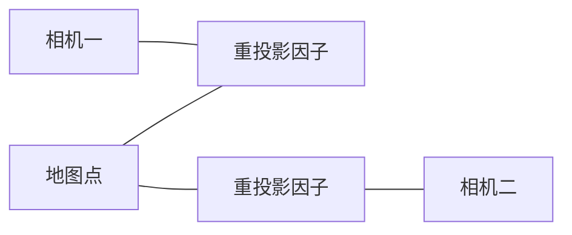

# 非线性最小二乘

相机投影、刚体变换和惯性传播都对状态非线性。非线性最小二乘把每条测量写成残差，用噪声尺度进行白化，再在当前估计附近反复求解局部线性问题。

## 1. 从 Gaussian 似然得到目标函数

设第 $i$ 个观测

$$
z_i=h_i(x)+n_i,
\qquad n_i\sim\mathcal N(0,\Sigma_i),
$$

并定义残差 $r_i(x)=z_i-h_i(x)\in\mathbb R^{m_i}$。若给定状态后各噪声块独立、$\Sigma_i$ 已知且与 $x$ 无关，则负对数似然去掉常数为

$$
F(x)=\frac12\sum_i r_i(x)^\mathsf T\Sigma_i^{-1}r_i(x).
$$

若 $L_iL_i^\mathsf T=\Sigma_i$，白化残差 $e_i=L_i^{-1}r_i$，便有

$$
F(x)=\frac12\sum_i\|e_i(x)\|^2.
$$

白化不仅是数值缩放，它表达概率模型中的相对可信度。若观测相关，应使用联合协方差；把相关残差当独立项会重复计算信息。若协方差依赖状态，完整 likelihood 还包含 $\frac12\log|\Sigma(x)|$，不能只保留二次项。

## 2. MAP 如何加入先验

Gaussian 先验 $x\sim\mathcal N(\bar x,P)$ 对欧氏状态产生

$$
F_{prior}(x)=\frac12\|x-\bar x\|_{P^{-1}}^2.
$$

流形状态需用局部差，例如

$$
r_p(T)=\operatorname{Log}(\bar T^{-1}T)^\vee.
$$

因此 MAP 仍可写成残差平方和，但先验只是一个带统计假设的约束。极小协方差近似“固定变量”，不代表先验数值真实准确。

## 3. 局部参数化与线性化

在当前估计 $x_k$ 附近定义局部增量 $\delta\in\mathbb R^n$：

$$
x=x_k\boxplus\delta.
$$

对欧氏变量 $\boxplus$ 是加法；对旋转或位姿是指数映射更新。白化残差一阶展开：

$$
e(x_k\boxplus\delta)
\approx e_k+J_k\delta,
\qquad
J_k=\left.\frac{\partial e(x_k\boxplus\delta)}{\partial\delta}\right|_{\delta=0}.
$$

局部子问题是

$$
\min_\delta\frac12\|e_k+J_k\delta\|^2.
$$

令梯度为零得到正规方程

$$
J_k^\mathsf TJ_k\delta=-J_k^\mathsf Te_k.
$$

实际求解不应显式形成 $(J^\mathsf TJ)^{-1}$；应选择 QR、Cholesky、稀疏分解或迭代法求线性系统。

## 4. 真 Hessian 与 GN 近似

对 $F=\frac12\sum_i e_i^2$：

$$
\nabla F=J^\mathsf Te,
$$

$$
\nabla^2F=J^\mathsf TJ+\sum_i e_i\nabla^2e_i.
$$

Gauss–Newton 忽略第二项。它在残差接近零、模型局部近似线性，或被忽略项相对较小时表现良好。若当前点远离解、残差大且曲率强，这个近似可能给出差方向。

## 5. 块稀疏从哪里来

每条测量通常只连接少量变量。视觉重投影连接一帧相机和一个地图点，IMU 因子连接相邻导航状态，回环连接两个位姿。因此 Jacobian 大量为零，$H=J^\mathsf TJ$ 呈块稀疏结构。

稀疏性由变量—残差连接关系决定，不是把 dense matrix 存成 sparse 格式就自动获得。消元顺序还会产生 fill-in；[Schur Complement](./schur-complement.md)利用 BA 中地图点条件独立的结构先消去点。

## 6. 鲁棒损失改变了什么

面对外点，常写

$$
F(x)=\frac12\sum_i\rho(s_i),
\qquad s_i=\|e_i(x)\|^2.
$$

其梯度包含权重 $\rho'(s_i)$：

$$
\nabla F=\sum_i\rho'(s_i)J_i^\mathsf Te_i.
$$

这可解释为对大残差降低局部权重，但权重随状态改变，Hessian 近似和最终协方差都不再等同于原始 Gaussian 最小二乘。鲁棒核不能识别“低残差但属于错误地点”的一致假解。

## 7. 数值条件与尺度

正规方程的条件数近似为 $\kappa(J^\mathsf TJ)=\kappa(J)^2$。像素、米、弧度和秒若尺度差异很大，或几何本身弱约束，线性系统会病态。白化、合理局部参数化和变量 scaling 可以改善数值表示，但不能创造缺失观测。

小特征值可能来自两类原因：真实 gauge freedom，例如整体平移和 yaw；或数据退化，例如只有单平面。前者需要选择规范或在可观子空间处理，后者需要新的运动或测量。

## 8. 停止不等于正确

梯度小、步长小或 cost 变化小都只是停止条件。错误对应、错误噪声、坏初值和规范自由度下也可能停止。应分别验证：残差模型、几何覆盖、线性系统条件、独立数据与最终任务指标。

下一篇[Gauss–Newton 与 Levenberg–Marquardt](./gauss-newton-and-lm.md)讨论如何接受或拒绝局部步长，以及阻尼为何能扩大稳定区域却不能修复错误模型。

## 参考资料

- [Ceres Solver：Modeling Non-linear Least Squares](https://ceres-solver.readthedocs.io/latest/nnls_modeling.html)。
- [Ceres Solver：Solving Non-linear Least Squares](https://ceres-solver.readthedocs.io/latest/nnls_solving.html)。
- Dellaert 与 Kaess，*Factor Graphs for Robot Perception*，关于稀疏图结构和消元。
