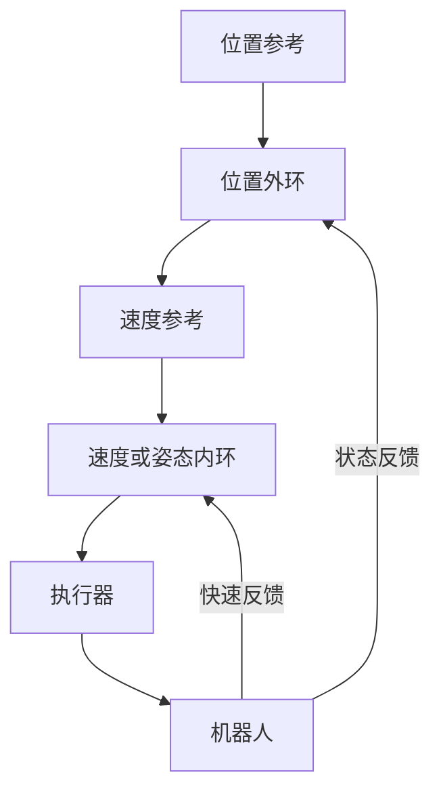

# 反馈、PID 与级联控制

开环控制只按模型给输入；反馈控制测量输出并根据误差修正输入。设 plant 为 $P(s)$、控制器为 $C(s)$，单位负反馈下

$$
\frac{Y(s)}{R(s)}=
\frac{C(s)P(s)}{1+C(s)P(s)},
\qquad
\frac{E(s)}{R(s)}=
\frac{1}{1+C(s)P(s)}.
$$

闭环特征方程是 $1+C(s)P(s)=0$。提高环路增益可在某些频段减小误差，但也会放大噪声、激发未建模动态并降低延迟裕度。

## 1. PID 的三种作用

连续 PID 为

$$
u(t)=K_pe(t)+K_i\int_0^te(\tau)d\tau+K_d\dot e(t).
$$

- P 根据当前误差立即修正；
- I 累积持续误差，可消除满足内部模型条件的稳态偏差；
- D 预测误差变化并增加阻尼，但对高频测量噪声敏感。

实际常对微分项加低通，并对测量而非设定值微分，避免设定值跳变产生 derivative kick：

$$
D(s)=-K_d\frac{Ns}{s+N}Y(s).
$$

## 2. 饱和与 anti-windup

执行器只能输出 $u_{min}\le u\le u_{max}$。若饱和时仍累积积分，解除饱和后会产生长时间过冲。反算 anti-windup 可令

$$
\dot I=e+K_{aw}(u_{sat}-u_{raw}),
$$

或在饱和且积分会继续推向错误方向时暂停积分。anti-windup 管理执行器非线性，不等于证明整个非线性闭环稳定。

## 3. 离散 PID

采样周期 $T_s$ 下，一种积分近似是

$$
I_k=I_{k-1}+\frac{T_s}{2}(e_k+e_{k-1}),
$$

微分可由带滤波的差分实现。控制参数与 $T_s$、离散化方法绑定；把连续参数原样放入不同采样率的软件会改变闭环。时间戳抖动明显时，应使用实际 $\Delta t_k$ 或在设计中分析多速率影响。

## 4. 级联控制

无人机常使用位置 → 速度 → 姿态 → 角速度级联；轮式机器人也可能使用路径误差 → 速度/曲率 → 电机电流。内环必须明显快于外环，外环才能把内环近似为已跟踪的执行器：

若内外环带宽接近，独立调参的假设失效，环间耦合可能导致振荡。估计器延迟也属于闭环相位的一部分，不能只在感知模块内部看待。

## 5. 前馈与反馈

已知动力学时可用逆动力学或参考加速度产生前馈 $u_{ff}$，反馈只修正模型误差：

$$
u=u_{ff}+u_{fb}.
$$

前馈提升跟踪，不提供对未知扰动的闭环鲁棒性；反馈能拒绝扰动，但受带宽、噪声和稳定裕度约束。二者互补而非替代。

频率响应、相位裕度和延迟见[极点、频率响应与稳定性](../signals-and-systems/poles-frequency-response-and-stability.md)。
