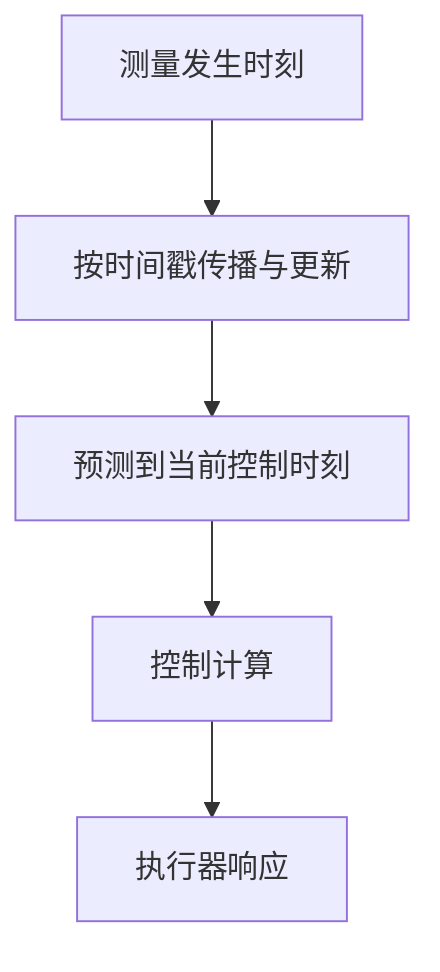

# 传感器同步、延迟与多速率系统

机器人里的“时间问题”至少包含测量发生时刻、设备时钟、消息到达时刻和算法输出时刻。把它们都叫 latency，会掩盖不同的修正方法。

## 1. 时钟模型

设备时钟可近似为

$$
t_d=(1+\epsilon)t_r+b+\eta(t),
$$

其中 $b$ 是 offset，$\epsilon$ 是 clock skew，$\eta$ 是 jitter。只估常量 offset 无法修复长记录中的 skew。硬件触发可统一采样事件，PTP 等协议可校准时钟，但仍需知道驱动时间戳代表曝光开始、结束还是消息接收。

## 2. 时间偏移怎样变成空间误差

对位置轨迹，使用错误时刻 $t+\delta t$：

$$
p(t+\delta t)\approx p(t)+v(t)\delta t
+\frac12a(t)\delta t^2.
$$

姿态一阶近似为

$$
R(t+\delta t)\approx R(t)
\operatorname{Exp}(\omega(t)\delta t).
$$

因此同一时间偏移在静止时难以观察，在高速转动时影响明显。时间 offset 与外参旋转在某些运动下可能耦合，需要充分激励；这也是[多传感器时空标定](../../slam/fundamentals/多传感器时空标定.md)强调运动设计的原因。

## 3. 插值与重采样

两个时刻之间的位置可线性插值，姿态应在 $SO(3)$ 上插值，例如

$$
R(t)=R_i\operatorname{Exp}\!\left(
\alpha\operatorname{Log}(R_i^\mathsf TR_{i+1})
\right),
\quad
\alpha=\frac{t-t_i}{t_{i+1}-t_i}.
$$

这是假设区间内局部恒定角速度的插值，不是额外测量。跨大间隔、快速加速度或轨迹断点时，不确定性应增大，越界外推更需显式标记。

降采样前必须先低通以避免 aliasing。非整数采样率转换通常先插值再低通再抽取；简单“取最近帧”会引入与运动相关的量化时间误差。

## 4. 滤波延迟与 group delay

滤波器相位 $\phi(\omega)$ 的 group delay 为

$$
\tau_g(\omega)=-\frac{d\phi(\omega)}{d\omega}.
$$

线性相位 FIR 在通带内可有近似常数延迟；一般 IIR 的延迟随频率变化，会改变波形。消息时间戳若仍标记原始采样时刻，使用者必须知道数据内容已经对应一个延迟后的有效响应。

## 5. 多速率估计与控制

IMU 可在数百 Hz 传播，相机/视觉定位以更低且不规则频率更新，控制器又以另一周期执行。正确组织应以 measurement timestamp 更新状态，并在需要时把估计预测到控制时刻：

迟到测量若直接用于“现在”的状态会产生时间错配；可使用历史状态回溯、out-of-sequence update 或丢弃策略，具体取决于 estimator 结构。仅提高消息 queue 长度不会消除时延。

## 6. 延迟的闭环影响

纯延迟在频域增加 $-\omega\tau$ 相位而不改变幅值，因此高带宽控制最敏感。感知耗时、通信、排队、滤波和执行器都贡献端到端延迟；只测神经网络 kernel 时间不足以判断闭环可用性。

时间同步保证“数据属于何时”，系统延迟决定“何时可用”。两者相关但不是同一个量。RTAB-Map、OpenVINS 或异步 HLoc 的系统集成还需定义状态外推、坐标帧和过期结果策略，见[异步推理、轨迹交接与可观测性](../../robotics-systems/异步推理、轨迹交接与可观测性.md)。
