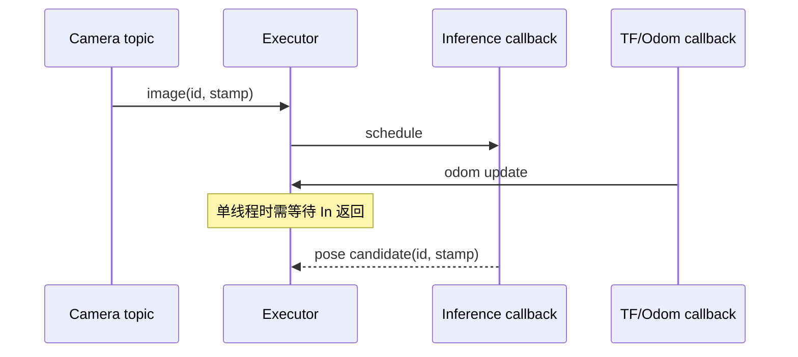

# ROS 2 的通信与执行机制

ROS 2 把组件连起来，但消息能到达不代表能按期处理。通信语义由 topic/service/action、QoS 和 TF 定义，执行时序则由 Executor、callback group 与线程共同决定。

## 1. 通信实体分别解决什么

- topic 是异步数据流，发布者不等待每个消费者完成；
- service 是一次请求—响应，适合短事务；
- action 是可反馈、可取消的长任务；
- parameter 配置节点行为，不适合作为高频状态流；
- tf2 保存带时间的坐标变换并查询变换链。

以定位链为例，相机驱动发布图像，里程计发布 `odom→base`，全局定位订阅图像和轨迹后发布候选/已确认 Pose，状态机决定是否更新 `map→odom`。切地图可用受控 service/action，而不是靠收到一帧特殊 Pose 猜测。

## 2. QoS 是匹配契约

QoS 包含 reliability、durability、history/depth 和 deadline 等策略。传感器流常允许 best-effort 以减少等待；配置或静态状态可能需要 reliable/transient-local。发布端与订阅端 QoS 不兼容时可能完全连不上；队列 depth 大也只会延后丢弃，不能修复消费者长期跟不上。

若 30 Hz 图像回调每次阻塞 100 ms，深队列会积累旧图像，使定位输出越来越陈旧。实时链常宁愿保留最新帧并显式统计丢帧，也不应把“无丢包”当唯一目标。

## 3. Executor 怎样触发 callback

Executor 等待订阅、timer、service 等实体就绪，再在线程上执行 callback。单线程 Executor 中一个长推理回调会阻塞其他回调；多线程 Executor 只有在 callback group 允许且有可用线程时才能并发。

Mutually Exclusive group 保证组内回调不并发；Reentrant group 允许并发/重入，但代码本身必须线程安全。多线程不自动让所有 callback 同时运行，共享锁、同一互斥组和 CPU 饱和仍会串行化。

耗时推理更适合移出短 callback：回调只校验并入队，worker 执行推理，再把带 input ID 的结果交回状态机。队列长度、覆盖策略和停机清理必须明确。

## 4. 生命周期与 launch

生命周期节点用 unconfigured、inactive、active 等状态控制配置和激活，可让驱动先加载资源、检查依赖，再开始发布。它不是业务定位状态机：节点 active 仍可能处于定位 lost。

launch 负责组装进程、参数、命名空间和重映射；它不能替代接口版本和运行时健康检查。配置应带版本并在启动日志中展开保存。

## 5. 怎样排查“有 topic 但系统不工作”

依次核对 publisher/subscriber 数量与 QoS、时间戳和 frame、队列年龄、callback 开始/结束、线程与 callback group、TF 查询时刻和状态机接受原因。仅看 `ros2 topic echo` 能证明消息存在，不能证明链路新鲜、坐标正确或按期执行。

## 参考

- [ROS 2 Humble QoS](https://docs.ros.org/en/humble/Concepts/Intermediate/About-Quality-of-Service-Settings.html)
- [ROS 2 Humble Executors](https://docs.ros.org/en/humble/Concepts/Intermediate/About-Executors.html)
- [ROS 2 Humble Callback Groups](https://docs.ros.org/en/humble/How-To-Guides/Using-callback-groups.html)
