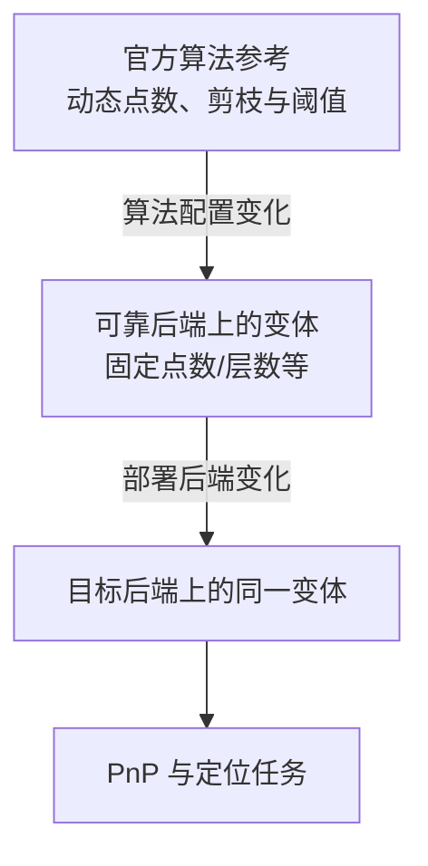

# LighterGlue 端侧优化实践

端侧优化 learned matcher 最容易走向两个极端：只看官方精度，发现太慢就放弃；或只追求一个更快的导出图，忽略它已经不再是同一个算法。更可靠的顺序是：**先建立正确参考，再定位热点；优化实现后重新检查任务收益，最后才讨论是否值得部署。**

LighterGlue 的算法结构见[从 MNN 到 LightGlue 与 LighterGlue](../../slam/fundamentals/从MNN到LightGlue与LighterGlue.md)。本文只讲优化方法，不给出任何私有实验数字。

## 1. 先固定“你正在优化哪个模型”

本文核对的公开 XFeat 专用实现固定在 `verlab/accelerated_features` 提交 [`e92685f`](https://github.com/verlab/accelerated_features/blob/e92685f57f8318b18725c5c8c0bd28c7fe188d9a/modules/lighterglue.py)。该封装使用 XFeat 64 维输入描述子、96 维内部 descriptor、6 层、1 个 attention head，并设置 `depth_confidence=-1`、`width_confidence=0.95`：前者关闭深度提前退出，后者允许宽度剪枝，但具体请求是否真的触发剪枝，还取决于依赖版本的点数阈值和执行路径。该封装加载单独发布的 `xfeat-lighterglue.pt`。

这些是该 commit 的实现事实，不是所有名为 LighterGlue 的代码都具有的永久参数。部署前还要固定 Kornia/LightGlue 实现，因为真正的 attention、assignment、剪枝和退出逻辑来自依赖库。

## 2. 三层参考把损失拆开



比较 1→2 回答“减点、静态化、减层损失了什么”；比较 2→3 才回答“ONNX、OpenCL、RKNN 或低精度额外损失了什么”。如果 CPU 参考启用动态 pruning，而 GPU 图使用 dense 固定点数，二者差异不能全部归因于 GPU。

三层必须对齐：

- 输入点集合、排序和坐标归一化；
- padding/mask；
- 层数、head、剪枝和 early exit；
- filter threshold 与 mutual/assignment 后处理；
- dtype 和权重；
- 输出索引含义。

## 3. 质量为什么不能只看匹配集合

官方匹配集合是实现参考，不是几何真值。两个实现可以返回不同匹配，却都让 PnP 得到正确位姿；也可能匹配数量接近，但错误对应集中在重复结构中。

验证至少分三层：

1. **实现一致性**：precision/recall、索引一致、score 与 assignment；
2. **几何有效性**：能映射到多少 3D 点，PnP 内点、重投影误差和位姿；
3. **系统收益**：最终是否正确接受，是否在 deadline 内，是否增加误接受。

有限帧对上 PnP 全部通过，只能写“在这组帧对上保持 PnP 通过”，不能写成匹配完全一致、位姿无损或全数据集质量保持。

## 4. 为什么 Glue 可能用更少匹配得到更多几何支持

MNN 只比较成对描述子；attention matcher还能利用同图结构与跨图上下文。它可能过滤大量外观相似但几何不一致的点，让剩余对应覆盖更稳定的结构。

于是可能出现：

```text
raw matches 更少
→ 可映射 2D-3D 对应更干净
→ RANSAC 更快找到一致模型
→ PnP 内点更多或更稳定
```

这不保证完整链更快。只要 matcher 增加的时间大于几何阶段节省的时间，总响应仍会变慢。还要考虑难图可能执行更多层、保留更多点，使尾延迟比平均值更差。

## 5. 先 profile，再选两三条路径

完整 matcher 可以拆成：

$$
T=T_{projection}+T_{position}+T_{attention}+T_{ffn}+T_{assignment}+T_{post}+T_{sync}+T_{ipc}.
$$

先在真实点数分布上记录算子/阶段时间、内存峰值和设备同步，再选择优化路径。

### 5.1 CPU 路径

检查：

- PyTorch/LibTorch 构建、数学库和线程池；
- 小矩阵是否因线程过多反而变慢；
- `permute → contiguous`、临时张量和 allocator；
- attention 是否使用适合当前 shape 的 kernel；
- worker IPC 是否只是几毫秒，还是序列化了大张量。

多个开关同时变化时，只能说“runtime 组合更快”，不能把全部收益归给某个 BLAS 或线程数。薄 IPC 占比小，只能说明重写 wrapper 不是主要收益；它不证明原生 C++ 在算子融合、布局和内存池上没有空间。

### 5.2 GPU/OpenCL/Vulkan 路径

重点不是“MatMul 能跑”，而是 attention 和整网是否留在设备：

- Q/K/V、softmax、FFN 是否产生重复布局转换；
- 是否显式物化大 attention 矩阵；
- kernel 数量和提交/同步次数；
- assignment 是否必须回 CPU；
- 中间张量是否频繁读回；
- FP16 存储与累加是否满足质量。

若热点集中在少数算子，可写有界自定义 kernel；若整网大部分都 fallback，从零重写所有层通常不是第一选择。

### 5.3 NPU/RKNN 路径

先确认同一静态图在 ONNX Runtime 正确，再比较 RKNN。attention 图可能同时遇到动态点数、mask、softmax、Reduce/ArgMax、Gather 和索引语义问题。错误应拆成：

- 编译器/算子正确性；
- FP16/近似带来的数值敏感性；
- 静态化、关剪枝等算法变化；
- 后处理实现错误。

不能把它们统称量化损失，也不能由某一版本失败推出整个硬件理论不可行。

## 6. 首次分歧与替换干预

对一对正常输入和一对困难输入，保存：

```text
input projection
position encoding
each self-attention / cross-attention block
FFN and residual
similarity and matchability
row/column normalization
argmax / Gather / mutual / threshold
```

当某层首次超过容差时，构造真实 shape 的最小子图。然后把目标后端该层输出换成可靠参考：

- 下游匹配恢复：该层是必要原因之一；
- 连续误差恢复但索引仍错：检查 assignment/后处理；
- 仍不恢复：可能更早已有差异或多个问题并存。

描述子 cosine 接近不保证 argmax 不翻转；阈值判断相同也不保证 Gather 索引正确。连续数值与离散决策要一起记录。

## 7. 真正有意义的实现优化

### 缓冲和常量复用

固定最大点数后，可复用 Q/K/V、attention workspace 和输出缓冲；位置编码中的常量可以缓存。但每个请求的有效点数和 mask 仍要更新，不能让上次内容泄漏。

### 减少 transpose 和 materialization

先确定后端最自然的 layout，让 projection、attention 和 FFN 尽量共享。优化目标不是让源码少写一个 `transpose`，而是确认 runtime 没有生成新 buffer。

### 减少同步

在同一设备连续提交多个算子，只在真正需要 CPU 结果时等待。计时又必须在最终边界同步；否则测到的只是提交时间。

### CPU assignment 向量化

若 backbone 在 GPU/NPU、assignment 留 CPU，应只传必要的紧凑张量，并复用输出缓冲。argmax、mutual 和阈值可以向量化，但要保留 tie、mask 与无效索引语义。

### 线程与亲和性

线程扫描要与 VIO/ROS 共载。独立 matcher 最快的线程数，可能抢占实时 callback。结果应同时记录 matcher wall time、CPU time、完整响应和 VIO 间隔。

## 8. 算法调整单独命名

在正确实现之后，可以研究：

- 512/768/1024 点；
- 空间覆盖更均匀的点选择；
- width pruning 和 depth early exit；
- 层数减少；
- FP16 或混合精度；
- 必要时蒸馏/微调。

减点、减层、改阈值都改变算法配置。每个配置要有独立名字，并同时检查困难帧、误接受和 PnP。不要把“速度更快但损失部分历史独有成功”的变体称为等价后端优化。

## 9. 用任务 Pareto，而不是只看 matcher

下面是一张方法表，不包含测量数字：

| 实现 | 与官方差异 | 固定机会质量 | 完整延迟 | 资源 | 判断 |
| --- | --- | --- | --- | --- | --- |
| 官方动态参考 | 无 | 参考 | 实测 | 实测 | 质量上界/速度基线 |
| 可靠后端固定点数变体 | 算法变化 | 与官方比较 | 实测 | 实测 | 评估减点收益 |
| 目标后端同一变体 | 仅后端变化 | 与可靠变体比较 | 实测 | 实测 | 归因部署损失 |
| 简单 MNN 基线 | matcher不同 | 同查询机会比较 | 实测 | 实测 | 判断 Glue 增量是否值得 |

Pareto 选择至少看：正确且及时覆盖、危险误接受、完整响应 P95/P99、内存和共载影响。单独 matcher 更快但最终正确定位更少，或定位更多但全部迟到，都不支配简单基线。

一个可公开复用的画图输入可以是：

```csv
implementation,quality_metric,full_response_p95_s,peak_memory_mib
official_reference,MEASURE_ME,MEASURE_ME,MEASURE_ME
reliable_variant,MEASURE_ME,MEASURE_ME,MEASURE_ME
target_backend_same_variant,MEASURE_ME,MEASURE_ME,MEASURE_ME
simple_mnn_baseline,MEASURE_ME,MEASURE_ME,MEASURE_ME
```

这里故意不填示意数字，避免把虚构值误读为 benchmark。

## 10. 什么时候停止投入

继续优化应有可检验假设，例如“两个 layout conversion 占完整 matcher 的 35%，合并后不会改变输出”。停止依据可以是：

- 正确实现仍明显超过完整链预算；
- 算法变体已损失关键困难帧且无法通过合理配置恢复；
- 热点需要驱动/编译器深改，维护成本超出任务收益；
- 优化收益递减，仍不如简单 MNN 的任务 Pareto。

负结果应限定为“固定版本、固定实现和已测 shape 下未胜出”，不能写成硬件理论不可能。

## 公开参考与权重

- [XFeat 官方仓库，固定提交 `e92685f`](https://github.com/verlab/accelerated_features/tree/e92685f57f8318b18725c5c8c0bd28c7fe188d9a)
- [XFeat 专用 `lighterglue.py`](https://github.com/verlab/accelerated_features/blob/e92685f57f8318b18725c5c8c0bd28c7fe188d9a/modules/lighterglue.py)
- [XFeat 论文（CVPR 2024）](https://openaccess.thecvf.com/content/CVPR2024/html/Potje_XFeat_Accelerated_Features_for_Lightweight_Image_Matching_CVPR_2024_paper.html)
- [LightGlue 官方仓库](https://github.com/cvg/LightGlue)
- [LightGlue 论文（ICCV 2023）](https://openaccess.thecvf.com/content/ICCV2023/html/Lindenberger_LightGlue_Local_Feature_Matching_at_Light_Speed_ICCV_2023_paper.html)

`accelerated_features` 在所核对提交中使用 Apache-2.0，并在仓库中提供 XFeat 与 XFeat-LighterGlue 权重；实际使用仍应同时核对依赖库和权重来源。本文不重新分发任何权重。
