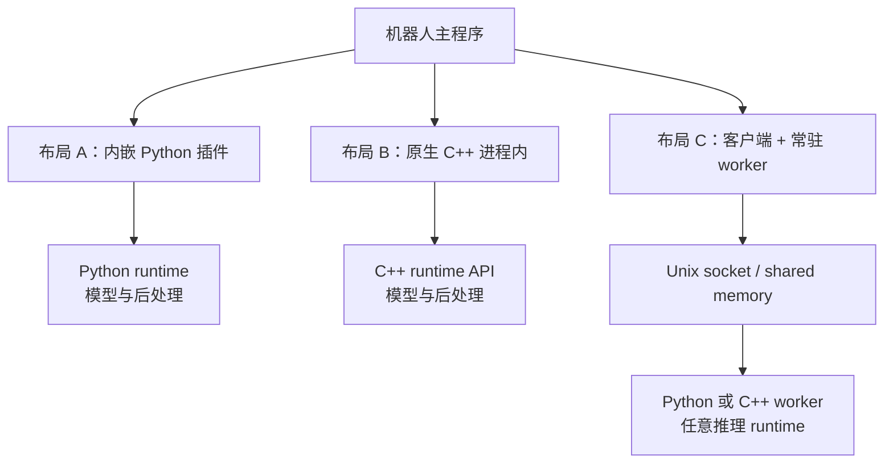

# Python 插件、进程内推理与独立 worker

讨论模型怎样接入 C++ 机器人程序时，常听到“用 Python 插件”“改成 C++”“拆 worker”“上 NPU”。这些词不在同一个维度：

| 维度 | 可选项示例 | 回答的问题 |
| --- | --- | --- |
| 扩展接口 | 插件、工厂、回调、RPC | 主程序从哪里调用新能力？ |
| 实现语言 | Python、C++、Rust | 业务逻辑用什么语言实现？ |
| 进程边界 | 同进程、独立常驻进程 | 地址空间、故障和生命周期怎样隔离？ |
| 推理 runtime | PyTorch、ONNX Runtime、RKNN Runtime | 谁加载计算图并调度 kernel？ |
| 计算设备 | CPU、GPU、NPU | 算子最终在哪里执行？ |

Python 插件可以调用独立 C++ worker；C++ 插件也可以调用同一个 ONNX Runtime；独立 worker 仍可能只跑 CPU。先分清这些维度，才能公平比较工程成本。

## 1. 三种常见布局



### 1.1 内嵌 Python 插件

优势是模型作者提供的 Python API、预后处理和权重加载方式通常更容易复用，适合快速建立数值基线。代价是主进程同时承担 CPython、扩展模块、模型 runtime 和 C++ 系统的生命周期；GIL、对象析构线程、Python 环境和二进制 ABI 都成为产品依赖。

### 1.2 原生 C++ 进程内

C++ 可以减少 CPython/NumPy 边界，并更自然地接入已有对象和内存池。但它并不自动更快：`cv::Mat` 到 runtime tensor 仍要核对 layout、stride、所有权、量化和同步；原模型的 NMS、插值、Top-K 与归一化也不会因换语言自动出现。

### 1.3 独立常驻 worker

worker 把模型和 runtime 的地址空间与主程序分开，能限制崩溃影响，也能独立重启。代价是新增协议、复制/映射、超时、版本和部署单元。worker 可以是普通 Unix 进程，不必是 ROS 节点；是否使用 ROS 应由通信语义决定，而不是因为它“也是一个进程”。

拆进程不会让数学计算自动变快。若网络本身占绝大多数时间，薄 RPC wrapper 的优化只能回收很小部分；但若主进程存在 GIL、线程池或内存争用，隔离可能改善尾延迟和可维护性。两种情况都应实测。

## 2. 生命周期比调用语法更重要

一个可靠实现应明确以下所有权：

| 对象 | 创建时机 | 所在线程 | 释放前置条件 |
| --- | --- | --- | --- |
| Python 解释器 | 进程启动或插件管理器初始化 | 固定原生线程更易审计 | 所有 Python 对象和调用线程已停止 |
| 模型/runtime context | worker/插件启动一次 | 声明是否线程安全 | 不再有在途推理，设备任务已同步 |
| 输入缓冲 | 每请求或池化复用 | 生产者/消费者协议明确 | runtime 不再借用该内存 |
| 输出对象 | 每请求 | 与 request ID 绑定 | 主程序完成复制或消费 |
| IPC 连接 | readiness 之后 | I/O 线程 | 停止接收、排空或拒绝在途请求 |

不要在每帧重新加载模型，也不要让多个 detector 对象意外各持一份权重。若 runtime 只允许单线程调用，应把串行规则写进封装，而不是依赖“目前碰巧只有一个 callback”。

## 3. GIL 和对象析构的基本边界

CPython 的 GIL 保护 Python 对象和解释器状态；它不是 C++ 内存安全的总开关。嵌入式 Python 中还要关心 `PyThreadState` 属于哪个解释器、由哪个原生线程创建，以及对象最后一次 `decref` 发生时解释器是否仍有效。

安全顺序通常是：

1. 停止接收新请求；
2. 取消或等待所有在途调用；
3. 在合法的解释器/GIL 状态下释放 Python 模块、tensor 和返回值；
4. 停止持有 Python 对象的原生线程；
5. 最后才考虑结束解释器。

“捕获 Python 异常”不能捕获原生扩展中的 SIGSEGV。线程状态问题的具体诊断见[嵌入式 Python 线程崩溃诊断](./嵌入式Python线程崩溃诊断.md)。

## 4. worker 协议至少要有这些语义

一个教学用协议不需要模拟产品，但要展示关键约束：

- worker 完成模型加载后才报告 `READY`；
- 每个请求携带唯一 `request_id`、输入身份和 deadline；
- 同一连接的在途请求数有上限，满了要拒绝或覆盖，不能无限排队；
- 响应回显 request ID，并区分有效结果、算法拒绝、超时和内部错误；
- 主程序用 monotonic clock 判断等待时间，用传感器 stamp 判断结果年龄；
- stop 先停止接收，再处理约定范围内的在途请求，最后释放 runtime；
- worker 退出时主程序把依赖它的结果标为失效，不伪造 descriptor。

下面是一个完全独立的 Unix domain `SOCK_SEQPACKET` 示例。它只处理合成整数，不包含任何机器人协议或模型代码；源码可在 <a href="/notes/examples/bounded_unix_worker.py" download>这里下载</a>。

```python
with socket.socket(socket.AF_UNIX, socket.SOCK_SEQPACKET) as client:
    client.settimeout(0.5)
    client.connect(socket_path)
    ready = recv_json(client)              # worker 已初始化

    request = {
        "type": "infer",
        "request_id": "demo-0001",
        "deadline_ns": time.monotonic_ns() + 200_000_000,
        "value": 7,
    }
    send_json(client, request)
    response = recv_json(client)
    assert response["request_id"] == request["request_id"]
```

`SOCK_SEQPACKET` 保留消息边界，适合小控制消息；大图像可以通过共享内存或 dma-buf 传递，再在控制消息里发送句柄和尺寸。共享内存减少显式复制的可能性，但仍要处理所有权、映射、缓存一致性和设备同步。

## 5. 有界输入不等于简单丢帧

常见策略有：

- **single-flight**：一次只允许一个请求，忙时明确拒绝；
- **bounded FIFO**：保留有限历史，适合不能跳过的任务；
- **latest-only**：覆盖尚未开始的旧请求，适合更重视新鲜度的定位；
- **事件触发**：只在失位或低置信时请求重模型。

无论选哪种，未处理请求都要进入分母，并记录 `busy`、`superseded`、`deadline_expired` 等原因。仅看到处理开始数等于完成数，不能证明上游没有等待；还要观察入队年龄、队列深度和发布间隔。

## 6. 超时和错误传播

建议把 worker 结果分为：

```text
OK                   有效输出，通过 schema 检查
ALGORITHM_REJECTED   正常运行，但没有足够特征/匹配
DEADLINE_EXPIRED     结果正确也已经太旧
INCOMPATIBLE_ASSET   模型、地图或预处理版本不匹配
RUNTIME_ERROR        推理库返回错误
WORKER_LOST          连接断开或进程退出
```

这些状态不应都压成空数组。空数组可能是合法的算法拒绝，也可能是 worker 已经损坏；上层采取的恢复动作不同。

### 故障隔离、自动恢复与安全失效

- **故障隔离**：worker 崩溃不直接破坏主进程地址空间；
- **安全失效**：主程序停止采纳依赖 worker 的新结果；
- **自动恢复**：受控重启、重新加载资产、更新 epoch 并恢复服务；
- **状态恢复**：系统重新获得足够证据，回到有效定位状态。

前两项可以很快，后两项可能需要地图加载和新的观测。不要把进程重启时间等同于机器人恢复定位时间。

## 7. 怎样选择

| 情况 | 更合适的起点 |
| --- | --- |
| 先建立与官方 Python 输出一致的原型 | 内嵌 Python 插件 |
| 已有成熟 C/C++ runtime，接口固定且需要紧密缓存复用 | 原生 C++ 进程内 |
| runtime 组合复杂、崩溃影响大或需要独立重启 | 常驻 worker |
| 既要插件替换性又要故障隔离 | 插件作为 client，调用 worker |

最终选择不应由“Python慢、C++快”这种语言标签决定。应比较完整链延迟、生命周期、故障暴露、依赖锁定和维护成本。

下一篇讨论计算实际放在哪里：[视觉定位的 CPU、GPU 与 NPU 分工](./视觉定位的CPU、GPU与NPU分工.md)。

## 公开参考

- [Python/C API：Thread State and the Global Interpreter Lock](https://docs.python.org/3/c-api/init.html#thread-state-and-the-global-interpreter-lock)
- [pybind11 embedding the interpreter](https://pybind11.readthedocs.io/en/stable/advanced/embedding.html)
- [Unix domain sockets, Linux man-pages](https://man7.org/linux/man-pages/man7/unix.7.html)
