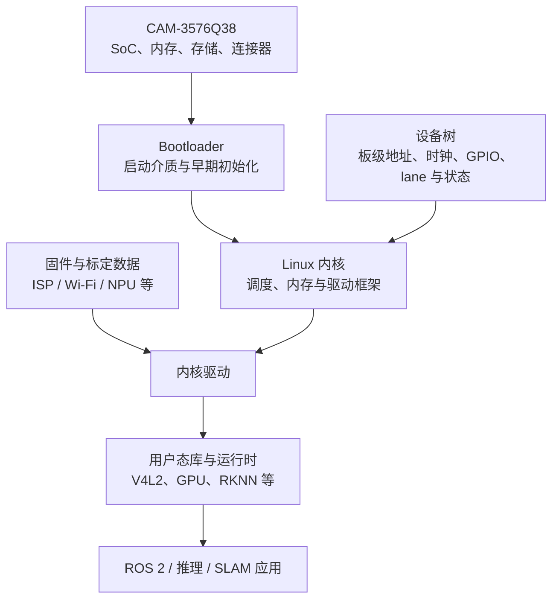
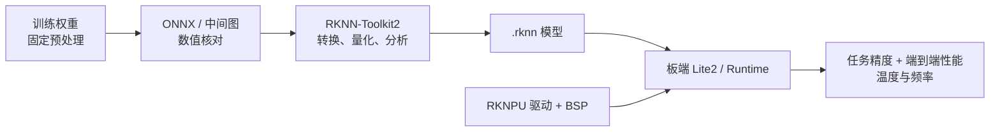

# Firefly CAM-3576Q38：硬件、BSP 与部署边界

把一个模型“部署到 RK3576”仍然过于宽泛。真正运行程序的是具体的 CAM-3576Q38 板卡、某个硬件 SKU 和一套匹配的 BSP；相机模组、机器人供电、散热与上层进程又会改变可用接口和持续性能。本文以 Firefly CAM-3576Q38 为边界，整理从硬件事实到可复现实验之间必须闭合的链条。

这里不把 SoC 数据手册中的所有能力都当成板上接口，也不把 CAM-3576JQ38、CAM-3576MQ38 或其他 RK3576 开发板的配置套到 Q38。具体数字优先来自 Firefly 的 [CAM-3576Q38 官方产品页](https://www.t-firefly.com/products/cam-3576q38-38mm-mini-single-board-computer)和[三款 CAM-3576 系列规格书](https://download.t-firefly.com/Spec/Mainboards/CAM-3576Q38_CAM-3576JQ38_CAM-3576MQ38_Specification_EN.pdf)；本文核对的是其中明确标为 **CAM-3576Q38 (Commercial)** 的列，规格书版本为 V1.0、日期 2026-09-22。

## 1. 先分清四个对象

| 层次 | 负责什么 | 不能直接推出什么 |
| --- | --- | --- |
| RK3576 SoC | CPU/GPU/NPU、ISP、编解码和片上控制器 | 板卡一定引出了所有控制器或能同时满速使用 |
| CAM-3576Q38 板卡 | 内存/存储选型、连接器、供电与实际布线 | 某个购买 SKU 的容量、相机模组和散热器已经确定 |
| 相机/IMU 等模组 | 成像、惯性测量及自身驱动/标定 | 数据已同步、已校正或已经变换到机器人基座 |
| 机器人系统 | 电源、散热、线束、ROS 进程、模型与地图生命周期 | 单板 benchmark 能代表端到端持续负载 |

部署记录应同时保存 SoC、板卡型号与版本、内存/存储 SKU、相机模组、BSP 镜像、模型文件和运行配置。只写“RK3576”无法复现问题。

## 2. 已核实的板级能力

官方规格书对 CAM-3576Q38 给出的主要信息如下。它们描述产品选项或接口能力，不代表当前手中设备必然采用最大配置。

| 项目 | CAM-3576Q38 官方信息 | 部署时还要确认 |
| --- | --- | --- |
| SoC | Rockchip RK3576 | 芯片/板卡 revision 与 BSP 对应关系 |
| CPU | 4× Cortex-A72 + 4× Cortex-A53，最高 2.2 GHz | governor、在线核心、持续频率和散热限制 |
| GPU | Mali-G52 MC3，规格书列出 OpenGL ES/OpenCL/Vulkan 支持 | 用户态驱动、算子后端与零拷贝能力 |
| NPU | 6 TOPS；规格书列出 INT4/INT8/INT16/FP16/BF16/TF32 | 具体模型算子覆盖、量化精度、runtime/driver 版本 |
| ISP | 16 MP ISP，支持 RGB-IR 与 HDR 能力描述 | 相机 sensor、lane、时钟、media graph 和调参文件 |
| 内存 | LPDDR4/LPDDR4X/LPDDR5，4/8/16 GB 选项 | 当前 SKU、可用内存和带宽竞争 |
| 存储 | eMMC 16–256 GB 选项，另有 TF 卡接口 | 当前容量、文件系统、写入寿命和掉电策略 |
| 网络 | 规格书列出 100M Ethernet 与板载双频 Wi-Fi 6 | 连接器线束、驱动、实际吞吐和时延 |
| 摄像头 | 规格书列出 4× MIPI-CSI D-PHY，并描述 40-pin 4-lane 接口 | 板上连接方式、模组兼容性、可并发组合需看原理图/BSP |
| 其他 I/O | USB 2.0、Type-C device、UART/I²C/GPIO/ADC、RS-485、RTC 等 | 复用、电平、连接器针脚和设备树启用状态 |
| 供电 | 12 V，经 8-pin 1.25 mm 连接器 | 峰值电流、线损、上电时序与机器人电源保护 |
| 尺寸/重量 | 约 38.09 × 38.11 × 11.54 mm，约 21 g | 模组、连接器、散热件和外壳后的系统尺寸 |
| 工作温度 | Q38 商业版列为 −20 ℃ 至 60 ℃ | 这是产品环境规格，不是降频/关机阈值 |

规格书同页还包含其他变体的工业/车规温度项，不能移植到 Q38。类似地，SoC 支持某接口协议，只说明片上控制器可能存在；最终可用 lane、连接器和复用必须回到 Q38 原理图、板级手册、设备树和实机枚举。

## 3. BSP 把硬件能力变成操作系统设备

- **Bootloader** 选择启动介质，初始化早期硬件并把内核、设备树和启动参数交给 Linux；
- **内核** 提供调度、内存、电源管理与设备驱动框架；
- **设备树（DTS/DTB）** 描述这块板上实际存在且启用的设备、GPIO、时钟、regulator、总线与 endpoint 连接；
- **驱动/固件** 让 ISP、sensor、NPU、GPU、网络等设备工作；
- **用户态库** 把内核接口暴露给 V4L2/GStreamer、OpenCL、RKNN Runtime 等上层；
- **应用** 才组合相机、预处理、网络、几何、ROS 2 和地图逻辑。

这条链中任何一层不匹配，都可能表现为“模型跑不了”或“相机没有图像”。例如设备树未启用某 sensor endpoint 时，仅安装 ROS 相机包不会补出硬件连接；NPU runtime 与内核驱动不兼容时，成功生成 `.rknn` 文件也不代表板端能执行。

Firefly 公共文档中的 defconfig、DTS 和 SDK 构建示例能帮助理解 BSP 结构，但若示例属于另一块板，就不能直接当作 CAM-3576Q38 的文件名或默认配置。准确入口应从实际交付 SDK/镜像的 manifest、构建日志和正在运行的 DTB 反查；这部分公开资料尚不足以在本文写死。

## 4. CPU、GPU、NPU、ISP/编解码器怎样分工

| 单元 | 更适合的工作 | 必须实测的边界 |
| --- | --- | --- |
| CPU | ROS 2 调度、控制流、数据组织、几何求解、数据库和不受 NPU 支持的算子 | SIMD/线程扩展、内存带宽、调度干扰 |
| GPU | 图像并行算子、OpenCL/Vulkan 可支持的通用计算 | 驱动、kernel 实现、共享/拷贝开销 |
| NPU | 已被 RKNN 编译器支持并成功映射的神经网络子图 | fallback、量化误差、动态 shape、输入布局和多核策略 |
| ISP | sensor 输入后的去马赛克、曝光/色彩/HDR 等图像处理 | sensor 与 IQ 配置、输出格式和延迟 |
| 编解码器 | H.264/H.265 等视频编码/解码 | 编码格式、分辨率、缓冲与零拷贝链路 |

“网络放 NPU、PnP 放 CPU”只是合理的初始分工，不是性能结论。若网络含不支持算子，图被切成多个子图并在 CPU 上 fallback，设备间同步和数据布局转换可能主导时延。局部特征后处理、匹配和 RANSAC 也可能因数据量与实现不同落在不同单元，必须用实际运行时报告和端到端 profile 判断。

ISP/编解码器同样不是任意 OpenCV 调用都会自动使用的透明加速器。相机输出格式、GStreamer/V4L2 管线、缓冲区类型和应用端复制决定了硬件单元是否真正参与以及是否产生额外拷贝。

## 5. 从训练模型到 RKNN 板端推理

Rockchip 官方 [RKNN-Toolkit2](https://github.com/airockchip/rknn-toolkit2) 将职责分成：PC 侧 Toolkit2 做模型导入、转换、量化与分析；板端可用 RKNN-Toolkit-Lite2 的 Python API 或 RKNN Runtime 的 C/C++ API；内核 RKNPU 驱动负责与 NPU 硬件交互。官方仓库明确列出 RK3576 支持。

一条可审计的部署链是：

1. 冻结训练框架、权重、预处理和基线输出；
2. 导出 ONNX 等中间表示，先在 CPU/对应 runtime 验证输入输出和数值；
3. 用固定 RKNN-Toolkit2 版本导入并指定 RK3576 target，记录 shape、layout、均值/尺度和算子警告；
4. 若量化，保存有代表性的校准集与采样规则，比较浮点、导出图和 RKNN 输出；
5. 在板端用与驱动匹配的 Lite2/Runtime 加载模型，确认是否存在 CPU fallback；
6. 分别测量预处理、NPU 执行、后处理、数据复制和端到端耗时；
7. 把 `.rknn`、转换脚本、工具链、runtime、驱动和 BSP 版本作为一个部署单元发布。

模型转换成功只证明编译器接受了图；它不证明量化精度满足任务要求，也不证明持续运行没有频率变化。Toolkit2 当前版本会变化，笔记不把“最新版本号”写成永久要求；每次实验应记录实际使用的 release/commit 和配套 runtime。

## 6. 相机链路要同时核对硬件、媒体图和时间

MIPI-CSI 链路至少连接 sensor、物理 lane/时钟、CSI 接收、ISP、video node 和用户态采集。排查时可沿以下证据链，而不是只看 `/dev/video*` 是否存在：

- 板卡原理图/连接器 pinout 与模组电气兼容；
- 正在运行的设备树 endpoint、clock、reset GPIO 和 regulator；
- 内核日志中的 sensor probe、media controller 拓扑；
- V4L2 格式、分辨率、帧率、曝光与缓冲时间戳；
- 多相机同步、左右目身份和标定版本；
- 从采集到 ROS 消息是否发生颜色转换、缩放和额外复制。

SoC 具备 ISP 不表示图像已经校正。畸变、双目 rectification、相机—IMU 外参和时钟关系仍属于算法输入契约，详见[多传感器时空标定](../../slam/fundamentals/多传感器时空标定.md)。

## 7. 温度、频率和持续性能

官方 Q38 规格书给出了工作环境温度，但没有在本文可核实的公开资料中给出这块板当前 BSP 的 thermal trip、降频表或配套散热器能力。因此不能把环境上限写成 SoC 降频阈值，也不能引用同系列板卡的风扇策略。

实机应保存三类证据：

1. `/sys/class/thermal/thermal_zone*` 的 zone 类型、温度与 trip（若内核公开）；
2. CPU `cpufreq`、GPU/NPU `devfreq` 可用频点与运行频率；
3. 同一持续负载下的温度、频率、功耗条件、端到端 P50/P95 和错误率。

测试要覆盖热稳态，而不只取启动后几秒的最快结果。散热片、导热界面、风道、外壳、环境温度和供电都应记录。出现时延上升时，还要区分热降频、内存压力、调度争用、垃圾回收/日志 I/O 和输入队列增长。

## 8. 机器人定位链怎样划分计时边界

一个视觉定位帧可以拆成：

$$
t_{e2e}=t_{queue}+t_{capture}+t_{pre}+t_{network}+t_{match}+t_{geometry}+t_{publish},
$$

但这些项不能靠各模块 P95 直接相加得到端到端 P95。异步队列、重叠执行和样本相关性会改变分布；应以同一输入 ID/时间戳做链路追踪，再从完整样本计算分位数。

建议每次板端实验至少报告：

| 类别 | 最小记录 |
| --- | --- |
| 硬件 | 板卡/SKU、供电、散热、相机模组 |
| 软件 | BSP/内核/设备树、驱动、RKNN runtime、应用 commit |
| 输入 | 分辨率、帧率、格式、batch、候选数与地图版本 |
| 正确性 | 浮点基线差异、任务指标、接受与正确、失败样本 |
| 时延 | 端到端边界、P50/P95、排队与各阶段耗时 |
| 资源 | RSS/峰值内存、温度、CPU/GPU/NPU 频率与利用率 |
| 连续性 | 丢帧、队列长度、超时、重启和持续测试时长 |

网络 kernel 变快而采集、匹配或排队变慢时，机器人不会得到更低的端到端延迟。反之，降低输入分辨率可能加速网络，却改变特征数量和定位精度。部署优化必须同时守住任务质量、时间戳正确性和资源上限。

## 9. 已验证与仍待实机确认

已由公开官方资料确认的是：Q38 的板级规格表、RK3576 计算单元与所列接口选项，以及 RKNN-Toolkit2 对 RK3576 的公开支持和工具职责。

仍需在实际设备/BSP 上确认的是：购买 SKU 的内存与 eMMC、板卡 revision、实际 DTB/defconfig、相机 lane 与 sensor 配置、NPU 驱动/runtime 组合、thermal trip、散热结构、持续频率、算子 fallback 和端到端性能。它们不是资料缺口下可以合理猜出的常数，而是部署交付的一部分。
