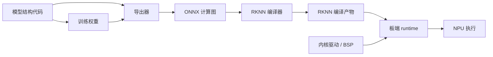
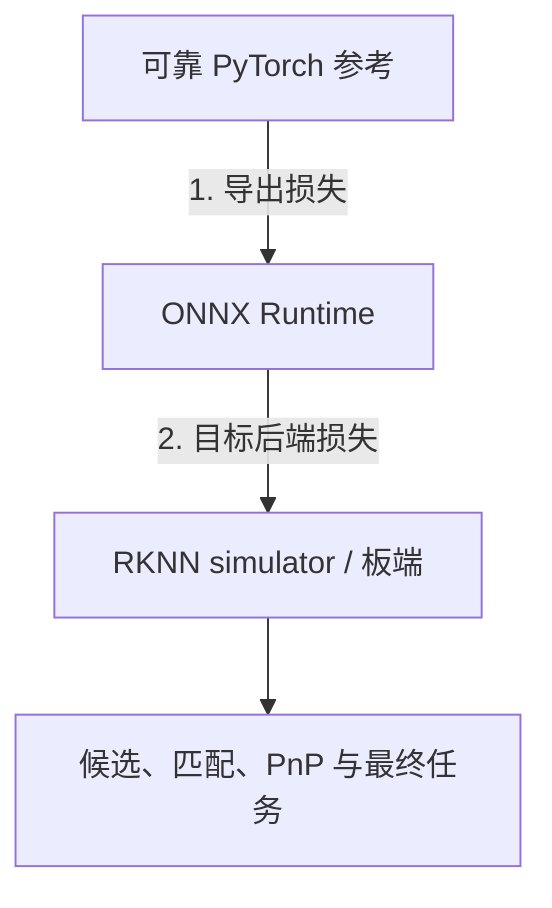

# 从 PyTorch 到 ONNX 与 RKNN

把 `.pt` 变成 `.onnx`，再变成 `.rknn`，不是保证无损的文件格式转换。每一步都可能改变图结构、shape 约束、算子实现和数值格式；最终还要由板端 runtime、驱动和硬件共同执行。

通用张量与精度基础分别见[张量、算子与神经网络计算](../../ai-infra/张量、算子与神经网络计算.md)和[数值精度、量化与结果验证](../../ai-infra/数值精度、量化与结果验证.md)。

## 1. 六个对象不要混在一起



- **结构代码**定义 forward、控制流和预后处理；
- **权重**只是一组参数，必须与结构匹配；
- **ONNX 图**描述导出的算子和张量，不包含任意 Python 逻辑；
- **RKNN 编译产物**是针对 target、shape 和优化选项生成的设备图；
- **runtime**管理模型、输入输出和设备提交；
- **驱动**负责用户态 runtime 与 NPU 内核接口。

“模型能导出”只到第三步，“NPU 能加载”只到第五步，“任务可部署”还需要正确性、完整链时效和持续稳定性。

## 2. 导出、静态化、精度和算法改动分开

| 变化 | 例子 | 是否可能改变数学语义 |
| --- | --- | --- |
| 导出 | PyTorch eager → ONNX | 应尽量等价，但算子分解/实现可能有误差 |
| 编译优化 | 常量折叠、算子融合、布局转换 | 理论等价，仍需验证实现 |
| 静态化 | 动态点数补到固定 1024 | mask 正确时可等价；错误 padding 会改变结果 |
| 精度变化 | FP32 → FP16/BF16 | 数值近似，可能改变排序与阈值 |
| 量化 | FP32 → INT8 | 需要校准，误差来自离散化与饱和 |
| 算法改动 | 减点、减层、关剪枝、改阈值 | 明确是新配置，不是等价加速 |

若一次转换同时做了静态 shape、FP16 和关闭剪枝，最终质量下降不能统称“量化损失”。需要逐层建立对照，才能知道损失来自算法还是后端。

## 3. 预处理是模型的一部分

至少固定：

- RGB/BGR/灰度和通道顺序；
- 像素范围、均值、标准差；
- resize、crop、padding 和插值；
- `NCHW`/`NHWC`；
- antialias、`align_corners` 等细节；
- 原图与网络输入间的坐标变换。

若归一化被融合进 RKNN 模型，应用端就不能再做一次。若导出把 InstanceNorm 移到 C++ 预处理，也要在固定图像上比较移前/移后的结果，而不是因为公式看起来相同就默认逐元素一致。

## 4. 动态点数与 mask 最容易出错

局部 matcher 常接收 $N_q$ 和 $N_r$ 个点。静态后端可能要求固定 $N_{max}$，于是需要 padding：

```text
descriptors: [1, Nmax, D]
keypoints:   [1, Nmax, 2]
valid_mask:  [1, Nmax]
```

无效 token 必须在所有相关位置被屏蔽：attention、matchability、assignment、argmax 和最终索引。只把描述子补零并不安全：零向量经过投影后可以变成非零 token，甚至参与 softmax。

若后端不支持布尔 mask，等价改写要验证广播轴和数值范围。例如用大负数屏蔽 logits 时，FP16 的可表示范围、softmax 稳定化和全行无效情形都要单独处理。

## 5. 索引、Gather 与负值语义

特征匹配常使用：

1. 行方向 argmax 得到 `match_q_to_r`；
2. 列方向 argmax 得到 `match_r_to_q`；
3. Gather 取回对向索引；
4. mutual check；
5. 阈值过滤。

某些参考实现用 `-1` 表示无匹配，而不同后端对负索引可能有不同约束：Python/PyTorch 的 `-1` 常表示最后一个元素，ONNX `GatherElements` 的规范也定义合法负索引范围，但目标编译器未必完整支持或可能在优化后改变路径。不能把负值直接 clamp 到 0，因为这会把“无效”伪装成第一个元素。

更可靠的做法是：显式维护 valid mask，把无效索引映射到合法哨兵位置，Gather 后再次用 mask 清除；然后用最小子图验证目标后端与参考输出一致。

## 6. Softmax 与 attention 的验证重点

attention 常写成：

$$
\operatorname{softmax}\left(\frac{QK^{\mathsf T}}{\sqrt d}+M\right)V.
$$

要核对：

- softmax 的轴；
- $1/\sqrt d$ 是否重复或遗漏；
- mask 的广播方向；
- 最大值稳定化；
- 累加 dtype；
- transpose/reshape 后 token 与 head 的顺序；
- self/cross attention 两侧长度是否互换。

平均 cosine 很高仍可能在 argmax 并列附近翻转。对匹配任务，连续误差和离散决策必须一起看。

## 7. 三层参考链

最小验证链是：



每层至少记录：

| 层级 | 连续量 | 离散量 | 任务量 |
| --- | --- | --- | --- |
| 全局描述子 | L2误差、cosine、norm | Top-K 与排名翻转 | 正确候选是否进入 |
| 局部特征 | 特征图误差、坐标误差 | NMS点、Top-K行序 | 有效3D与几何覆盖 |
| matcher | Q/K/V、attention、assignment | argmax、mutual、阈值 | PnP输入与内点 |
| 系统 | 位姿与协方差 | 接受/拒绝/过期 | 正确且及时定位 |

## 8. 怎样找第一个分歧

不要一开始只看最终输出。可以给模型增加诊断输出，按以下顺序比较：

1. 预处理后的输入；
2. 第一层 projection/卷积；
3. 每个 block 的残差输出；
4. assignment 前的相似度与 matchability；
5. argmax、Gather 和 mutual mask；
6. 最终匹配。

首次明显分歧出现后，做两个实验：

- **最小复现**：只保留怀疑算子和真实形状的固定输入；
- **替换干预**：把目标后端该节点的输出替换成可靠参考，再看下游匹配是否恢复。

若替换一个节点即可恢复，因果证据比“它的误差最大”更强；若仍不恢复，可能有多个问题或分歧更早。

## 9. RKNN 工具链的职责边界

Rockchip 官方仓库把 RKNN-Toolkit2、Toolkit-Lite2、C/C++ Runtime 和内核驱动分开：PC 侧完成模型转换与分析，板端通过 Python 或 C API 执行 `.rknn`。具体算子、动态 shape、精度和 MatMul API 会随版本变化，因此历史失败必须标注 toolkit/runtime/driver 和 target，不能泛化为“RKNN 不支持 Transformer”。

部署记录至少保存：

```text
source model commit + weights hash
export script + opset + input contract
RKNN toolkit version + target + build log
.rknn hash
board runtime + driver + BSP
accuracy-analysis / perf report
task-level regression
```

下一篇讨论这些结果怎样进入可信实验：[端侧效果与性能怎样测才可信](./端侧效果与性能怎样测才可信.md)。

## 公开参考

- [ONNX IR Specification](https://onnx.ai/onnx/repo-docs/IR.html)
- [ONNX `GatherElements`](https://onnx.ai/onnx/operators/onnx__GatherElements.html)
- [PyTorch `torch.export`](https://docs.pytorch.org/docs/stable/export.html)
- [RKNN-Toolkit2 官方仓库，核对提交 `42aa1d4`](https://github.com/airockchip/rknn-toolkit2/tree/42aa1d426c0a9e0869b6374edba009f7208a1926)
- [RKNN Model Zoo](https://github.com/airockchip/rknn_model_zoo)
