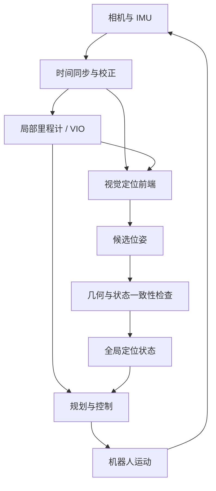
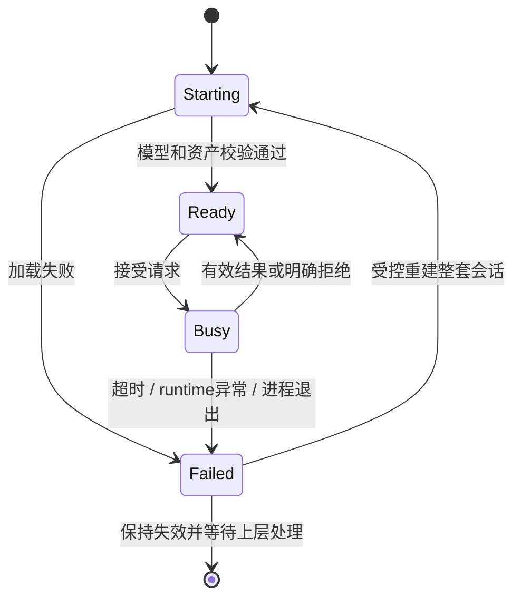

# 学习模块怎样接入机器人系统

把一个传统视觉模块换成学习模型，最容易低估的不是网络本身，而是它进入系统以后继承了哪些语义。模型在图片上输出了正确特征，不等于机器人已经得到了一次可采纳的定位；一次定位通过了几何求解，也不等于它足够新、足够稳定，能够进入规划或控制。

“最小侵入”因此不是尽量少改几行代码，而是：**尽量保留已经验证的系统语义，只替换确实需要改变的责任边界，并让失败能够被检测、隔离和回退。**

## 1. 先画出原系统的责任链

下面是一条通用定位链。它不是某个产品的拓扑，只用来说明学习模块可能进入的位置。



若只替换图中的视觉前端，后面的几何验证、状态机、坐标变换和健康输出可以继续承担原职责。这通常比让新模块直接发布“最终位姿”更容易控制回归范围。但前提是新模块真的遵守原接口，而不是只让字段名称看起来一样。

## 2. 五个维度定义改动大小

| 维度 | 要回答的问题 | 常见隐患 |
| --- | --- | --- |
| 算法正确性 | 替换改善哪一种失败？检索、匹配、深度还是几何接受？ | 用最终成功率反推每个模块都变好 |
| 数据契约 | shape、dtype、坐标、时间戳和行序怎样定义？ | 关键点、描述子和 3D 点错一行仍能运行 |
| 实时性 | 输入频率、请求频率、deadline 和最大结果年龄是什么？ | 单模型很快，但队列让结果迟到 |
| 资源 | 常驻内存、临时张量、带宽、线程和温度如何变化？ | 短跑正常，持续运行仍增长或降频 |
| 故障行为 | 模型失败、进程退出、超时和地图不兼容时怎么办？ | 静默切换算法，产生混合地图或假有效结果 |

修改文件少，只说明补丁表面小；若它改变地图语义、错误传播或最终状态所有权，系统侵入仍然很大。

## 3. 数据契约要细到可以写断言

学习视觉接口至少要写清：

- 图像是灰度还是 RGB，像素范围是 $[0,255]$ 还是 $[0,1]$；
- 张量是 `NCHW` 还是 `NHWC`，dtype、stride 和连续性要求是什么；
- resize、padding、畸变校正发生在哪里，关键点属于哪一个像素坐标系；
- 第 $i$ 行描述子是否永远对应第 $i$ 个关键点和第 $i$ 个 3D 点；
- 空结果、NaN、无穷值、越界索引和重复匹配怎样处理；
- 输入时间戳是曝光、驱动采集、消息发布还是消费时刻；
- 输出携带哪个模型、地图和 reset epoch。

一个可检查的局部特征对象可以写成：

```text
FeatureSet {
  input_id, sensor_stamp, calibration_id,
  image_geometry: {width, height, rectified},
  keypoints_xy: float32[N, 2],
  scores:       float32[N],
  descriptors: float32[N, D],
  points3d:     optional float32[N, 3],
  model_id, preprocessing_id
}
```

这里 `N` 是一个契约：筛掉关键点时，所有按行关联的数组必须用同一个 mask。仅检查数组长度相同还不够，最好在固定输入上保存关联摘要并做几何回归。

坐标与时间戳的通用讨论见[坐标、时间戳与数据契约](../坐标、时间戳与数据契约.md)。

## 4. 模型、预处理与地图必须一起版本化

视觉地图不是一袋可以随意互换的向量。若地图中的局部描述子由算法 A 生成，查询改用算法 B，即使维度相同，也没有理由认为两者位于兼容的特征空间。旧地图已有的 3D 点也只与旧关键点观测对齐，不能自动变成新关键点的 3D。

建议把以下内容绑定成一个 manifest：

```text
map schema + calibration
+ global model and preprocessing
+ local model and preprocessing
+ descriptor dtype/dimension/normalization
+ matcher semantics and thresholds
+ runtime-compatible asset hashes
```

启动时先验证 manifest，再加载地图。失败应是清楚的“不兼容”，而不是回退到另一个 detector 后继续向同一数据库写入。整套 legacy profile 可以作为回退，但不要在一个会话里逐帧静默混用不兼容特征。

地图中 2D 观测、3D 点和描述子怎样关联，可继续读[地图到底存了什么](../../slam/fundamentals/地图到底存了什么.md)。

## 5. 实时性不是一个“模型毫秒数”

设输入在 $t_0$ 产生，任务在 $t_q$ 入队、$t_s$ 开始服务、$t_f$ 完成、$t_a$ 被系统采纳，则：

$$
T_{queue}=t_s-t_q,\qquad
T_{service}=t_f-t_s,\qquad
T_{response}=t_f-t_0.
$$

若输出描述的是传感器时间 $t_{sensor}$，在采纳时的数据年龄为：

$$
A_{result}=t_a-t_{sensor}.
$$

这四个量回答不同问题。服务时间通过，不代表排队后的响应通过；结果年龄预算也不能替代响应 deadline。传感器能否持续 1×输入、检测请求频率 $f_{detect}$、P95 响应期限 $D_{response}$，是三条需要分别定义和验收的合同。

机器人还在运动时，迟到定位可能对应过去的相机位姿。系统需要保留 input ID、查询时刻里程计和地图版本，必要时做运动补偿或拒绝过期结果，详见[异步推理、轨迹交接与可观测性](../异步推理、轨迹交接与可观测性.md)。

## 6. 检查对其他模块的影响

学习模块即使放在独立线程或加速器上，仍可能通过共享资源影响系统：

- CPU worker、OpenMP/BLAS 和 ROS executor 抢占核心；
- GPU/NPU 与 CPU 共享内存带宽；
- 大张量和缓存抬高 RSS/PSS，触发回收或 OOM；
- 同步等待阻塞相机回调；
- 热状态改变 CPU/GPU/NPU 频率；
- 日志和观测工具本身造成 I/O 与调度扰动。

因此要同时观察 VIO 输出间隔和年龄、深度/规划/控制回调、reset/lost、队列和系统频率。没有共同运行某个组件时，只能说“未测”，不能说“没有影响”。

## 7. 故障隔离不等于自动恢复

一次安全故障链至少包含：



“故障隔离”表示某个模块崩溃没有带走整个主进程；“故障检测”表示上层及时知道它坏了；“安全失效”表示不再发布假有效结果；“自动恢复”则还需要重新建立模型、地图、请求关联和系统状态。四者不能互换。

旧 TF 或缓存消息也可能继续存在。下游必须同时检查健康状态、stamp、epoch 和新鲜度，而不是把“还能查到变换”当作当前定位有效。

## 8. 从基线到回退的验证顺序

一次可解释的替换至少保留这些对照：

1. **原生基线**：冻结地图、输入、参数与计时合同；
2. **单模块增量**：只换 global、local 或 matcher，定位收益来自哪里；
3. **数据契约回归**：固定输入比较关键点、描述子、候选、对应和位姿；
4. **连续输入**：统计未处理、丢弃、超时、排队和结果年龄；
5. **定位子系统共载**：至少与传感器、VIO、地图和接受链同时运行；
6. **完整产品共载**：再加入真实会运行的深度、规划、控制等组件；
7. **故障与恢复**：错误地图、模型失败、worker退出、切图和 reset；
8. **整套 profile 回退**：切换回已知兼容的模型、地图与配置组合。

固定数据上的提升说明“在这些输入上有收益”；真实相机与任务闭环才能回答“机器人能否使用”。二者都重要，但证据等级不同。

## 9. 最小侵入检查表

- [ ] 替换边界与保留职责已画清；
- [ ] 输入输出 schema 可由启动时和逐请求断言检查；
- [ ] 模型、预处理、地图和 matcher 版本绑定；
- [ ] 空结果、超时、非法输出和过期结果 fail closed；
- [ ] 不静默换算法或污染地图；
- [ ] 端到端 trace 覆盖输入、排队、服务、接受和消费；
- [ ] 与 VIO、深度、规划、控制的共载范围如实记录；
- [ ] legacy 回退按整套会话执行并有恢复步骤。

下一篇从实现形态继续拆开：[Python 插件、进程内推理与独立 worker](./Python插件、进程内推理与独立worker.md)。
