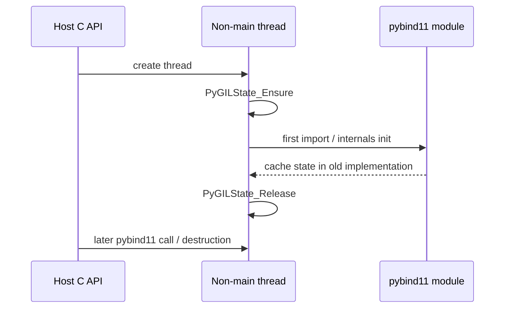

# 嵌入式 Python 线程崩溃诊断

嵌入式 Python 的崩溃经常出现在 tensor 析构、NumPy deleter 或 `decref`，但栈顶只是“最后触碰坏状态的位置”。根因可能更早发生在解释器初始化、线程状态缓存或对象跨线程生命周期。

本文用公开的 [pybind11 PR #5870](https://github.com/pybind/pybind11/pull/5870) 作为机制案例。它解释一种明确的 dangling `PyThreadState*`；这不等于任何相似 SIGSEGV 都由它造成，也不代表它修复所有退出卡死。

## 1. CPython、pybind11 与 PyTorch 各负责什么

| 层 | 职责 |
| --- | --- |
| CPython | 解释器、Python 对象、GIL、`PyThreadState` 与 C API |
| pybind11 | 用 C++ RAII 和模板封装 Python/C API，管理对象引用和 GIL scope |
| PyTorch Python 扩展 | 包含 tensor/NumPy bridge、`libtorch_python` 等原生代码，并可能 vendored 自己构建时的 pybind11 源码 |
| 应用程序 | 选择在哪个原生线程初始化、导入、调用和销毁这些对象 |

安装一个新的系统 `pybind11` 头文件，不会自动改写已经编译好的 PyTorch `.so`。要判断修复是否进入执行链，必须找出产生相关二进制时使用的 vendored commit，并核对实际加载的 ELF。

## 2. PR #5870 修复的公开机制

PR 描述的序列是：

1. 非 pybind11 的 C API 代码在非主线程调用 `PyGILState_Ensure()`；
2. 该线程导入 pybind11 模块，初始化 pybind11 internals；
3. 旧代码把当时的 current `PyThreadState*` 保存到内部 TLS；
4. 外层调用 `PyGILState_Release()`，释放步骤1临时创建的 thread state；
5. pybind11 以后仍可能读取缓存指针，于是形成 dangling pointer 和未定义行为。

合并提交 [15943963b3c3294cfe8073a9b589676f3117be02](https://github.com/pybind/pybind11/commit/15943963b3c3294cfe8073a9b589676f3117be02) 把 internals 构造中的：

```cpp
tstate = cur_tstate;
```

改为：

```cpp
tstate.set(nullptr);  // See PR #5870
```

后续 `gil_scoped_acquire` 在需要时从当前线程状态重新取得合法值，而不是持有可能失效的旧指针。该 PR 于 2025-10-16 合并；具体发布版是否包含修复，要检查版本所含 commit，而不是只比较日期。

## 3. 为什么 tensor/NumPy 栈不等于输入有错

假设 core 显示：

```text
tensor_from_numpy deleter
→ pybind11::object::dec_ref
→ ConcretePyInterpreterVTable::decref
→ SIGSEGV
```

这说明崩溃在引用计数/析构路径暴露，但至少有几种候选：

- NumPy 数组确实在 tensor 使用前释放；
- tensor deleter 在错误线程或解释器状态下运行；
- 缓存的 `PyThreadState*` 已悬空；
- 解释器正在 finalize，而 C++ 对象仍持有 Python 引用；
- 更早的越界写破坏了对象。

所以“复制 NumPy 输入后不崩”只能支持生命周期相关假设，不能单独证明借用内存就是根因；复制也可能改变时序。

## 4. 先让每个 core 可解释

对每个 core 绑定：

- 源码 commit 与未提交差异；
- 准确可执行文件和 ELF build ID；
- 实际加载的 `libpython`、`libtorch_python`、NumPy、OpenCV 等路径；
- 调试符号和所有线程的符号化栈；
- 启动配置、输入和失败属于运行中、正常退出还是退出卡死。

常用只读命令：

```bash
readelf -n ./app | grep 'Build ID'
ldd ./app
cat /proc/$PID/maps
gdb ./app core
# gdb: thread apply all bt full
```

core 与错误 ELF 不匹配时，符号化结果可能完全误导。闭源库无符号时，也要保存 build ID 和偏移，不能把一个函数名猜成完整原因。

## 5. 用受控对照减少变量

建议按顺序只改变一个因素：

1. 原应用 + 原 Python 模型；
2. 把另一个 native runtime 替换成固定输出，不加载它；
3. 保留实际调用结构，但模型只返回冻结合成 tensor；
4. 绕过 `cv::Mat ↔ NumPy`，直接在 Python 内部生成输入；
5. 强制复制输入，比较借用与拥有内存；
6. 将初始化、调用和销毁集中到同一长期线程；
7. 在最小嵌入程序中去掉 ROS、地图和图优化；
8. 仅替换包含目标修复的 pybind11/PyTorch 二进制。

若不加载另一个 runtime 仍复现同一签名，它就不是该故障的必要条件；它仍可能通过时序影响暴露概率。少量“不崩”不是安全证明，要记录运行次数、调用数、退出次数和暴露时长。

## 6. 最小复现应保留原触发条件

一个好的最小复现不是把所有线程都删掉，而是保留怀疑的生命周期：



验证修复时不要同时增加“主线程先导入”这种规避，否则无法知道是底层修复生效，还是不再触发原路径。理想证据包括：

- 旧版本稳定复现；
- 应用单一修复后，在相同或更强暴露下不再复现；
- 模型输出与任务结果回归；
- 可行时撤销修复再次复现。

## 7. 三种处理解决的是不同问题

### 初始化规避

在主线程提前导入模块，可能避免 internals 首次在临时 thread state 下初始化。它适合临时止血和验证假设，但没有修复底层库中仍存在的错误路径；未来初始化顺序变化可能重新暴露。

### 库级修复

升级到确实包含修复的版本，或对固定旧版本回移上游提交，再重新构建受影响二进制。它解决已确认的内部机制，但仍需 ABI、指令集和模型输出回归。

### worker 隔离

把 Python runtime 放在独立进程，降低主进程被带走的风险，并允许独立重启。它没有解释或修复库内 bug，只改变故障域；如果 worker 自己仍崩，服务可用性仍要靠检测、超时和恢复。

三者可以同时存在，但报告必须说清哪个是根因修复、哪个是触发规避、哪个是系统隔离。

## 8. 什么样的结论才可证伪

强结论应写成：

> 在固定二进制和最小复现中，首次从非主线程导入时，旧 pybind11 internals 缓存了随后被 `PyGILState_Release` 删除的 `PyThreadState*`；应用提交 1594396 的改动后，原触发顺序下不再缓存该指针，重复调用与退出回归通过。

而不是：

> RKNN 与 PyTorch 天然不兼容，或 from_numpy 会导致崩溃。

前者列出约束、路径和干预，后者无法被清楚验证。

## 9. 仍要单独保留的故障

SIGSEGV、SIGABRT 和退出挂起可能来自不同机制。即使运行中崩溃由 thread state 修复，未捕获线程栈的历史退出卡死也不能自动宣布解决。正常退出应单独检查：停止请求、join线程、设备同步、对象析构和解释器结束的顺序。

下一篇回到算法与后端的联合优化：[LighterGlue 端侧优化实践](./LighterGlue端侧优化实践.md)。

## 公开参考

- [pybind11 PR #5870](https://github.com/pybind/pybind11/pull/5870)
- [pybind11 merge commit 1594396](https://github.com/pybind/pybind11/commit/15943963b3c3294cfe8073a9b589676f3117be02)
- [关联 issue #2888](https://github.com/pybind/pybind11/issues/2888)
- [CPython Initialization, Finalization, and Threads](https://docs.python.org/3/c-api/init.html)
- [pybind11 embedding documentation](https://pybind11.readthedocs.io/en/stable/advanced/embedding.html)
