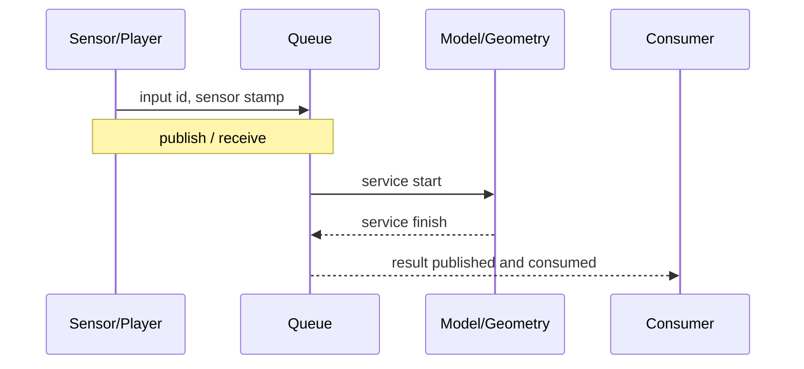

# 端侧效果与性能怎样测才可信

端侧视觉定位最常见的误判，是用一个容易测的数字回答另一个问题：单模型延迟代替完整响应，慢放成功代替实时覆盖，accepted 数代替正确定位，平均输入倍率代替逐消息连续性。

可信评估要逐层增加真实约束，并保持每层回答的问题清楚。

## 1. 六层证据梯子

| 层级 | 输入与环境 | 能回答什么 | 不能回答什么 |
| --- | --- | --- | --- |
| 单模块探针 | 合成/固定 tensor | API、shape、粗略 kernel 成本 | 真实帧对和系统时延 |
| 固定真实帧对 | 同一 Query–Reference | matcher/特征本身的增量 | 检索机会和连续输入 |
| 固定查询机会 | 同一地图与 Query 时刻 | 算法替换增加/丢失哪些定位 | 实时处理覆盖 |
| 连续输入 | 原速消息流与队列 | 排队、丢弃、过期和及时正确 | 其他机器人模块的争用 |
| 定位子系统共载 | 传感器、VIO、地图、定位状态 | 定位链内的资源和故障影响 | 深度、规划、控制等完整负载 |
| 完整产品共载 | 实际运行的全部关键组件 | 工程准入证据 | 飞行/商业认证仍需独立流程 |

不要跳过中间层：固定帧对能解释“为什么更好”，连续输入才能说明“好结果能否按时到达”。

## 2. 四种时间不要混写

一次请求可以有：



定义同一 monotonic 墙钟上的：

$$
T_{queue}=t_{start}-t_{enqueue},
$$

$$
T_{service}=t_{finish}-t_{start},
$$

$$
T_{response}=t_{consume}-t_{publish\_boundary}.
$$

若消息描述传感器时刻 $t_{sensor}$，则结果年龄是：

$$
A_{result}=t_{consume}-t_{sensor}.
$$

墙钟响应与传感器时间域年龄只有在时钟可比时才能一起解释。播放器 API 的 `publish()` 返回也不是相机曝光时刻；它只是一条可复现的软件计时边界。

## 3. 1×输入、检测频率和响应期限是三件事

- **持续 1×供给**：记录一秒的传感器数据大约用一秒墙钟发布；
- **检测请求频率 $f_{detect}$**：定位系统按任务合同选择查询机会；
- **响应期限 $D_{response}$**：例如要求 P95 完整请求在该期限内到达定义的输出边界。

第一条通过不保证第三条：系统可以一边持续接收，一边让内部队列越来越长。第三条通过也不保证第一条：只发布很少输入会让每个请求都很快。结果年龄上限又是第四个约束，不能替代响应 deadline。

## 4. 正确性分母必须完整

对每个输入或查询机会，至少区分：

```text
input
├── not_selected（设计门控）
├── selected
│   ├── dropped / superseded / timeout
│   ├── processed
│   │   ├── rejected
│   │   └── accepted
│   │       ├── correct and timely
│   │       ├── correct but late
│   │       └── incorrect
```

常用指标回答不同问题：

- `accepted precision = correct accepted / all accepted`；
- `sequence coverage = correct accepted / all eligible queries`；
- `timely coverage = correct and before deadline / all eligible queries`；
- 恢复事件成功率以启动/失位事件为分母，而不是以消息条数为分母。

未处理、超时和失败必须留在分母中。只报告 accepted 中的正确率，可能掩盖系统几乎不输出。

## 5. P95 不能按阶段相加

若预处理、网络和几何分别有一组样本，三个 P95 通常来自不同请求：

$$
P95(X+Y+Z)\neq P95(X)+P95(Y)+P95(Z).
$$

正确做法是用 input ID 将同一请求的边界关联起来，先计算每个完整样本的总时间，再从这些总时间求 P50/P95/P99。阶段分位数仍可用于诊断，但不能拼成合同。

尾部分位还要报告样本数。十几次请求的 P99 基本等于最大值，不足以承诺稳定长尾。

## 6. 预热、冷启动与缓存

建议分开报告：

| 模式 | 包含什么 |
| --- | --- |
| 冷启动 | 进程、Python/runtime、模型、地图/索引首次加载 |
| 首请求 | allocator、kernel 编译、页面调入和缓存尚未稳定 |
| 暖态 batch=1 | 模型与地图就绪，真实单请求 |
| 持续输入 | 暖态服务 + 排队 + 共载 + 热状态 |

预热不能简单地“删掉前十个最慢样本”。应记录预热输入、结束条件和正式窗口，并保留冷启动作为部署指标。reference 特征缓存必须符合线上实际；离线预先算好 Query 特征只能叫质量诊断。

GPU/NPU 调用若异步，计时终点必须等待结果真正可用。CPU API 很快返回可能只说明提交完成。

## 7. rosbag、MCAP、topic 与时间戳

- **topic** 是 ROS 消息流的命名通信通道；
- **rosbag2** 记录和回放多个 topic；
- **MCAP** 是可承载这些消息的容器格式之一；
- **消息时间戳**描述传感器/系统定义的事件时间，不等于播放器墙钟。

回放适合固定输入、复现错误和比较版本。正式性能轮应把数据预先放到板端，避免网络传输成为额外变量。

重复短记录可以增加启动/退出、生命周期和压力暴露，但不能制造新的独立场景。即使把下一轮时间戳整体平移为单调递增，循环首尾的图像、IMU 和真实运动仍可能不连续；这会改变 VIO 跟踪、定位难度、CPU负载、尾延迟和内存。因此应称“循环输入压力测试”，不能直接外推为物理连续运动长稳。

ROS 2 回放入口见 [rosbag2](https://github.com/ros2/rosbag2)，MCAP 格式见 [MCAP specification](https://mcap.dev/spec)。

## 8. 平均 1×不代表逐消息均匀

若一轮时长为 $T$ 的数据也在约 $T$ 墙钟时间内发布完，平均供给是 1×；它仍可能先短暂停顿，再突发补发多条消息。至少检查：

- 每消息目标发布时间与实际发布时间的 lateness；
- 相邻发布间隔的 P50/P95/max；
- 最大空窗和短间隔突发数；
- 循环边界；
- 左/右图和 IMU 是否都有相同粒度账本。

只有总消息数相等，不代表消费者全部收到；消费者计数少也不能立即称 DDS 丢包。还要排除：

- 启动发现期；
- 停止时队列未排空；
- 统计窗口边界；
- 时间同步筛选；
- 设计门控或预处理降采样；
- QoS/DDS、调度和资源争用。

建议逐层记账：

```text
source records
→ publisher attempted/returned
→ formal subscriber received
→ synchronized tuples
→ selected requests
→ process started/finished
→ result published/consumed
→ shutdown queue remainder
```

`busy=0` 和 process start/finish 闭合，只能证明进入该 process 的请求没有残留，不能证明所有上游队列无积压。还需要队列年龄或深度。

## 9. 观测工具也会改变被测系统

高频 Python subscriber、逐帧 JSON、`ps` 扫描和 profiler 都会消耗 CPU、锁和 I/O。做法是：

1. 用重 profiling 轮定位瓶颈；
2. 用轻量事件计时做正式性能轮；
3. 做一次 observer on/off 对照；
4. 在报告中列出启用的观测项。

若审计节点收到消息才开始计时，这是一条合法旧边界，但不能与播放器 publish 边界混在同一表中。

## 10. 内存、温度和频率

RSS 是进程映射的驻留页总量，多个进程共享页可能重复计数；PSS 按共享比例分摊，更适合进程组比较。两者都要说明统计集合。短时增长不等于泄漏，长时间未平台化也不能称稳定；可按墙钟、输入消息、轨迹长度和循环次数分别回归，帮助找增长变量。

温度必须和频率、风扇/散热、环境与供电一起记录。自定义停止线不是硬件官方安全上限；没有实体功率计时，不能从利用率或温度推算功耗。

## 11. 一份最小运行账本

每个 run 建议冻结：

```yaml
run_id: public-demo-001
software_commit: ...
model_hashes: {...}
map_hash: ...
input_hash: ...
clock_boundary: publisher_return_to_result_consume
queue_policy: latest_only
warmup_policy: ...
components: [camera_player, vio, localization]
excluded_components: [depth, planner, controller]
thermal_and_power: {...}
```

原始逐请求事件、汇总 CSV 和画图脚本共同保存。图表只由固定数据生成，避免手工复制数字造成口径漂移。

下一篇进入一个具体的原生故障案例：[嵌入式 Python 线程崩溃诊断](./嵌入式Python线程崩溃诊断.md)。
