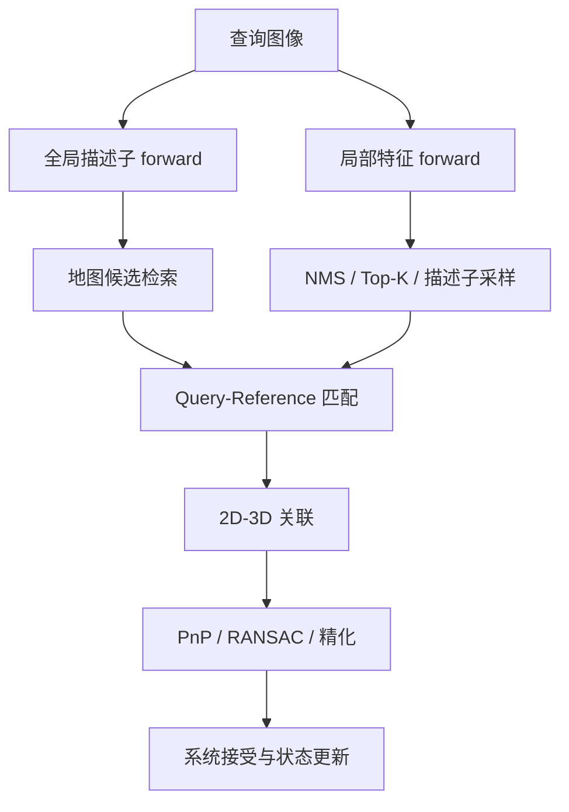
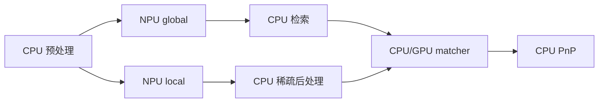

# 视觉定位的 CPU、GPU 与 NPU 分工

本文中的 **MNN** 指 mutual nearest neighbor（双向最近邻）匹配，不是 Alibaba 的 MNN 神经网络推理框架；两者只是缩写相同。

“把视觉定位放到 NPU”不是一个完整设计。定位链里既有密集卷积，也有动态选点、索引、数据库查询和鲁棒几何；它们对算子、内存和控制流的要求不同。合理的起点是按计算形态拆分，而不是按模型名称给硬件贴标签。

算法细节见 [MixVPR 与 XFeat](../../slam/fundamentals/MixVPR与XFeat：从图像到全局、局部描述子.md)和[从 MNN 到 LightGlue 与 LighterGlue](../../slam/fundamentals/从MNN到LightGlue与LighterGlue.md)。本文只讨论部署分工。

## 1. 一条教学用视觉定位链



各阶段的典型计算形态：

| 阶段 | 主要工作 | 常见形态 |
| --- | --- | --- |
| 全局描述子 | CNN/MLP forward、池化、归一化 | 规则密集张量计算 |
| 检索 | 向量点积、Top-K、索引查询 | 小批量线性代数或数据库访问 |
| 局部 forward | CNN、多尺度融合、密集特征图 | 规则密集张量计算 |
| 稀疏后处理 | NMS、阈值、Top-K、插值、坐标回映 | 动态点数、索引和分支 |
| MNN | 相似度矩阵、行列 argmax、互选 | 中小矩阵 + 动态索引 |
| learned matcher | attention、FFN、assignment、剪枝 | 密集计算与动态稀疏控制混合 |
| 几何 | 2D–3D 关联、RANSAC、PnP | 小规模分支、随机采样与求解 |

## 2. 为什么 forward 常适合 NPU，后处理常留 CPU

NPU 编译器更容易处理固定 shape、连续算子和可融合的卷积/矩阵乘。以局部特征为例，网络可以输出：

```text
dense descriptor map
keypoint logits
reliability heatmap
```

随后还要：

1. 把 logits 展开成像素级热力图；
2. 做 NMS 与阈值筛选；
3. 按 score 排序取 Top-K；
4. 在密集特征图上插值采样描述子；
5. L2 归一化；
6. 把 resize 后坐标映射回原图。

这些步骤包含动态数量、排序、Gather 和坐标运算。若目标编译器支持不完整，把整个图硬塞给 NPU 可能产生 CPU fallback、图切分和频繁同步。一个常见但需要验证的边界是：**NPU 负责规则 forward，CPU 负责稀疏后处理。**

它不是普遍最优结论。某些 GPU/NPU runtime 已有高效 Top-K、NMS 或自定义算子；某些 CPU 又可能成为瓶颈。要用转换报告和分阶段计时确认实际执行设备。

## 3. 小规模 MNN 为什么可能在 CPU 更快

设两组归一化描述子为 $Q\in\mathbb R^{N_q\times D}$、$R\in\mathbb R^{N_r\times D}$，相似度矩阵为：

$$
S=QR^{\mathsf T}.
$$

MNN 还需要对 $S$ 的行和列分别做 argmax，再保留互为最近邻的索引。GPU/NPU 擅长矩阵乘，但完整 matcher 的成本是：

$$
T=T_{prepare}+T_{submit}+T_{matmul}+T_{sync}+T_{argmax}+T_{filter}+T_{return}.
$$

当 $N_q,N_r,D$ 不大、描述子本来就在 CPU，而后续 2D–3D 与 PnP 也在 CPU 时，设备提交、同步、布局转换和结果读回可能比矩阵乘本身更贵。成熟 CPU BLAS/OpenCV 实现还可能充分利用缓存和 SIMD。反过来，在更大批量、描述子常驻设备或 matcher 与后续网络都在 GPU 时，设备方案可能胜出。

因此不要用“矩阵乘适合 GPU”代替完整调用测量，也不要未经 profile 就声称某个 OpenCV 构建一定启用了 NEON、特定 BLAS 或多线程路径。应记录实际二进制、线程、shape 和调用栈。

## 4. `NORM_L2SQR` 为什么可以避免平方根

OpenCV `BFMatcher` 的 `NORM_L2SQR` 比较平方欧氏距离：

$$
d^2(q,r)=\sum_k(q_k-r_k)^2.
$$

平方根在非负区间单调，因此 argmin $d^2$ 与 argmin $d$ 相同。若两描述子已经逐行 L2 归一化，则：

$$
\|q-r\|_2^2=2-2q^{\mathsf T}r,
$$

所以欧氏平方距离、余弦相似度和内积产生相同的最近邻排序。`crossCheck=true` 再要求双向互选，可实现一种 MNN。

但“数学排序等价”仍有条件：

- 两侧确实按行归一化且没有零向量/NaN；
- 搜索集合完全相同；
- 没有额外 cosine/距离阈值或 ratio test；
- tie-breaking、dtype 和累加误差不会改变并列附近的 argmax；
- 返回索引与原关键点行序一致。

这些条件不成立时，不能把 BF cross-check 与某段 exact cosine MNN 代码视为相同接口。

## 5. GPU 共享内存也有边界成本

在集成 GPU SoC 上，CPU/GPU 可能共享物理 DRAM，因此不一定存在独立显存间的 PCIe 拷贝。但仍可能发生：

- 用户缓冲重新打包到驱动认可的 layout；
- cache flush/invalidate 或一致性操作；
- 页映射、dma-buf import/export；
- command submission 和 fence 等待；
- CPU 访问 GPU 输出前的同步；
- runtime 为连续张量创建临时副本。

所以准确表述应是“存在映射、转换、同步或复制成本的可能”，具体哪一种要看 allocator、驱动和 runtime trace；不能把所有平台都简化为“GPU 传回 CPU”。

## 6. 单模块最优不等于完整链最优

假设 NPU global、NPU local 和 GPU matcher 单独都最快，组合后仍可能变慢：

- 两个 NPU 模型串行争用同一设备；
- matcher 等待 local 输出，无法与 global 重叠；
- 每段使用不同 layout，重复 transpose；
- CPU 在等待设备时占着关键 callback；
- 多 runtime 各有线程池和内存池；
- 热状态让持续频率低于短探针。

因此要画依赖图，先找关键路径，再决定是否并行。不同请求可以流水，但同一请求的依赖不能靠多线程消失。



## 7. 后端分配的验证表

对每个模块记录：

| 字段 | 示例问题 |
| --- | --- |
| runtime 与版本 | ONNX Runtime、RKNN Runtime、OpenCL 驱动具体是什么版本？ |
| 实际设备 | 是否有 CPU fallback？从哪里证明？ |
| 输入输出 | shape、dtype、layout、动态点数怎样表达？ |
| 内存 | 数据是否常驻？谁拥有缓冲？是否隐式 contiguous？ |
| 同步 | 计时点是否等待设备真正完成？ |
| 质量 | 候选、关键点、匹配、PnP 与最终接受是否变化？ |
| 共载 | VIO、ROS executor、另一个模型是否变慢？ |
| 持续性 | 热稳态、频率、P95/P99 和内存是否变化？ |

下一篇把这条链落到导出工具上：[从 PyTorch 到 ONNX 与 RKNN](./从PyTorch到ONNX与RKNN.md)。

## 公开参考

- [OpenCV `BFMatcher`](https://docs.opencv.org/4.x/d3/da1/classcv_1_1BFMatcher.html)
- [Rockchip RKNN-Toolkit2](https://github.com/airockchip/rknn-toolkit2)
- [ONNX Runtime performance documentation](https://onnxruntime.ai/docs/performance/)
