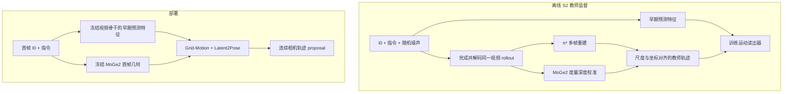

# 从视频世界模型到 WAM：以 DiffWAM 为例

本文把 World Action Model（WAM）限定为：从观测与任务条件中产生动作相关的连续轨迹提案。它不同于只预测世界，也不同于直接输出电机控制。DiffWAM 的问题是，能否跳过部署时完整未来视频生成与多帧重建，直接从视频模型的早期预测特征恢复相机运动。

本文核对 2026-09-30 版本的 [DiffWAM 原论文](https://arxiv.org/abs/2609.39763)及[官方项目页](https://zzmmzzm.github.io/diffwam.github.io/)（核对日期 2026-10-17）。论文当时未提供可固定 commit 的公开代码入口，因此实现细节只按论文陈述，不推测未公开接口。

## 1. 部署输入输出

输入是首帧 RGB 图像 $I_0$ 和语言指令 $c$。视频骨干从早期去噪/预测过程产生多层特征；冻结的 MoGe2 从首帧估计几何。Grid-Motion 保留预测特征的时空网格关联，Latent2Pose 将运动表示与首帧几何结合，输出相对初始相机的连续相机轨迹：

$$
\hat\tau=\{(\hat R_t,\hat p_t)\}_{t=1}^{T}.
$$

论文设定中相机轴为右、下、前，Pose 把未来相机坐标映射到初始相机坐标。Grid-Motion 不是传统光流；Latent2Pose 输出的是轨迹 proposal，不是控制量。

## 2. 为什么首帧几何不能省略

视频预测特征混合外观、语义和运动，但不天然带度量尺度。DiffWAM 的几何分支在部署时仍运行：MoGe2 从 $I_0$ 提供首帧几何与尺度线索，运动读出器据此将隐运动落到三维相机轨迹。

所以“部署不做多帧重建”不等于“部署没有几何模型”。模型输出的米制含义仍依赖单目几何估计、训练分布和尺度条件，不能当作外部测量真值。

## 3. 三个训练阶段

论文明确区分阶段标签与去噪 schedule index：

| 阶段 | 输入与监督 | 冻结/训练 | 产物 |
| --- | --- | --- | --- |
| S0 视频骨干准备 | 导航视频/指令数据 | 适配视频骨干；细节按论文配置 | 具有导航预测能力的骨干 |
| S1 导航感知读出预训练 | 预测特征、首帧几何与语料库已有轨迹 | 视频骨干和 MoGe2 冻结，训练运动读出器 | 初始化 $\theta_{pre}$ |
| S2 Geometry-guided Predictive Distillation | 同一随机 rollout 的早期预测特征与重建教师轨迹配对 | 骨干/MoGe2 仍冻结，优化 Grid-Motion/Latent2Pose 等读出组件 | 直接从早期表示读轨迹的模型 |

不能把全流程统称为一个模糊“蒸馏阶段”：S1 先建立语料库轨迹监督的读出，S2 才使用与同一完成 rollout 配对的重建轨迹做 GPD。

## 4. 离线教师链怎样构造

S2 离线继续完成与早期特征相同随机样本的视频 rollout，并解码未来视频。$\pi^3$ 从完成视频重建相机运动和深度，MoGe2 的度量深度用于校准 $\pi^3$ 平移尺度。若 $\bar p_t,\bar R_t$ 是重建坐标中的 camera-to-world 类表示，论文把监督转到初始相机并用尺度 $\alpha$ 校准：

$$
R_t^\star=\bar R_0^\top\bar R_t,\qquad
p_t^\star=\alpha\bar R_0^\top(\bar p_t-\bar p_0).
$$

同一 rollout 配对避免把一组随机未来的特征错配到另一条轨迹，但不能消除生成误差、重建漂移或单目尺度偏差。这是 reconstruction-derived reference，不是物理绝对 GT。

## 5. 训练链与部署链并列

部署去掉完成视频、在线 $\pi^3$ 多帧重建和教师轨迹，却保留视频预测骨干、首帧 MoGe2 与轨迹读出。

## 6. FastDreamer 与异步交接

FastDreamer 在机器人执行当前轨迹时准备下一 proposal，并保留观测时间、面向预定未来 handoff state 处理提案。它解决推理期间机器人继续运动导致的状态/参考系错位，但轨迹仍要经过下游规划与执行检查。

论文报告的延迟只适用于声明的模型变体、硬件与测量边界，不能外推到 CAM-3576Q38。通用 input ID、队列和轨迹变换方法见[异步推理、轨迹交接与可观测性](../异步推理、轨迹交接与可观测性.md)。

## 7. 局限与验证

分别检查轨迹位置/旋转误差、终点/任务成功、碰撞与动态可行性、首帧几何尺度、不同视频随机样本的稳定性和端到端延迟。论文演示表明 proposal 可接入连续执行，不等于任意环境泛化或安全控制已经解决。

LingBot-Map 恢复已观测视频流的几何，DiffWAM 从预测表示提出未来运动；两者可讨论几何表征联系，但论文教师重建使用的是 $\pi^3$，不是 LingBot-Map。任何替换都只是待验证设想，还需处理生成视频域、尺度、时序一致性和监督质量。

基础的蒸馏边界见[训练、推理与知识迁移](../../ai-infra/训练、推理与知识迁移.md)，世界模型职责见[世界模型与定位、建图、规划的关系](./世界模型与定位建图规划的关系.md)。
