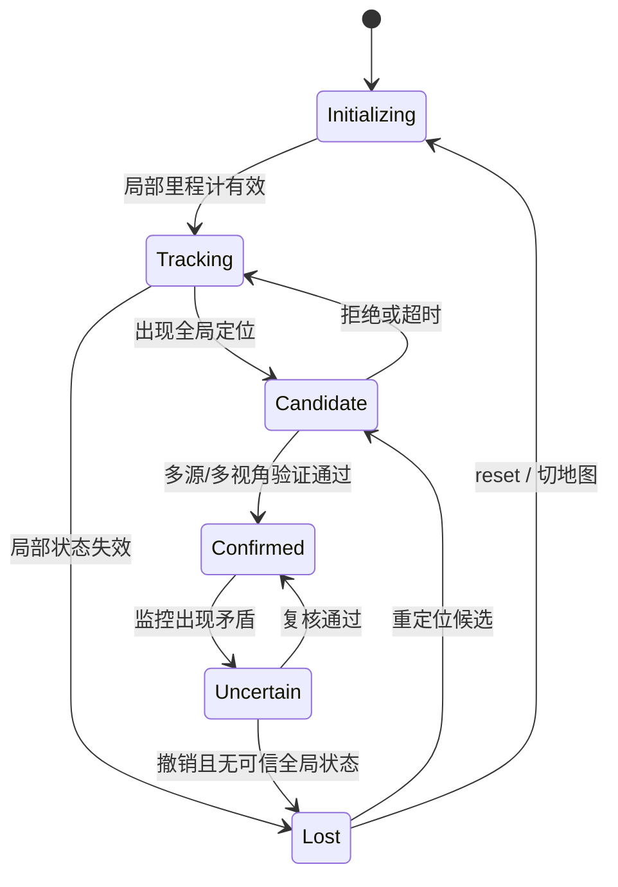

# 定位状态机、误接受隔离与恢复

定位器返回一个 Pose，只说明某条算法链产生了候选。机器人系统还要决定候选是否新鲜、是否有足够独立证据，以及它能否改变正式地图状态和导航输入。

## 1. 状态比一个 success 布尔值更丰富



`Tracking` 表示局部运动连续，不等于全局已定位；`Candidate` 不得污染正式 `map→odom`；`Confirmed` 才允许更新全局状态；`Uncertain` 可保留局部运动但停止把全局 Pose 当可靠导航输入。

## 2. 候选确认

确认输入至少包括：消息有效性与地图/模型版本、采集时间和最大年龄、单帧几何、跨帧相对运动、地图邻域或共视关系、外部先验及其不确定性。连续几帧落在同一错误房间可能只是相关错误重复，只有新增视角/结构或独立运动证据才提高辨识力。

```text
on_candidate(c):
  if stale(c) or wrong_epoch(c): reject
  if not single_frame_geometry_ok(c): reject
  pending.add(c)                 # 不发布正式 map→odom
  if new_view_evidence(pending) and motion_consistent(pending, odom):
      commit(candidate_transform)
      state = CONFIRMED
  elif timeout: reject_and_clear()
```

这是系统设计方案，不是 RTAB-Map 原生状态机。RTAB-Map 的源码级前端与图一致性检查见[危险误接受防护与恢复](../slam/rtabmap/危险误接受防护与恢复.md)。

## 3. 合法大修正与错误跳变

丢失后的正确重定位可能让 `map→odom` 大幅变化，因此不能用机器人速度上限直接拒绝所有大跳变。检查应比较候选对应采集时刻的局部轨迹、地图身份与几何证据。平滑一个错误修正只会让导航慢慢走向错误地点。

稳定跟踪、首次定位、丢失后重定位和跨会话地图合并拥有不同先验，应采用不同验证策略和超时，而不是共享一个跳变阈值。

## 4. 误接受后的隔离与恢复

监控发现矛盾后，先冻结新的全局状态写入，保存候选、输入 ID、约束和决策理由；再撤销可疑约束并重算图。若错误结果已触发特征融合、稠密地图更新、规划或控制，仅删除一条图边不等于完整回滚。

完整恢复依赖事务边界、快照或可重放事件。局部里程计仍可信时，可以继续发布 `odom→base`，同时把全局定位标为 uncertain；规划器是否停车、限速或局部运行由安全策略决定，不是定位库自动替系统决定。

进程重启或切地图要增加 epoch。迟到的旧结果即使分数很高，也因 epoch 不匹配被丢弃，避免重启后“复活”旧候选。

## 5. 输出语义与评估

输出应明确 `candidate/confirmed/uncertain/lost`、对应输入时间、变换方向、地图版本和原因码。评估既看正确接受、召回和首次恢复时间，也看危险误接受持续时间、发现延迟、污染范围、撤销成功率与恢复耗时，见[定位评估方法](../slam/data-evaluation/定位评估方法.md)。

状态机提高系统防护，不会把内部一致性变成独立真值；重复结构和相关证据仍需专门数据回放。
