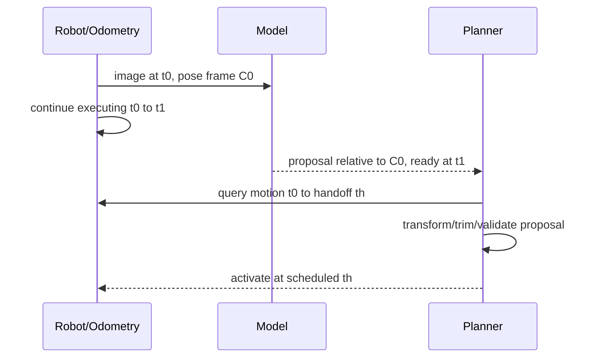

# 异步推理、轨迹交接与可观测性

机器人不会等模型算完才运动。异步系统的核心不是“多开线程”，而是让每个结果知道自己对应哪一帧、哪套状态，并在激活前补偿推理期间已经发生的运动。

## 1. 用 input ID 贯穿链路

每个任务记录 `input_id`、采集时间 $t_0$、入队、开始/结束推理、验证和激活时间，以及 model/map/reset epoch。输出没有这些身份，就无法判断它是最新结果还是旧结果迟到。

队列策略需要显式选择：处理全部帧保持完整但可能积压；latest-only 保持新鲜但丢帧；有界队列折中。任何策略都要统计队列年龄与丢弃原因。

## 2. 旧观测产生的新轨迹

若 proposal 中轨迹写在观测相机 $C_0$ 下，直接在完成时 $t_1$ 执行会产生参考系错位。交接应查询可信局部轨迹，把 proposal 变换到计划激活状态，并裁掉已经过去的时间段；若 odometry reset、时间越界或补偿过大，则拒绝重算。

FastDreamer 是这种思想的案例：在执行当前轨迹时准备下一提案，保留观测时间并面向预定交接状态处理。通用系统不能只复制论文接口，还要加本机的碰撞、安全和控制约束，见 [DiffWAM 专题](./world-models/从视频世界模型到WAM.md)。

## 3. 并行和重叠的真实边界

预处理、网络、几何和通信只有依赖允许时才能重叠。GPU/NPU stream、CPU 线程和 ROS callback 共享内存带宽与调度资源；阶段耗时下降不一定降低关键路径。不能把各阶段 P95 相加成端到端 P95，也不能用模型 kernel 延迟代表输入到动作延迟。

## 4. 可观测性：让一次结果可以追溯

结构化事件至少包含：输入 ID/时间、队列长度、各阶段时间、frame、模型/地图版本、候选分数、几何统计、状态机转移、丢弃/接受原因和发布对象。分布式 tracing 用同一 trace ID 串起节点；日志保存决策，metrics 聚合趋势，回放保存可重现实物输入。

性能边界建议记录：

$$
L_{e2e}=t_{consume}-t_{capture},\qquad
A_{out}=t_{consume}-t_{input}.
$$

前者是链路延迟，后者是消费时的数据年龄；若时间来自不同设备，先保证时钟可比较。

## 5. 故障回放

回放要覆盖模型变慢、结果乱序、队列溢出、TF 缺失、定位 reset、地图切换和正确的大幅全局修正。断言不仅是“有输出”，还要检查旧 epoch 被拒绝、状态未被候选污染、端到端年龄未超过契约，以及恢复后首个确认结果有完整证据。

ROS 2 的队列与回调机制见 [ROS 2 的通信与执行机制](./ROS2通信与执行机制.md)，坐标传播见[坐标、时间戳与数据契约](./坐标、时间戳与数据契约.md)。
