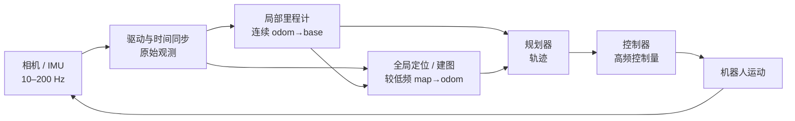

# 机器人系统分层与数据流

机器人系统首先是多速率、带反馈的数据系统。把算法装进节点并不等于职责已经清楚；每一层都要说明输入、输出、更新频率、状态所有权和失败语义。

## 1. 一条定位到控制的示意链

频率只是教学示意，不是配置建议。局部里程计负责短时连续运动；全局定位校正漂移；规划器结合地图和当前状态生成轨迹；控制器追踪轨迹。全局定位暂时不可用时，局部里程计仍可能连续，但是否继续执行取决于任务的安全边界。

## 2. 模块、进程、节点与线程

- 模块是职责边界，可以是库、类或服务；
- 进程拥有独立地址空间和故障边界；
- ROS 2 节点是通信与参数实体，一个进程可含多个节点；
- 线程是进程中的并发执行资源，多个 callback 不会因存在多个节点就自动并行。

设计时先按状态所有权和依赖方向划模块，再决定部署形态。将所有组件塞进一个进程可减少序列化，却放大崩溃影响；拆成进程提高隔离，却增加通信、拷贝和版本契约。

## 3. 数据流与控制流

图像、IMU 和 Pose 是数据流；切地图、reset、启停定位和进入降级状态属于控制流。把控制命令伪装成普通数据 topic 容易丢失幂等、确认与超时语义。短事务可用 service；需反馈和取消的长任务更适合 action；持续状态仍应通过带时间戳的消息发布。

反馈链意味着下游结果可能影响上游状态。例如误定位若直接更新 `map→odom`，规划器会认为机器人在地图中跳变；若又用该规划结果筛选后续定位，就形成自证循环。候选定位应先隔离验证，见[定位状态机、误接受隔离与恢复](./定位状态机、误接受隔离与恢复.md)。

## 4. 依赖方向

稳定接口应从系统语义出发：定位模块输出带 frame、stamp、状态与协方差的估计，不要求规划器理解某个检索网络的内部 score。算法实现可以替换，但消息含义不变；若语义变化，应提升接口或地图版本，而不是保持字段名不变。

同样，RTAB-Map 的回环边、HLoc 的 PnP 结果和学习模型的轨迹 proposal 都不是天然可执行命令。系统层需把它们转换为候选、已确认状态或规划约束。

## 5. 最小验收

对每条边记录生产者、消费者、frame、时间语义、单位、频率、最大年龄、缺失/重复策略和版本。用回放验证传感器延迟、定位丢失、进程重启与切图，不只验证顺畅路径。

下一步读[坐标、时间戳与数据契约](./坐标、时间戳与数据契约.md)和 [ROS 2 的通信与执行机制](./ROS2通信与执行机制.md)。
