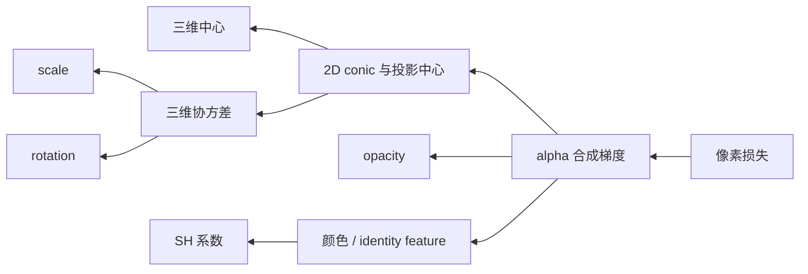

# 可微渲染、优化与增密

可微渲染的目标不是只生成一张图，而是让像素误差沿合成链回到 Gaussian 的位置、形状、透明度和外观。3DGS 还必须动态改变 primitive 数量：连续梯度负责调参数，离散的 clone、split、prune 负责调整表示容量。

## 1. 优化问题

给定训练相机 $v$ 的真实图像 $\mathbf I_v$，渲染函数写为

$$
\hat{\mathbf I}_v=
\mathcal R(\Theta;\mathbf K_v,\mathbf T_{C_v\leftarrow W}),
$$

其中 $\Theta$ 包含全部 Gaussian 参数。原始 3DGS 的图像损失常将 L1 与结构相似性组合：

$$
\mathcal L_{rec}=(1-\lambda)\lVert
\hat{\mathbf I}-\mathbf I\rVert_1
+\lambda\bigl(1-\operatorname{SSIM}(\hat{\mathbf I},\mathbf I)\bigr).
$$

这只约束训练视角的成像一致性。它不会自动保证物理材质、度量表面或未见区域正确；相机 Pose 错误也可能被错误几何和外观部分吸收。

## 2. 梯度经过哪些环节

对固定候选和顺序，alpha 合成由乘加、指数和矩阵运算组成，可以求导。例如 $\alpha_i$ 不只改变自身颜色贡献，也改变后方所有项的 $T_j$；backward 必须计入这条遮挡链。

公开 CUDA 实现通常保存 forward 的最终透射率、贡献计数等中间量，再按相反方向重放候选，累计像素对颜色、opacity、二维均值和 conic 的梯度。预处理 backward 再经投影、协方差分解和 SH 求值回到三维参数。源码入口可从课程 fork 的 [`backward.cu`](https://github.com/Tiansuanyu/gaussian-grouping-project/blob/23feeef7ded25b2374fbb027d667e91500efd1d0/submodules/diff-gaussian-rasterization/cuda_rasterizer/backward.cu) 追踪。

forward 还返回屏幕半径等可见性信息。训练代码只为本视角半径大于零的 Gaussian 累积 densification 统计，并记录其最大屏幕半径；这是一种由当前可见集合驱动的容量调整。它不是遮挡概率估计，也不代表不可见 Gaussian 可以永久删除。

排序、tile 相交集合和增删 primitive 是离散操作。常见实现不会对“某个 Gaussian 刚好跨过 tile 边界或交换顺序”的事件求完整梯度，而是在当前离散结构下优化连续参数。这是可微近似的重要边界。

## 3. 为什么只优化初始点不够

SfM 点集中在容易匹配的纹理区域，数量和空间分布都不是渲染最优。若只移动这些点：

- 欠重建区域缺少 primitive，梯度无法凭空创造容量；
- 一个很大的 Gaussian 可能试图覆盖复杂细节；
- 透明或无贡献 Gaussian 会继续占用排序、显存和计算。

因此训练交替进行参数更新与密度控制。

## 4. Clone、split、prune 与 opacity reset

| 操作 | 典型触发 | 作用 | 不能保证的事情 |
| --- | --- | --- | --- |
| clone | 位置梯度大、Gaussian 较小 | 在欠覆盖区域复制容量 | 不会直接发现正确表面拓扑 |
| split | 位置梯度大、Gaussian 较大 | 沿当前椭球采样子中心并缩小尺度 | 不是统计意义的混合模型分裂证明 |
| prune | opacity 太低或屏幕/世界尺度异常大 | 删除低贡献或不稳定 primitive | 阈值不具有跨场景普适性 |
| opacity reset | 周期性压低过早饱和 opacity | 重新开放可见性竞争 | 不等于重新初始化全部场景 |

课程 fork 的 [`densify_and_clone()`、`densify_and_split()` 与 `prune_points()`](https://github.com/Tiansuanyu/gaussian-grouping-project/blob/23feeef7ded25b2374fbb027d667e91500efd1d0/scene/gaussian_model.py) 同时复制几何、SH 与 identity encoding。其 densification 统计量来自屏幕空间均值的 $x,y$ 梯度范数；这是一种“当前视图误差希望投影中心移动多少”的启发式信号，不是直接的三维几何不确定性。

split 产生子 Gaussian 后删除父项，使容量从粗支撑转向细支撑；clone 则保留原项并增加副本。optimizer 中的 Parameter 也必须同步扩展或裁剪，否则状态张量会与模型错位。

## 5. 参数约束与数值稳定

实现优化的是未激活变量：

$$
\mathbf s=\exp(\hat{\mathbf s}),\qquad
o=\sigma(\hat o),\qquad
\mathbf q=\hat{\mathbf q}/\lVert\hat{\mathbf q}\rVert.
$$

这样可保持正尺度、$0$ 到 $1$ opacity 和合法旋转，但也带来饱和区：sigmoid 两端梯度很小，尺度指数可能造成大动态范围。投影协方差的低通项、alpha clamp 和早停阈值既是性能策略，也是数值保护。

3DGS 中的 $\boldsymbol\Sigma$ 描述 primitive 形状；优化理论里的协方差或状态估计误差协方差描述不确定性。二者符号相同但语义完全不同。

## 6. 加入 identity 监督后

Gaussian Grouping 在 $\mathcal L_{rec}$ 外加入二维分类损失和三维邻域正则：

$$
\mathcal L=\mathcal L_{rec}
+\lambda_{2D}\mathcal L_{2D}
+\lambda_{3D}\mathcal L_{3D}.
$$

此时几何、外观与 identity 共享可见性权重，语义梯度也可能影响 Gaussian 参数；具体哪些变量被 optimizer 更新要以实现为准。课程 fork 的 [`train.py`](https://github.com/Tiansuanyu/gaussian-grouping-project/blob/23feeef7ded25b2374fbb027d667e91500efd1d0/train.py) 用 `loss.backward()` 联合反传，并通过同一 densification 路径维护 object feature。

下一篇集中说明[Gaussian Grouping](./gaussian-grouping.md)的监督来源和损失边界；kernel 如何实现这些梯度见[Gaussian Rasterizer 的 GPU 实现](../../computer-systems/graphics-gpu/gaussian-rasterizer.md)。
