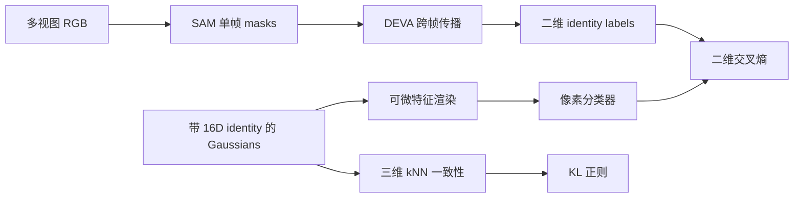

# Gaussian Grouping：从重建到实例分组

Gaussian Grouping 在 3DGS 上为每个 Gaussian 增加可学习 identity encoding，使二维跨视图 mask 的监督能提升为三维实例分组。它的关键不是把 SAM 标签直接粘到点上，而是让几何、可见性合成、分类和空间一致性共同约束一个持久的三维表示。

普通 RGB reconstruction 只要求每条训练射线的合成颜色接近图像；把两把外观相似的椅子交换 identity，颜色损失可能完全不变。Scene understanding 还需要回答哪些 primitive 属于同一实例、不同视角中的 mask 是否指向同一对象，这不是 RGB/SH 参数自然携带的信息。

## 1. 监督从哪里来

论文先用 SAM 对单帧产生开放世界 masks，再用通用视频分割/跟踪器传播，得到跨视图尽量一致的 identity。它们是自动生成的训练标签，不是传感器真值：遮挡、mask 边界、ID 切换和未检出都会进入三维优化。

“跨视图一致”是目标而非绝对保证。相机 Pose 和几何错误也会让同一 Gaussian 在不同帧落到错误像素，因此二维标签质量、重建质量与分组质量相互耦合。

## 2. 16 维 identity encoding

每个 Gaussian 除几何和 SH 外再保存

$$
\mathbf e_i\in\mathbb R^{16}.
$$

论文将它作为零阶 SH，即不随观察方向变化。给定同一套 alpha 权重，像素 identity feature 为

$$
\mathbf E(\mathbf p)=
\sum_i \mathbf e_i\alpha'_i(\mathbf p)
\prod_{j<i}\bigl(1-\alpha'_j(\mathbf p)\bigr).
$$

随后用分类头 $f:\mathbb R^{16}\rightarrow\mathbb R^K$ 产生场景内 $K$ 个 identity logits，经 softmax 和二维 label 计算交叉熵。

identity encoding 不是天然有语义的类别向量，也不是可跨场景直接比较的通用 embedding。其维度 16 是论文设计选择；论文消融中 32 维没有提升该实验重建效果且更慢，不能扩大为“任何任务 16 维都最优”。课程 fork 的 [`GaussianModel`](https://github.com/Tiansuanyu/gaussian-grouping-project/blob/23feeef7ded25b2374fbb027d667e91500efd1d0/scene/gaussian_model.py) 保存 `_objects_dc`，训练时的 [`1×1 Conv2d`](https://github.com/Tiansuanyu/gaussian-grouping-project/blob/23feeef7ded25b2374fbb027d667e91500efd1d0/train.py) 实现逐像素线性分类器。

若直接存不可导的整数 ID，多个半透明 Gaussian 在像素中的混合无法形成可用的连续训练信号。向量 feature 可以沿与 RGB 相同的 alpha 权重合成，再由分类器产生 logits；类别边界由损失学习，而不是对整数编号做没有语义的加权平均。

## 3. 二维分类损失

令像素真值 identity 为 $y(\mathbf p)$，则

$$
\mathcal L_{2D}=-\frac{1}{|\Omega|}
\sum_{\mathbf p\in\Omega}
\log\operatorname{softmax}(f(\mathbf E(\mathbf p)))_{y(\mathbf p)}.
$$

它要求当前视角的混合特征可分类，却未直接约束空间相邻 Gaussian 的 identity。细小或被遮挡的 Gaussian 可能很少得到稳定二维梯度；同一个像素也可能混合前后多个 Gaussian。

fork 在实现中还按 $\log K$ 对分类项归一化。那是固定源码版本的训练尺度选择，不应回写为论文公式的必要组成。

## 4. 三维空间一致性正则

论文在三维中采样 Gaussian，并找到每个样本的 $k$ 个近邻。设 $P_i=\operatorname{softmax}(f(\mathbf e_i))$，可写成

$$
\mathcal L_{3D}=\frac{1}{mk}
\sum_{j=1}^{m}\sum_{i\in\mathcal N_k(j)}
D_{KL}(P_j\Vert P_i).
$$

这个项把“空间相近的 primitive 更可能属于同一对象”作为先验，填补稀疏监督并减少噪声。它的边界也很明确：对象接触面两侧同样空间接近，过强正则会跨边界平滑；kNN 距离也不等于可见表面上的测地邻接。

课程 fork 的 [`loss_cls_3d()`](https://github.com/Tiansuanyu/gaussian-grouping-project/blob/23feeef7ded25b2374fbb027d667e91500efd1d0/utils/loss_utils.py) 用 `torch.cdist` 和 top-k 建邻域，并对分类概率计算 KL。源码中的归一化细节和采样策略属于实现，不要与论文抽象混为一谈。

## 5. 从分组到编辑

稳定 identity 让操作可以选择一组 Gaussian，而不是逐帧编辑像素：

- removal：删除目标组；
- recomposition：变换或交换选中组的三维中心；
- inpainting：删除后，用二维修复结果监督新增/优化的 Gaussian；
- colorization：主要调整选中组的 SH；
- style transfer：论文实现还会开放位置、尺度等参数。

这些操作的三维一致性来自共享 Gaussian，而补全内容的真实性仍取决于二维生成先验和可见视图。删除暴露出的背面若从未被观测，不会仅靠 identity 自动恢复。

## 6. 与一般语义地图的关系

Gaussian Grouping 更接近**场景内实例身份场**：它擅长从 mask 得到可渲染、可选择的对象组。开放词汇类别、关系图、可通行性和动态对象生命周期都不是其 identity loss 自动提供的能力。更广的地图层次见[从几何地图到语义地图](../learning-based/从几何地图到语义地图.md)。

同样，3DGS 的 Gaussian 不应直接当作概率状态估计里的 landmark covariance；identity 的 16 维空间也不等价于 DINO/CLIP 这类跨数据集视觉特征。

## 7. 代码路径与层次

课程 fork 在 Gaussian Grouping 算法上加入了新的 gsplat 后端，但没有因此改变上述损失定义的职责：

- [`gaussian_renderer.render()`](https://github.com/Tiansuanyu/gaussian-grouping-project/blob/23feeef7ded25b2374fbb027d667e91500efd1d0/gaussian_renderer/__init__.py) 同时输出 RGB 和 identity feature；
- [`train.py`](https://github.com/Tiansuanyu/gaussian-grouping-project/blob/23feeef7ded25b2374fbb027d667e91500efd1d0/train.py) 组合重建、二维分类与三维正则；
- [`gaussian_model.py`](https://github.com/Tiansuanyu/gaussian-grouping-project/blob/23feeef7ded25b2374fbb027d667e91500efd1d0/scene/gaussian_model.py) 在增密、裁剪和 PLY 存取时同步维护 identity。

后端怎样共享几何、为何 3+16 通道引出 Native19，放在[Gaussian Rasterizer 的 GPU 实现](../../computer-systems/graphics-gpu/gaussian-rasterizer.md)和[通道融合、占用率与性能测量](../../computer-systems/graphics-gpu/gpu-kernel-optimization.md)中讲解。

## 参考

- Ye et al., [Gaussian Grouping: Segment and Edit Anything in 3D Scenes](https://www.ecva.net/papers/eccv_2024/papers_ECCV/papers/04195.pdf), ECCV 2024
- [官方项目页](https://ymq2017.github.io/gaussian-grouping/)
- [课程项目固定 commit](https://github.com/Tiansuanyu/gaussian-grouping-project/tree/23feeef7ded25b2374fbb027d667e91500efd1d0)
