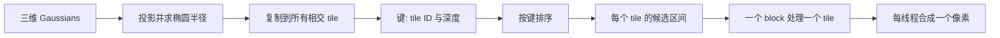

# Gaussian Splatting 渲染

给定相机和一组三维 Gaussian，渲染器要回答：哪些 Gaussian 可能覆盖当前像素、它们按什么顺序混合、怎样避免逐像素遍历全部场景？3DGS 的答案是先把 Gaussian 投影成屏幕椭圆，再建立 tile 列表并进行近似前到后合成。

## 1. 从 3D ellipse 到像素权重

上一节得到投影中心 $\boldsymbol\mu'_i$ 和屏幕协方差 $\boldsymbol\Sigma'_{i}$。透视投影在中心附近经 Jacobian 线性化；Gaussian 经过仿射变换仍是 Gaussian，因此局部可用二维 Gaussian 近似。像素 $\mathbf p$ 处的二维核为

$$
g_i(\mathbf p)=\exp\left[-\frac12
(\mathbf p-\boldsymbol\mu'_i)^\mathsf T
(\boldsymbol\Sigma'_i)^{-1}
(\mathbf p-\boldsymbol\mu'_i)\right],
$$

有效 alpha 是

$$
\alpha_i(\mathbf p)=\operatorname{clamp}
\left(o_i g_i(\mathbf p),0,\alpha_{\max}\right).
$$

实现会以椭圆主轴的若干倍标准差形成有限 bounding box，而不是在无限平面上求值。半径过小、深度非法或完全在视锥外的 Gaussian 会在预处理阶段被剔除。

## 2. 前到后 alpha 合成

对当前像素按深度从近到远排列候选，定义到第 $i$ 个 Gaussian 前仍未被遮挡的透射率

$$
T_i=\prod_{j<i}(1-\alpha_j),
$$

其贡献权重为 $w_i=T_i\alpha_i$。最终颜色

$$
\mathbf C(\mathbf p)=\sum_i w_i\mathbf c_i+T_{N+1}\mathbf C_{bg}.
$$

这和传统 source-over 透明度混合的直觉相同：近处先吸收一部分能量，剩余透射率再交给远处。若 $T$ 已很小，后续 Gaussian 几乎不会改变结果，可以提前终止。

Vulkan 的固定功能 blending 通常在 draw/fragment 顺序下把当前 source 与 attachment 中的 destination 混合；深度测试、排序与 draw 提交由应用和管线共同决定。3DGS CUDA rasterizer 则在一个 tile kernel 内显式遍历已排序 Gaussian，维护 $T$ 并同时累积多个属性，而且要提供 backward。二者可共享 alpha 递推形式，但执行结构、可见性近似和可微要求不同。

同一组 $w_i$ 还能合成深度、法向或 identity feature：

$$
\mathbf F(\mathbf p)=\sum_iw_i\mathbf f_i.
$$

这正是 Gaussian Grouping 渲染 16 维实例特征的基础。但“共用数学权重”不自动意味着实现只运行一个 kernel；是否合并通道取决于 rasterizer 的接口与模板实例化。

## 3. 为什么需要 tile

直接让每个像素检查全部 Gaussian，成本是 $O(HWN)$。3DGS 采用固定大小屏幕 tile：

一个大椭圆会复制到多个 tile 的工作列表。排序键把 tile ID 放高位、深度放低位，使同一 tile 的条目相邻且近似按中心深度排列。prefix sum 用于为这些复制条目分配连续空间；radix sort 后再找出每个 tile 的起止区间。

这种数据结构把全局问题变成局部候选列表，但列表长度仍受屏幕覆盖率影响：Gaussian 数量相同，若许多大 Gaussian 重叠在同一块屏幕区域，成本会明显不同。

## 4. 排序是一种近似

实现通常按 Gaussian 中心的相机深度排序，而不是对每个像素计算椭球与射线的精确交点再排序。同一个倾斜椭球在不同像素的真实前后关系可能不同，多个相交 primitive 也可能无法由单一全序准确表达。因此渲染质量来自可优化表示和高效近似的配合，不是严格的几何可见性求解。

训练可以适应部分近似误差，但不能据此认为深度图一定等于真实表面。若用渲染深度做测量或碰撞，还需明确深度定义（期望、median、最大贡献等）及验证方法。

## 5. 与三角形 rasterization 的异同

| 环节 | 三角形管线 | Gaussian splatting |
| --- | --- | --- |
| primitive | 三角面 | 投影后二维椭圆 |
| 覆盖测试 | edge function / barycentric | Mahalanobis 距离与半径 |
| 可见性 | 深度测试常选最近片元 | 多个有序 alpha 贡献 |
| 属性 | 顶点属性重心插值 | 每 Gaussian 属性按 $w_i$ 合成 |
| 工作组织 | tile-based GPU 内部实现常见 | 显式建立 Gaussian–tile 列表 |
| 可微性 | 普通边界覆盖离散 | 固定候选下对连续参数可导，拓扑变化仍离散 |

二者都把空间 primitive 映射到屏幕局部工作，但不能把 Gaussian conic 当成三角形的简单替换。传统管线的更完整说明见[光栅化：从三角形到片元](../../computer-systems/graphics-gpu/rasterization.md)。

## 6. 公开实现中的具体阈值

课程项目所含 `diff-gaussian-rasterization` 路径可在固定 commit 的 [`forward.cu`](https://github.com/Tiansuanyu/gaussian-grouping-project/blob/23feeef7ded25b2374fbb027d667e91500efd1d0/submodules/diff-gaussian-rasterization/cuda_rasterizer/forward.cu) 与 [`rasterizer_impl.cu`](https://github.com/Tiansuanyu/gaussian-grouping-project/blob/23feeef7ded25b2374fbb027d667e91500efd1d0/submodules/diff-gaussian-rasterization/cuda_rasterizer/rasterizer_impl.cu) 核对：它使用三倍标准差的半径，tile 为 $16\times16$；合成时 alpha 上限为 $0.99$，很小的 alpha 会跳过，透射率足够低时提前结束。

这些数字是该实现的工程选择，不是所有 Gaussian renderer 的理论常数。理解 GPU 数据流可继续读[Gaussian Rasterizer 的 GPU 实现](../../computer-systems/graphics-gpu/gaussian-rasterizer.md)，理解参数怎样从图像误差学习则进入[可微渲染、优化与增密](./differentiable-rendering.md)。
