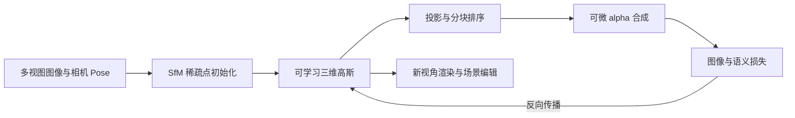

# 3D Gaussian Splatting

这一组笔记回答一个贯穿建图、渲染与语义编辑的问题：如何把多视图图像变成一组可优化的三维高斯，再让它们快速生成新视角图像和实例特征？

3D Gaussian Splatting（3DGS）不是传统三角网格，也不是沿射线密集查询 MLP 的 NeRF。它显式保存许多带位置、形状、透明度和外观的三维高斯，将它们投影为屏幕空间椭圆后进行有序 alpha 合成。这个表示把几何优化、可微渲染和 GPU 光栅化连接到同一条链路。

## 阅读顺序

1. [三维高斯场景表示](./gaussian-representation.md)：一个 Gaussian 存什么，协方差和球谐函数分别表达什么。
2. [Gaussian Splatting 渲染](./gaussian-splatting-rendering.md)：三维椭球怎样投影、分块、排序并合成为像素。
3. [可微渲染、优化与增密](./differentiable-rendering.md)：梯度怎样回到场景参数，clone、split、prune 在解决什么问题。
4. [Gaussian Grouping：从重建到实例分组](./gaussian-grouping.md)：二维 mask 如何监督三维 identity encoding，以及它能支持哪些编辑。
5. [Gaussian Rasterizer 的 GPU 实现](../../computer-systems/graphics-gpu/gaussian-rasterizer.md)：把上述公式落实到 CUDA kernel、tile 列表和 backward。
6. [通道融合、占用率与性能测量](../../computer-systems/graphics-gpu/gpu-kernel-optimization.md)：以课程项目的 gsplat/Native19 改造为案例理解性能结论。

## 与已有笔记的边界

- 相机内外参与 SfM 初始化由[增量式 SfM 与稀疏地图](../hloc/增量式SfM与稀疏地图.md)主讲；本组把 SfM 点当作优化初值。
- 一般地图对象、观测与坐标约定见[地图到底存了什么](../fundamentals/地图到底存了什么.md)；3DGS 的 Gaussian 不是传统 landmark observation track。
- tensor、自动微分与算子图的通用基础见[张量、算子与神经网络计算](../../ai-infra/张量、算子与神经网络计算.md)；这里集中讲渲染算子的领域数学。
- 三角形管线和普通 rasterization 见[从三维场景到最终图像](../../computer-systems/graphics-gpu/graphics-pipeline.md)；Gaussian rasterizer 是另一类屏幕空间覆盖与混合算法。

## 资料层次与固定版本

本组明确区分四层资料：

| 层次 | 本组用法 |
| --- | --- |
| 原始 3DGS | 场景参数化、投影合成、优化与密度控制的算法基础 |
| Gaussian Grouping | 16 维 identity encoding、二维分类监督、三维一致性正则与对象编辑 |
| 上游实现 | `diff-gaussian-rasterization` 与 `gsplat` 的通用光栅化机制 |
| 课程项目 fork | gsplat shared-geometry、Native19 和实测性能案例；不反推成论文结论 |

课程项目源码固定到公开 `dev` commit [`23feeef`](https://github.com/Tiansuanyu/gaussian-grouping-project/tree/23feeef7ded25b2374fbb027d667e91500efd1d0)，gsplat 对照固定到 v1.5.3 commit [`937e299`](https://github.com/nerfstudio-project/gsplat/tree/937e29912570c372bed6747a5c9bf85fed877bae)。函数链接均指向这些版本，避免把分支后续变化混入当前分析。

## 主要参考

- Kerbl et al., [3D Gaussian Splatting for Real-Time Radiance Field Rendering](https://repo-sam.inria.fr/fungraph/3d-gaussian-splatting/), SIGGRAPH 2023
- Ye et al., [Gaussian Grouping: Segment and Edit Anything in 3D Scenes](https://www.ecva.net/papers/eccv_2024/papers_ECCV/papers/04195.pdf), ECCV 2024
- [Gaussian Grouping 官方项目](https://ymq2017.github.io/gaussian-grouping/)
