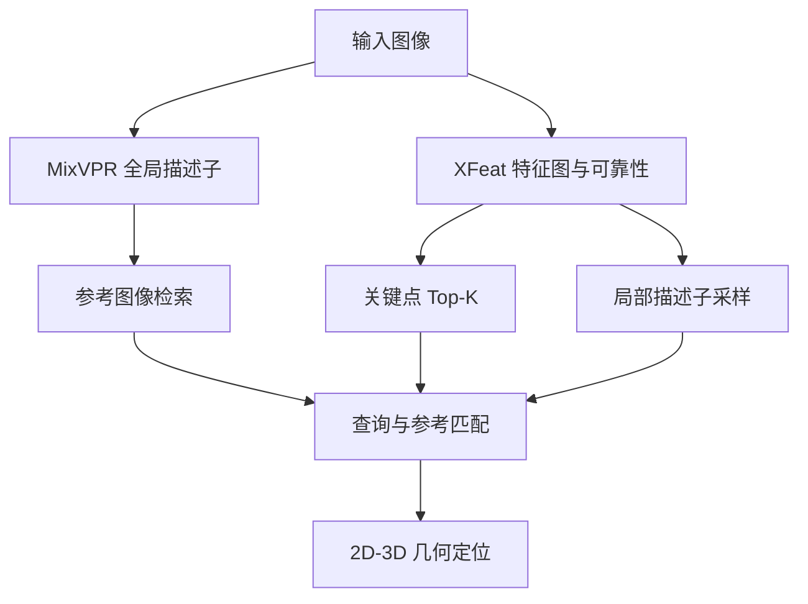
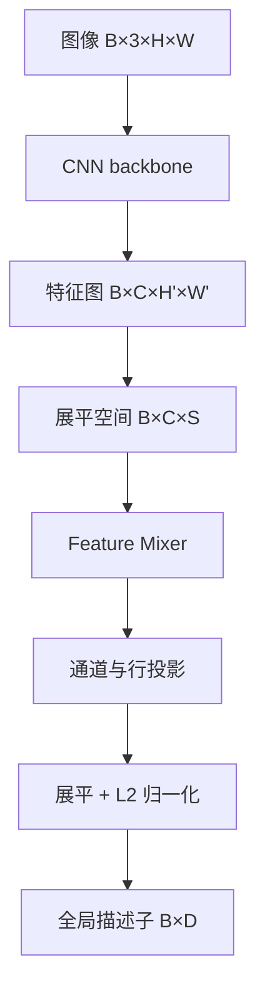
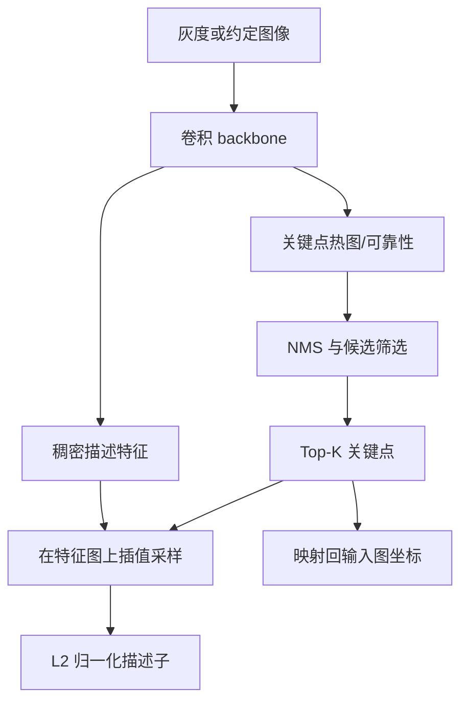

# MixVPR 与 XFeat：从图像到全局、局部描述子

视觉重定位通常先回答“可能在哪里”，再回答“相机的具体位姿是什么”。前一个问题适合用每张图一个向量的**全局描述子**，后一个问题需要带二维位置的**局部关键点与描述子**。MixVPR 和 XFeat 分别是这两类模块的代表，但把它们接到定位系统里，远不只是调用两次 `forward()`。



## 1. 全局描述子和局部描述子不是同一种输出

设图像为 $I\in\mathbb R^{H\times W\times 3}$。全局模型输出

$$
g(I)\in\mathbb R^D,
$$

其中一个向量概括整幅图，常经 L2 归一化后用点积或余弦相似度检索。它适合快速缩小地图范围，但丢掉了大部分空间位置。

局部特征则输出

$$
K=\{(x_i,y_i,s_i,d_i)\}_{i=1}^{N},
$$

其中 $(x_i,y_i)$ 是像素坐标，$s_i$ 是分数，$d_i\in\mathbb R^C$ 是描述子。匹配器输出的是这些行之间的索引关系。若地图还保存了与参考关键点同序的三维点 $X_i$，查询关键点与参考行的匹配才能转成 PnP 所需的 2D–3D 对应。

因此，下列关系是定位接口的一部分，而不是实现细节：

```text
keypoints[i] ↔ scores[i] ↔ descriptors[i] ↔ points3d[i]
```

任何 Top-K、深度过滤、坐标裁剪或无效点删除，都必须对相关数组执行同一组索引操作。

## 2. MixVPR 怎样把特征图聚合成一个向量

MixVPR 使用 CNN backbone 提取二维特征，再用 feature mixer 聚合空间和通道信息。以官方示例中的 $320\times320$ 输入为例，裁剪后的 ResNet-50 backbone 可产生约

$$
F\in\mathbb R^{B\times1024\times20\times20}.
$$

把空间维展平，可写成

$$
F'\in\mathbb R^{B\times C\times S},\qquad S=H'W'.
$$

Mixer 在空间位置之间反复交换信息，随后做通道投影和行投影，最后展平并归一化为全局向量。直观上，它不是只对所有位置做一次平均，而是先让不同空间位置的响应相互组合，再压缩为固定长度表示。



### 2.1 512 维不是把 4096 维截短

官方仓库分别提供不同输出维度的配置与权重。描述子维度由聚合器的输出通道数和输出行数共同决定，例如某个配置满足

$$
D=C_{out}R_{out}.
$$

换成 512 维模型意味着使用与该结构对应的投影层和训练权重，不是运行 4096 维模型后取前 512 个数。直接截断会改变向量的统计分布，也没有训练目标保证它仍是好的检索表示。

输出从 4096 维降到 512 维，通常会降低描述子存储、相似度计算和索引带宽；却不意味着 backbone 也缩小八倍。若 CNN backbone 与输入尺寸不变，前半段的大部分计算仍然存在。性能判断必须分别测量 backbone、聚合头、检索和内存占用。

### 2.2 检索契约

部署 MixVPR 时至少固定：

- 权重与结构标识；
- 输入尺寸、颜色顺序、缩放和 normalization；
- resize 是拉伸、等比例缩放还是 padding；
- 输出维度、dtype，以及是否已经 L2 归一化；
- 参考库是否由完全相同的契约生成。

只替换查询侧模型而沿用不兼容的地图向量，会让“相似度”失去原来的意义。模型版本和参考索引必须作为一个整体管理。

## 3. XFeat 怎样产生稀疏局部特征

XFeat 的目标是用轻量 CNN 同时形成稠密描述信息和关键点可靠性，再从中选出有限数量的稀疏特征。概念流程如下：



这里应区分神经网络 forward 和稀疏后处理：

1. forward 生成特征图、分数或可靠性；
2. NMS 抑制相邻重复响应；
3. Top-K 选择候选点；
4. 按关键点位置在描述子图上采样，常涉及双线性插值；
5. 描述子归一化；
6. 将特征图坐标映射回模型输入或原始图像坐标。

不同实现即使使用相同权重，也可能因为 NMS 半径、Top-K 前后的过滤顺序、插值选项、`align_corners`、padding 或坐标缩放不同而产生不同关键点和描述子。

### 3.1 坐标到底属于哪张图

若原图是 $W\times H$，模型输入是 $W_m\times H_m$，简单拉伸下可写成

$$
x= x_m\frac{W}{W_m},\qquad
y= y_m\frac{H}{H_m}.
$$

但使用等比例缩放和 padding 时，还必须先减去 padding，再除以缩放因子。若图像先做了畸变校正，关键点属于校正图；它不能直接拿去查询原始畸变相机模型。定位系统应明确：

- 输入是原图还是校正图；
- 坐标约定是像素中心还是像素边界；
- resize/padding 参数；
- 输出是否已经映射回目标图像坐标。

### 3.2 稀疏点和三维地图的关系

局部网络只给二维点和描述子，并不会自动给出地图三维点。三维来源可能是双目、RGB-D、SfM 或多视图三角化。无论来源如何，保存地图时都要形成同序记录：

```text
reference keypoint ─ descriptor ─ valid 3D point ─ observation metadata
```

旧地图里某种特征的三维点，不能直接当成新特征的三维点。即使两个关键点看起来很接近，它们的行号、像素位置和深度有效性也没有自动对应关系。要么用新特征重新生成关联，要么设计经过验证的转换过程。

## 4. 从模型张量到定位结果的验证阶梯

只比较神经网络输出误差不够。建议逐层验证：

| 层级 | 需要比较什么 | 典型失败 |
| --- | --- | --- |
| 预处理 | 实际输入像素、布局、dtype | RGB/BGR、重复 normalization |
| 全局输出 | norm、cosine、候选排序 | 向量接近但近邻次序翻转 |
| 局部输出 | 点数、坐标、score、描述子 | padding 回映或插值差异 |
| 匹配 | 索引、互选、阈值附近样本 | 行顺序错位、并列值差异 |
| 几何 | 有效 2D–3D、内点、位姿 | 三维缺失或空间分布差 |
| 系统 | 接受、时效与状态更新 | 正确结果过期或未被采纳 |

这也是为什么“模型能跑”与“视觉定位链成立”是两个不同结论。

## 5. 权重和公开来源

- MixVPR 的论文、结构、示例配置和不同维度权重见[官方仓库固定提交 `4043915`](https://github.com/amaralibey/MixVPR/tree/4043915cef24818003ece1a8112bc8a24e69abe0)与[WACV 2023 论文](https://openaccess.thecvf.com/content/WACV2023/html/Ali-bey_MixVPR_Feature_Mixing_for_Visual_Place_Recognition_WACV_2023_paper.html)。实际工程应固定 commit、配置和权重哈希。该固定提交未在根目录明确给出许可证时，不应自行假定代码或权重可重新分发。
- XFeat 的模型、权重与使用入口见[官方仓库固定版本](https://github.com/verlab/accelerated_features/tree/e92685f57f8318b18725c5c8c0bd28c7fe188d9a)和[CVPR 2024 论文](https://openaccess.thecvf.com/content/CVPR2024/html/Potje_XFeat_Accelerated_Features_for_Lightweight_Image_Matching_CVPR_2024_paper.html)。仓库采用 Apache-2.0；发布制品时仍应记录权重来源与哈希，而不是复制一个无来源文件。

进一步阅读：[从 MNN 到 LightGlue 与 LighterGlue](./从MNN到LightGlue与LighterGlue.md)、[从图像对应到相机位姿](./从图像对应到相机位姿.md)、[视觉定位的 CPU、GPU 与 NPU 分工](../../robotics-systems/deployment/视觉定位的CPU、GPU与NPU分工.md)。
