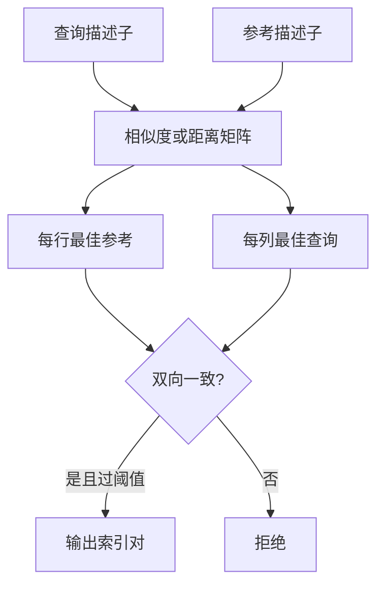
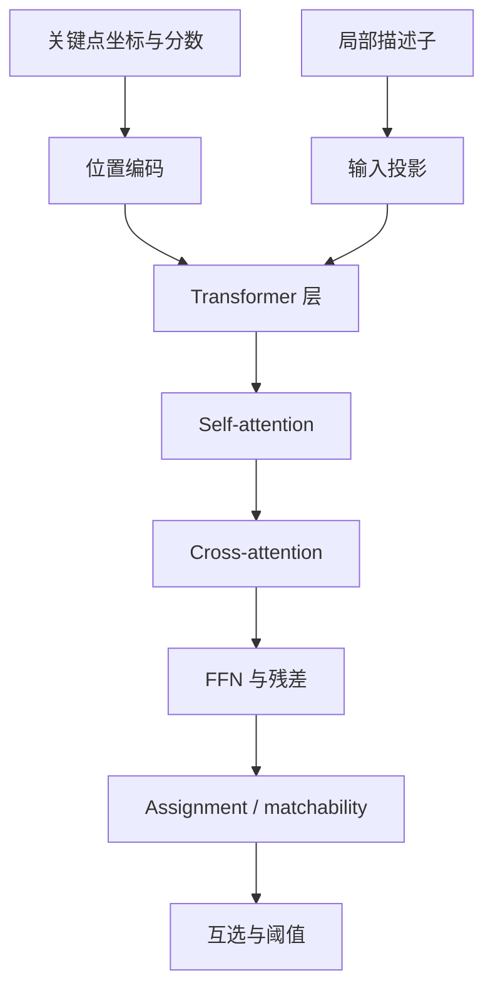

# 从 MNN 到 LightGlue 与 LighterGlue

局部匹配的输入不是两张原图，而通常是两组关键点、分数和描述子。简单的 MNN 用描述子距离直接建立对应；LightGlue 一类模型则让两幅图的特征通过 attention 交换上下文，再估计匹配和置信度。后者可能解决重复纹理和外观变化下的歧义，却也引入了与点数相关的计算、动态控制流和更复杂的部署契约。

> 本文的 **MNN** 指 mutual nearest neighbor（双向最近邻）匹配，不是 Alibaba 的 MNN 神经网络推理框架。

## 1. MNN：简单不等于没有语义条件

对查询描述子 $q_i$ 和参考描述子 $r_j$，先计算相似度矩阵

$$
S_{ij}=q_i^{\mathsf T}r_j.
$$

若两侧描述子都经过 L2 归一化，则

$$
\lVert q_i-r_j\rVert_2^2
=\lVert q_i\rVert_2^2+\lVert r_j\rVert_2^2-2q_i^{\mathsf T}r_j
=2-2q_i^{\mathsf T}r_j.
$$

所以在这些条件下，最大 cosine/dot-product 与最小平方 L2 距离具有相同排序。`NORM_L2SQR` 还能避免为每个候选计算平方根，因为平方根是单调函数，不改变最近邻排序。

上述等价需要同时满足：

- 所有参与比较的描述子确实归一化；
- 比较的是同一候选集合；
- 阈值在 cosine 与 L2 空间中正确换算；
- dtype、有限值和数值误差没有改变并列或近并列结果；
- 后处理规则相同。

MNN 接受一对 $(i,j)$ 的条件是：$j$ 是 $q_i$ 的最近邻，并且 $i$ 也是 $r_j$ 的最近邻。

### 1.1 cross-check、阈值和并列值

OpenCV BFMatcher 的 `crossCheck=true` 表达的是互为最佳这一类约束，但它是否与某个“exact cosine MNN”实现完全相同，还取决于 norm、归一化、阈值和并列值处理。只比较匹配数量无法证明等价，应比较具体索引对和阈值附近样本。

并列最大值尤其容易被忽略：不同 `argmax` 实现可能选择第一个、最后一个或并行归约中先到的索引。FP16 或不同累加顺序也可能让近并列项交换顺序。工程契约若要求复现，应该显式规定 tie-breaking；若只要求任务等价，则还要继续比较 PnP 与最终接受。

## 2. 为什么要让特征“看见”彼此

MNN 独立比较每对描述子，不知道一组特征的整体上下文。重复窗格、相似纹理和外观变化可能使单点描述子产生歧义。Attention matcher 让一个点结合本图和另一图的其他点重新编码，从而利用上下文消除部分歧义。

这里的 attention/Transformer 是在**特征序列**上工作；XFeat 的 CNN 则从图像生成特征。两者不是同一个网络阶段。基础公式见 [Attention、KVCache 与高效计算](../../ai-infra/Attention、KVCache与高效计算.md)。

## 3. LightGlue 的主要组成

LightGlue 接收两侧关键点和描述子，主要包含：

1. **输入投影**：把特征描述子映射到 matcher 的内部维度；
2. **位置编码**：把归一化后的关键点坐标等几何信息编码进特征；
3. **self-attention**：同一图像内的点交换上下文；
4. **cross-attention**：两幅图之间交换信息；
5. **FFN、残差与归一化**：更新每个 token 的表示；
6. **assignment 和 matchability**：形成匹配分数，并判断哪些点适合匹配；
7. **互选与阈值**：输出离散索引对。

LightGlue 还可使用深度提前退出和宽度剪枝，让容易的图像对少算一些层或 token。这些机制会让运行时间随输入内容变化。导出到偏好静态图的后端时，常见选择是关闭动态控制、固定层数和点数，但这已经改变了执行行为，必须用可靠后端先测算法损失，再评估目标后端损失。

## 4. XFeat-LighterGlue 是什么

XFeat 官方仓库在固定 commit `e92685f...` 中提供的 `modules/lighterglue.py` 是面向 XFeat 描述子的适配 matcher。该配置的关键点包括：

- 输入描述子维度为 64；
- matcher 内部描述子维度为 96；
- 6 层、1 个 attention head；
- 使用独立的 `xfeat-lighterglue.pt` 权重；
- 默认关闭 depth early stopping，保留宽度相关配置与匹配阈值。

这些值应以[固定版本源码](https://github.com/verlab/accelerated_features/blob/e92685f57f8318b18725c5c8c0bd28c7fe188d9a/modules/lighterglue.py)为准，而不是靠模型名字猜测。

因此，XFeat-LighterGlue：

- 是 attention matcher，不是从图像提特征的 CNN；
- 不是把通用 LightGlue 权重简单截短；
- 需要与 XFeat 描述子维度和对应权重配套；
- 其匹配输出仍要进入几何验证，不能把网络分数直接当成位姿正确。

LightGlue 的通用设计见[官方仓库](https://github.com/cvg/LightGlue)与[ICCV 2023 论文](https://openaccess.thecvf.com/content/ICCV2023/html/Lindenberger_LightGlue_Local_Feature_Matching_at_Light_Speed_ICCV_2023_paper.html)。XFeat 仓库及其发布权重采用 Apache-2.0，部署时仍应固定具体 commit 和权重哈希。

## 5. 为什么更少的匹配也可能有更好的几何支持

PnP 并不奖励“匹配越多越好”，它需要足够多、分布合理且几何一致的 2D–3D 对应。一个 attention matcher 可能：

- 去掉描述子看似接近、但上下文不一致的错误对应；
- 在重复纹理中保留更可靠的一对一关系；
- 让内点分布覆盖图像更多区域。

于是总匹配数减少，RANSAC 的有效内点率却可能提高，PnP 有机会更快或更稳。但这不意味着完整链必然更快：matcher 本身的 attention 计算、内存流量和同步，可能远大于节省的几何时间。

完整收益应该写成任务级差分：

$$
\Delta T_{pipeline}
=\Delta T_{matcher}+\Delta T_{geometry}+\Delta T_{queue}+\Delta T_{system}.
$$

不能只拿 matcher 探针或 PnP 局部耗时推断整条定位链。

## 6. 部署时怎样把算法损失与后端损失分开

建立三层参考：

| 层级 | 目的 |
| --- | --- |
| 官方算法、官方配置、可靠后端 | 定义算法参考 |
| 计划部署的点数/层数/mask 配置，仍在可靠后端 | 测算法变体损失 |
| 完全相同变体运行在目标后端 | 测导出、编译和 runtime 损失 |

必须保证第二、三层的点数、排序、padding、mask、层数、阈值和后处理一致，才可以把差异归到后端。若同时从 1024 点改到 512 点、关闭剪枝、换 FP16 并改写索引，最终差异没有单一归因。

检查顺序应同时覆盖连续值和离散决定：

1. 输入描述子与坐标 normalization；
2. projection、位置编码、Q/K/V；
3. attention、softmax 轴和 mask；
4. FFN、残差与 LayerNorm；
5. assignment 和 matchability；
6. `argmax`、Gather、mutual check 和阈值；
7. 匹配索引、2D–3D、PnP 与位姿接受。

当首次明显分歧出现时，把该算子输出临时替换成可靠参考。如果下游匹配恢复，就得到了比“这一层误差很大”更强的因果证据。详细方法见[从 PyTorch 到 ONNX 与 RKNN](../../robotics-systems/deployment/从PyTorch到ONNX与RKNN.md)。

## 7. 怎样选择 MNN 或 learned matcher

| 情况 | MNN 更有吸引力 | learned matcher 更值得验证 |
| --- | --- | --- |
| 描述子区分度与几何验证已足够 | 实现小、延迟稳定 | 额外上下文收益可能有限 |
| 重复纹理或外观变化明显 | 容易受单点歧义影响 | 可能改善对应质量与覆盖 |
| 端侧预算紧、点数不大 | 成熟 CPU 归约常很高效 | attention 和内存代价需实测 |
| 后端偏好静态图 | 很容易表达 | 动态点数、剪枝和 mask 增加适配成本 |
| 故障回退要求明确 | 可作为简单、可诊断基线 | 应保留显式超时与不静默 fallback |

最终选择不应只看“官方匹配集合召回”。固定查询机会下比较新增/丢失的正确位姿和误接受，再在连续输入中比较及时正确覆盖、资源争用和结果年龄，才是面向机器人系统的结论。

进一步阅读：[MixVPR 与 XFeat](./MixVPR与XFeat：从图像到全局、局部描述子.md)、[LighterGlue 端侧优化实践](../../robotics-systems/deployment/LighterGlue端侧优化实践.md)、[端侧效果与性能怎样测才可信](../../robotics-systems/deployment/端侧效果与性能怎样测才可信.md)。
