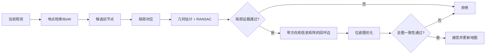

# 回环检测与位姿图优化

回环检测回答“当前是否回到了曾经到过的地点”，位姿图优化回答“若新增这条跨时约束，整张轨迹怎样重新满足所有相对测量”。二者紧密连接，却不是一个模块：地点识别只能提出候选，几何验证才能估计约束，图优化再检验并分配全局修正。

## 1. 为什么里程计需要回环

相邻运动测量不断复合：

$$
T_{W\leftarrow B_k}
=T_{W\leftarrow B_0}
\prod_{i=1}^{k}T_{B_{i-1}\leftarrow B_i}.
$$

每一步的小偏差会累积。再次到达旧地点时，回环边连接远隔很久的节点，给漂移提供全局约束。它并不会证明旧地图本身准确，只是在给定测量模型下提高图的一致性。

## 2. 从地点候选到可用约束

一个可靠系统至少区分四类证据：

1. **外观证据**：两个地点看起来相似；
2. **对应证据**：局部特征或几何结构能建立对应；
3. **相对变换证据**：PnP、两视图或 ICP 能估计变换；
4. **图一致性证据**：新边不与已有运动和其他闭环产生不可接受的冲突。

重复走廊可能同时通过前三层，错误关联仍能形成低残差几何模型。因此全局一致性有价值，但若旧图中已有共同错误，也不能把它当作独立真值。

## 3. 地点概率为何需要时间先验

只按当前图像相似度排序，候选会在相似房间间跳动。Bayes filter 可将观测 likelihood 与前一时刻地点分布结合：

$$
p(L_t\mid z_{1:t})\propto
p(z_t\mid L_t)
\sum_{L_{t-1}}p(L_t\mid L_{t-1})p(L_{t-1}\mid z_{1:t-1}).
$$

转移模型表达地点随运动通常连续，虚拟地点表示“不属于已知地点”。这能抑制孤立的外观高分，却依赖运动和转移假设；绑架式跳转或长时间丢失时，过强时间先验也会延迟恢复。

RTAB-Map 的具体 likelihood、posterior 和记忆召回见[定位与重定位流程](../rtabmap/定位与重定位流程.md)。

## 4. 位姿图的目标函数

设节点 Pose 为 $T_i$，边测得相对变换 $Z_{ij}$。一种常见残差是

$$
r_{ij}=\operatorname{Log}
\left(Z_{ij}^{-1}T_i^{-1}T_j\right),
$$

优化目标为

$$
\min_{\{T_i\}}
\sum_{(i,j)\in\mathcal E}
\rho\left(r_{ij}^{\mathsf T}\Omega_{ij}r_{ij}\right).
$$

$\Omega_{ij}$ 是信息矩阵，$\rho$ 是可选鲁棒核。坐标约定也可以使用相反方向，但 $Z_{ij}$、预测相对变换和残差必须一致。

整张图通常存在全局规范自由度，需要固定一个节点或加入先验。有限方差的 prior 仍允许变量小幅调整；只有求解器明确把变量设为常量，才是严格固定。

## 5. 优化“收敛”不等于回环正确

优化器报告收敛，只表示在其目标与初值下找到一个停止点。还应检查：

- 新回环边和原有里程计边的白化残差；
- 加边前后轨迹是否出现不合理折叠；
- 最大误差是否集中在新边或把冲突推给其他边；
- 多个独立回环是否支持同一拓扑解释；
- 移除该边后结论是否显著改变。

“误差/标准差 ratio”是归一化残差，不是米或像素。它的可解释性依赖边协方差是否校准；把所有边都设得很松会让 ratio 变小，却不会让地图更准确。

## 6. 鲁棒核和可切换约束能做什么

鲁棒核降低大残差边的影响；switchable constraints、动态协方差缩放等方法允许优化器弱化可疑回环。它们提高容错性，但不能凭空辨别两个都高度自洽的重复结构候选。

对于离散多峰歧义，更可靠的策略包括：保留多个候选、利用时序或其他传感器、延迟冻结，以及在独立数据上验证。单个候选附近的协方差描述不了“另一个房间也成立”。

## 7. 回环、重定位和跟踪恢复

- **回环**通常发生在同一持续运行的图中，新增旧节点与当前节点之间的约束；
- **重定位**强调当前状态未知，需要恢复到已有地图坐标；
- **跟踪恢复**还要把一次全局 Pose 安全地交给连续估计器。

算法上可能复用相同地点识别和几何模块，但状态语义不同。回环发生在已有连续图中，重定位则要先恢复当前观测与既有地图的关系。

## 8. 阅读实现时的检查顺序

1. 候选集合来自全局检索、空间邻近还是时间窗口？
2. 地点分数是相似度、likelihood、posterior 还是校准概率？
3. 相对变换由 PnP、两视图、ICP 还是组合注册给出？
4. 边方向、信息矩阵和鲁棒模型怎样定义？
5. 谁最终接受边，失败时是否真正撤销？
6. 优化后哪个 frame 被修正，输出怎样传给下游？

图优化的数值基础见[状态估计与不确定性](./状态估计与不确定性.md)，图像候选和局部对应见[视觉地点识别与图像匹配](./视觉地点识别与图像匹配.md)。
