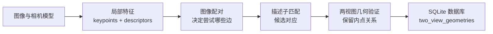
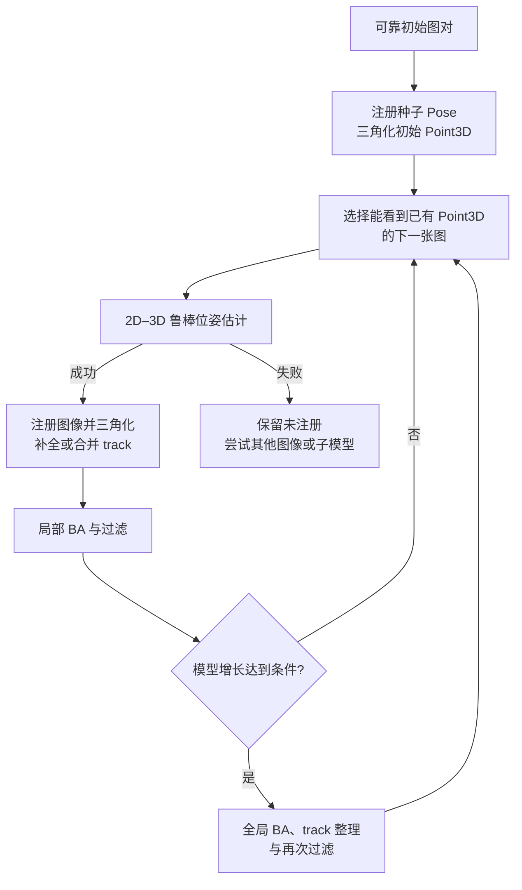

# 增量式 SfM 与稀疏地图

一组图像有很多局部匹配，怎样变成带相机位姿、三维点和观测关系的地图？增量式 SfM 的核心并不是“一次求解所有未知量”，而是先从可靠的两视图种子建立小模型，再反复注册新图像、三角化新结构并优化已有模型。

本文以 COLMAP 公开实现为具体例子。投影、E/F/H、三角化、PnP 与 BA 的数学原理由[从图像对应到相机位姿](../fundamentals/从图像对应到相机位姿.md)主讲；observation、track 和 landmark 的通用语义见[地图到底存了什么](../fundamentals/地图到底存了什么.md)。这里重点解释它们怎样连成一条重建流水线。

## 1. SfM 的输入和输出

典型输入是一组观察同一静态场景、具有足够视角重叠的图像。图像可以按时间采集，也可以来自无序照片集；时间相邻不自动表示视觉重叠，无序也不表示必须穷举全部图对。

输出至少包含：

- 相机模型与内参；
- 成功注册图像的外参；
- 多视图三维点及其 observation track；
- 哪个图像二维点关联到哪个 Point3D；
- 重投影误差等模型内质量信息。

对普通单目图像集，如果没有已知基线、控制点、可靠位置先验或其他米制约束，重建只确定到一个全局相似变换。模型内部距离一致不表示单位天然是米，也没有天然的重力方向和地理原点。

## 2. 先分清数据库和稀疏重建

COLMAP 的 SQLite 数据库与最终稀疏模型承担不同职责。

| 层 | 主要内容 | 尚未说明什么 |
| --- | --- | --- |
| 数据库 | rigs、cameras、frames、images、keypoints、descriptors、matches、two-view geometries | 某张图已经注册、某个 observation 已成为稳定三维点 |
| `Reconstruction` | 已注册 frame/image 的 Pose、相机、Point2D—Point3D 关联、Point3D、track | 地图与真实世界的绝对尺度、朝向和精度已经得到独立验证 |

原始 `matches` 是描述子匹配；经过几何验证的内点和两视图模型在 `two_view_geometries`。所核对版本的增量重建使用后者构造 correspondence graph，而不是把所有原始匹配直接当作真实同名点。

数据库和稀疏模型中的 `image_id`、`camera_id`、`point3D_id` 是身份标识，不应假设连续，也不能当作数组行号。重跑特征、配对或重建后，Point3D ID 也没有跨版本稳定语义。

## 3. 从图像到两视图关系

COLMAP 的前端可概括为三步：

1. 为图像建立相机身份并提取局部关键点和描述子；
2. 依据数据规模和先验选择待匹配图对；
3. 对描述子匹配做两视图几何验证，保存内点关系和相应几何模型。

穷举匹配适合较小集合；顺序、空间、词汇树或显式 pairs 可以减少大集合的候选规模。配对策略决定哪些潜在 track 有机会出现：漏掉真正重叠图对会割裂模型，加入大量无关图对则增加计算和误匹配风险。

几何验证通过也只说明某个两视图模型解释了一组对应。纯旋转、近似平面、重复纹理和低视差仍可能让初始化或后续三角化不可靠。

## 4. 用一对图像播种模型

空模型还没有三维点，无法直接用 2D–3D PnP 注册第一张图。增量式 SfM 先选择一对具有足够可靠对应和视差的图像，估计两者相对位姿，将第一相机设为规范坐标，再三角化初始 Point3D。

种子图对需要同时平衡：

- 对应数量和空间覆盖；
- 两视图几何是否稳定；
- 三角化角是否足以恢复深度；
- 正深度、重投影和内参是否合理。

匹配最多的图对不一定是最好种子。连续视频中几乎相同的两帧可能匹配很多，却因基线太小而产生病态深度；相隔太远的两帧又可能缺少足够可靠对应。

初始对定义的是重建的坐标规范，不是测得了绝对世界。所核对的 `IncrementalPipeline::InitializeReconstruction()` 在注册初始对并三角化后，会执行一次全局 BA、规范化和过滤，再判断模型是否足以继续增长。

## 5. 注册下一张图像：从 2D–2D 变成 2D–3D

已有模型以后，新图像可沿 correspondence graph 找到它与已注册图像的二维对应；若对端 observation 已关联 Point3D，便形成新图像二维点到地图三维点的对应：

$$
p_k \longleftrightarrow P_{W,j}.
$$

系统据此做鲁棒绝对位姿估计和精化。采用 COLMAP 的 world-to-camera 方向，可写为

$$
P_C=R_{C\leftarrow W}P_W+t_{C\leftarrow W},
\qquad p\sim\pi(P_C).
$$

相机中心在世界中是

$$
C_W=-R_{C\leftarrow W}^{\mathsf T}t_{C\leftarrow W}.
$$

因此模型文件里的平移不是可直接绘制的相机世界坐标。导入其他系统前必须核对它需要 `cam_from_world` 还是 `world_from_cam`。

`IncrementalMapper::RegisterNextImage()` 会先检查可见 Point3D 支持，再建立 2D–3D 对应并估计 Pose。当前源码还具有面向 rig 的广义相机注册，以及可选的 structure-less resection fallback；这些是所核对开发版本的实现能力，不是理解经典增量式 SfM 主线所必需的假设。

## 6. 三角化、补全与合并 track

新图像注册后，它与已有注册图像之间尚未建点的对应可以被三角化；已有短 track 也可能因新 observation 得到补全，代表同一实体的兼容 track 可以合并。

一个 COLMAP Point3D 不是只有 XYZ。它还保存颜色、平均重投影误差和由 `(image_id, point2D_idx)` 组成的 track。图像侧 Point2D 又保存反向的 Point3D 关联。这个双向关系正是后续定位把 Reference 二维匹配接到三维点的关键。

三角化有效通常要求：

- 相机 Pose 与内参在当前精度下可用；
- 对应来自同一静态实体；
- 射线具有足够夹角；
- 点在相关相机前方；
- 多视图重投影一致。

长 track 和低重投影误差是有用证据，但都不是独立真值。错误相机和错误点可能共同达到局部自洽，重复结构也可能形成错误但一致的关联。

## 7. 为什么注册后还要反复 BA

每次新图像注册都会带入新的 Pose、观测和三维点。如果只把早期估计冻结，误差会沿增量顺序累积。BA 联合调整相机参数和三维结构：

$$
\min_{\{T_i\},\{P_j\},\theta}
\sum_{(i,j)\in\mathcal O}
\rho\!\left(
\left\|z_{ij}-\pi(T_i,P_j;\theta)\right\|^2
\right),
$$

其中 $\theta$ 表示被允许优化的内参，$\mathcal O$ 是实际 observation 集。哪些 Pose、点和内参可变是实验定义的一部分；“运行过 BA”并不说明全部变量都被优化。

COLMAP 的增量流水线在注册新图像后执行局部精化，并在模型增长达到条件时执行全局精化；两者之间还穿插 track 补全、合并和异常 observation/Point3D 过滤。局部 BA 限制计算规模，全局 BA 减少较大范围的一致性误差，但优化收敛仍不能证明模型对应了正确物理结构。

## 8. 输出模型怎样表达地图

现代 COLMAP 稀疏模型可以包含 `rigs`、`cameras`、`frames`、`images` 和 `points3D` 的二进制或文本表示。单相机旧模型可能没有显式 rig/frame 文件，读取工具需要处理版本兼容。

| 对象 | 关键语义 |
| --- | --- |
| camera | 投影模型、宽高和共享内参；多张 image 可引用同一 camera |
| rig | 多传感器装配及相对关系 |
| frame | 某一时刻 rig 的一次实例，可包含一个或多个传感器数据 |
| image | 图像身份、camera/frame 关联和二维点；Pose 来自所属 frame 与传感器变换 |
| Point3D | 世界坐标、颜色、误差与 observation track |

`images.txt` 的二维点中，未三角化 observation 的 Point3D ID 为无效值；它仍是已提取的图像点，但不是地图 landmark。反过来，`points3D.txt` 的 track 索引到具体图像的 `point2D_idx`，这个索引必须与当前特征版本一致。

不要只复制 `points3D.bin` 便称为完整视觉定位地图。HLoc 一类定位流程还需要 Reference 图像身份、二维观测关联、局部特征以及检索/配对信息，才能从 Query 匹配走到 2D–3D PnP。

## 9. 怎样判断一次重建是否可用

重建成功不应只看“生成了点云”。至少分层检查：

| 层级 | 可检查内容 | 仍不能单独证明 |
| --- | --- | --- |
| 注册覆盖 | 注册图像数、未注册图像、是否碎成多个子模型 | 已注册图像 Pose 全部正确 |
| 连接结构 | 图对内点、共视连通性、track 长度与覆盖 | 没有重复结构误关联 |
| 三维几何 | 正深度、三角化角、点云空间分布 | 具有真实尺度和绝对方向 |
| 投影一致性 | 重投影误差分布、异常相机和异常点 | 模型接近独立真值 |
| 外部验证 | 控制点、可靠轨迹、已知距离、留出图像定位 | 所有未观测区域也准确 |

只报告均值容易掩盖局部坏区，应查看分位数、空间分区和具体失败图像。若把模型用于定位，还要在不参与建图的 Query 上检查 2D–3D 支持、PnP 成功率、错误接受和空间覆盖。

配对、相机模型、图像缩放、特征版本和 BA 配置都应随地图冻结。重新提取特征时，官方文档特别提醒：已有 `two_view_geometries` 可能导致匹配步骤跳过旧图对；因此不能仅修改 matcher 名称就假设数据库已全部重算。

## 10. 与 OpenVINS、HLoc 和 RTAB-Map 的关系

| 系统 | 主要输入组织 | 核心状态/地图 | 典型任务 |
| --- | --- | --- | --- |
| COLMAP | 可离线组织的重叠图像集合 | 已注册图像、相机、Point3D 和 track | 多视图稀疏重建 |
| [OpenVINS](../rtabmap/OpenVINS状态传播与视觉更新.md) | 连续时间相机 + IMU | 有界 clone 窗口、IMU 状态与少量可选 landmarks | 连续局部 VIO |
| [HLoc](./) | Query + 固定 Reference 地图 | COLMAP/pycolmap 模型及检索、局部特征缓存 | 已知地图中的绝对重定位 |
| [RTAB-Map](../rtabmap/) | 在线传感器流与 odometry | Signature、记忆层级、约束图与地图产品 | 在线建图、定位和回环维护 |

COLMAP 和 HLoc 最容易混淆：前者主要回答“Reference 稀疏地图怎样从多视图建立”，后者主要回答“新 Query 怎样在既有地图中定位”。HLoc 通常先检索候选 Reference，再把局部匹配沿 Reference observation 接到 Point3D，最后估计 Query Pose；这不会在每次 Query 到来时重新运行完整增量式 SfM，也不会默认修改 Reference 地图。

OpenVINS 则通过 IMU 传播和短期视觉轨迹递推连续状态。它可以在运动中提供局部里程计，但核心估计器不维护 COLMAP 式长期可检索重建。两者即便观察同一环境，坐标自由度、尺度来源、时间语义和状态生命周期也不同。

RTAB-Map 更关注在线节点、记忆迁移、回环约束和地图更新。它可以保存局部视觉/深度几何，但这不等于将 COLMAP 的离线全局 Point3D/track 数据结构原样搬进在线系统。

## 11. 固定源码与格式入口

以下入口固定到本专题核对的 commit，正文用类和函数名说明职责，不以浮动行号作为依据：

- [`incremental_pipeline.cc`](https://github.com/colmap/colmap/blob/b16ff739eb5753cf61966f22089975f7e5a57a9b/src/colmap/controllers/incremental_pipeline.cc)：初始对、增量注册、局部/全局精化和多子模型控制；
- [`incremental_mapper.h`](https://github.com/colmap/colmap/blob/b16ff739eb5753cf61966f22089975f7e5a57a9b/src/colmap/sfm/incremental_mapper.h)：`FindInitialImagePair()`、`RegisterNextImage()`、三角化、track 整理和 BA 接口；
- [`incremental_mapper.cc`](https://github.com/colmap/colmap/blob/b16ff739eb5753cf61966f22089975f7e5a57a9b/src/colmap/sfm/incremental_mapper.cc)：2D–3D 对应建立、绝对位姿注册与精化实现；
- [`reconstruction.h`](https://github.com/colmap/colmap/blob/b16ff739eb5753cf61966f22089975f7e5a57a9b/src/colmap/scene/reconstruction.h)：相机、frame、image、Point3D 与 track 的顶层容器；
- [数据库格式](https://colmap.github.io/database.html)：特征、匹配和两视图几何的 SQLite 关系；
- [稀疏模型格式](https://colmap.github.io/format.html)：Pose 方向、模型对象和 ID/索引约定；
- [官方 SfM 教程](https://colmap.github.io/tutorial.html#structure-from-motion)：前端、增量重建和采集条件。

HLoc 如何消费这类地图见[如何选择视觉重定位 Pipeline](./如何选择视觉重定位Pipeline.md)；在线 VIO 的滤波链见[OpenVINS：状态传播与视觉更新](../rtabmap/OpenVINS状态传播与视觉更新.md)。
