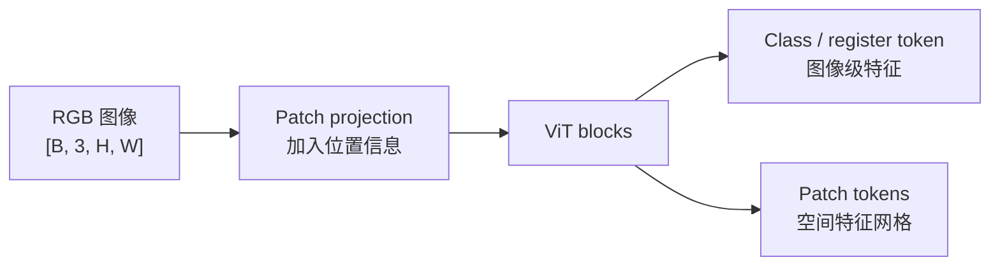

# DINOv2 与视觉基础特征

DINOv2 首先是图像编码器：它把图像变成可迁移的全局与 patch 表示。它本身不直接输出相机 Pose、度量深度或三维地图；这些产物需要下游头、匹配或几何链。

本文核对 [DINOv2 原论文](https://arxiv.org/abs/2304.07193)与官方仓库 commit [`7764ea0`](https://github.com/facebookresearch/dinov2/tree/7764ea0f912e53c92e82eb78a2a1631e92725fc8)（核对日期 2026-10-17）。

## 1. 输入和输出是什么

ViT 将图像切为 patch，投影后输入 Transformer。以 patch 边长 14、输入 $518\times518$ 为例，每边 37 个 patch，共 1369 个 patch token。若隐藏宽度为 $D$，局部特征形状近似为 $[B,1369,D]$；class token 或聚合后的 $[B,D]$ 可作为图像级表示。

精确输入尺寸、register token 和返回层由模型变体/API 决定。通用 shape 与 attention 推导见[张量、算子与神经网络计算](../../ai-infra/张量、算子与神经网络计算.md)和 [Transformer 与 Vision Transformer（ViT）](../../ai-infra/Transformer与VisionTransformer（ViT）.md)。

## 2. 自监督教师—学生为何能学习表示

DINOv2 继承判别式自监督与 iBOT 的思路，让同一图像不同裁剪/遮挡视图的学生输出匹配教师目标，同时学习图像级和 patch 级表示。教师参数通过学生参数的指数移动平均（EMA）更新，而不是由标签直接训练：

$$
\theta_{teacher}\leftarrow m\theta_{teacher}+(1-m)\theta_{student}.
$$

论文还组合 masked image modeling、KoLeo regularization、数据整理和大规模训练稳定化。小模型可由冻结的大 ViT-g 蒸馏，而不是简单从头缩小训练。EMA 教师、自蒸馏和模型蒸馏是训练机制，不表示每个输出 token 都有几何监督。

## 3. 全局与局部表示怎样使用

图像检索可对全局向量做余弦相似度：

$$
s(I_a,I_b)=\frac{f_a^\top f_b}{\|f_a\|\|f_b\|}.
$$

patch 特征保留粗网格位置，可用于密集分类、分割或 patch 间相似度。假设两个 $37\times37$ 网格得到归一化特征 $F_a,F_b$，相似度矩阵 $F_aF_b^\top$ 只给出表观近邻；要成为几何对应，还需处理尺度、亚像素位置、互检、重复纹理和相机模型。

因此必须区分：骨干特征是可复用表示；检索描述子需要聚合与任务验证；局部匹配需要位置和对应策略；语义标签需要分类/分割头；深度或 Pose 需要几何预测头或显式求解器。

## 4. 与定位和地图的连接

DINOv2 特征可作为检索、分割或多视图模型的初始化/输入，但强语义相似性可能让同类物体或相似房间更接近。特征相似不能替代 PnP/RANSAC 与跨帧验证，也不是校准后的“地点正确概率”。

若用微调或 [LoRA](../../ai-infra/参数高效微调LoRA与QLoRA.md)改变骨干，地图端旧特征和 Query 新特征即使维度相同也可能分布不兼容。应冻结版本，比较旧/新交叉组合的检索、匹配、几何与接受结果，而不是只重算 Query。

## 5. 局限与评估

论文展示冻结特征在多类图像/像素任务上的迁移能力，但目标域、输入预处理和尺度仍会改变结果。对 SLAM 应分别评估检索召回、局部对应、几何成功和最终 Pose；不能把线性探测或分类结果外推为定位精度。

下一步阅读 [VGGT](./从匹配到前馈三维重建.md)，观察通用视觉编码怎样进入完整多视图几何模型。
