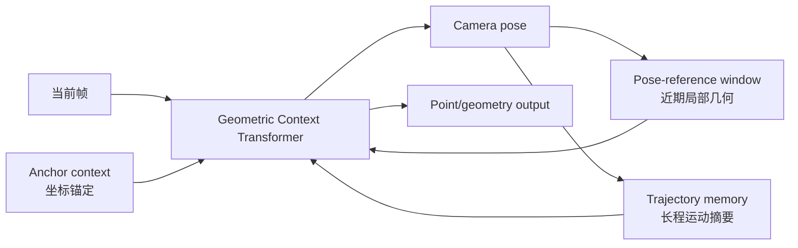

# LingBot-Map 与流式几何记忆

批量多视图模型可以让所有帧彼此交互，流式重建却不能无限保留并重算历史。LingBot-Map 的核心问题是：在因果接收图像时，怎样用有限上下文维持坐标锚定、局部几何和长程轨迹信息。

本文核对 [Geometric Context Transformer for Streaming 3D Reconstruction](https://arxiv.org/abs/2604.14141)与官方仓库 commit [`b9dd1b1`](https://github.com/Robbyant/lingbot-map/tree/b9dd1b1de535e6d36e777fb42b8433c781bfd783)（核对日期 2026-10-17）。

## 1. 任务和状态

输入是连续视频帧，输出包括相机 Pose 与三维点/点云类几何。流式要求第 $t$ 帧只使用已到达信息，并控制上下文和计算增长。模型维护的 token/缓存是网络推理状态，不自动具有数据库节点、可编辑图边或持久 landmark ID。

## 2. 三类上下文各解决什么

- **anchor context** 提供稳定坐标锚点，使后续预测不随局部窗口任意换参考；
- **pose-reference window** 保留近期、几何相关的参考帧，为当前帧提供细粒度局部线索；
- **trajectory memory** 压缩较长历史的相机运动信息，用于长程一致性和漂移修正线索。

三者不是三个同义缓存：anchor 强调固定参考，window 强调局部高分辨率上下文，memory 强调压缩长历史。具体缓存更新与淘汰由公开实现定义，不能直接套用 LLM token 的规则。

## 3. 与 VGGT、RTAB-Map 的关系

VGGT 联合处理给定视图集合，global attention 可让本批视图直接交互；LingBot-Map 面向因果流，必须限制历史状态。RTAB-Map 则把观测组织为显式节点、视觉词、约束和 STM/WM/LTM，并通过注册与位姿图处理回环。

因此 LingBot-Map 的 trajectory memory 不自动等于 RTAB-Map 长期数据库，anchor 也不等于显式固定的图节点；论文若展示长期漂移改进，也不能反推其具备任意删除图边、跨会话回环或事务回滚能力。

四类模型的统一比较表见 [VGGT 专题](./从匹配到前馈三维重建.md)。

## 4. 坐标、尺度与误差积累

流式输出必须记录 Pose 方向、参考帧和相机坐标约定。模型维护锚点可以减少参考漂移，但遮挡、动态场景和域外数据仍会积累错误。输出置信度是模型量，不自动成为位姿误差协方差。

官方论文报告约 518×378 输入下约 20 FPS、超过 10,000 帧的实验能力；该数字只适用于论文声明的模型、设备和测量范围，不能外推到 CAM-3576Q38。部署时还要测预处理、缓存增长、设备同步和完整端到端延迟。

## 5. 怎样评价流式几何

除 ATE/RPE 和重建误差外，应按序列长度观察漂移、状态内存、单帧/尾延迟、断流/reset 和跨场景泛化。长序列能跑完不等于回环后全局正确；短窗口精度也不能代表长期坐标稳定。

若用于机器人系统，还要定义结果采集时间、reset epoch 与迟到 Pose 的处理，见[异步推理、轨迹交接与可观测性](../../robotics-systems/异步推理、轨迹交接与可观测性.md)。
