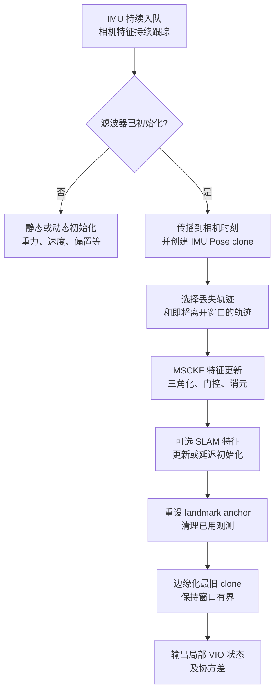

# 状态传播与视觉更新

OpenVINS 最值得学习的不是某个参数，而是它怎样把“高频 IMU 传播”和“较低频视觉校正”放进一个带交叉协方差的滑窗 EKF。相机特征并非全部变成长期地图点：普通 MSCKF 特征只在形成多帧约束时临时三角化，随后通过零空间投影消去；只有被选为 SLAM feature 的少量点才作为显式变量留在状态中。

## 1. 先明确任务与输出边界

OpenVINS 的基础任务是视觉惯性里程计（VIO）：根据按时间到达的 IMU 和相机观测，递推估计局部运动状态。它可以支持单目、同步双目或多相机输入，也可以选择 KLT 或描述子跟踪，但视觉前端的输出最终都是带时间和相机身份的稀疏特征轨迹。

典型状态输出包含姿态、位置、速度、陀螺仪偏置、加速度计偏置及协方差。它不是以下任务的同义词：

- 不是已知大地图中的单帧绝对重定位；
- 不是自带地点识别和全局回环的长期 SLAM；
- 不是相机–IMU 标定真值生成器；
- 不是稠密深度或表面重建器。

在没有额外全局约束时，VIO 的世界原点和全局 yaw 属于坐标规范，轨迹还会随时间漂移。输出连续不等于全局准确。

## 2. 滤波器状态里有什么

忽略可选项时，活动 IMU 状态可以概括为

$$
x_I=\left(R_{I\leftarrow G},\ p_I^G,\ v_I^G,\ b_g,\ b_a\right).
$$

这里 $G$ 是 VIO 的局部全局坐标，$I$ 是 IMU 坐标。所核对源码使用 `q_GtoI` 表示从 $G$ 到 $I$ 的旋转，同时用 `p_IinG` 表示 IMU 原点在 $G$ 中的位置。它们不是一个无需转换就能直接拼成矩阵的同向命名组合；对接其他系统时应先明确目标接口需要 $T_{G\leftarrow I}$ 还是 $T_{I\leftarrow G}$。

完整状态还可能包括：

| 变量 | 作用 |
| --- | --- |
| 当前 IMU 状态 | 承载当前姿态、位置、速度和偏置 |
| IMU Pose clones | 保存若干历史成像时刻的 Pose，使同一特征能同时约束多帧状态 |
| 相机–IMU 时间偏移 | 将相机时间映射到 IMU 时间；源码约定 $t_{imu}=t_{cam}+t_{off}$ |
| 相机外参与内参 | 可作为固定配置，也可按开关加入在线估计状态 |
| IMU 内参与重力敏感项 | 描述尺度、轴不正交等更细的惯性模型，可选估计 |
| SLAM landmarks | 少量显式留在状态中的三维特征，可选 |

所有活动变量共享联合协方差 $P$。新 clone 不是复制一个互不相关的 Pose，而是通过 stochastic cloning 扩充状态及交叉协方差；视觉更新才能把历史相机约束正确传回当前 IMU 状态和其他变量。

## 3. 一帧图像触发的执行链

固定 commit 中，`VioManager` 把主要步骤组织为：

### 3.1 初始化不是随便指定原点

初始化要为重力方向、速度和 IMU 偏置等状态建立可用起点。公开实现包含静态和动态初始化路径，并在初始化期间同时积累 IMU 与视觉轨迹。静态初始化需要一段满足假设的低运动数据；动态初始化则需要足够视觉惯性信息。数据窗口存在并不代表激励充分，错误初始化可能在之后表现为尺度、姿态或偏置快速发散。

### 3.2 IMU 传播到相机时刻

用简化 IMU 模型表示，先去除偏置：

$$
\hat\omega=\omega_m-b_g,\qquad
\hat a=a_m-b_a.
$$

再积分姿态、速度和位置，并传播偏置随机游走。OpenVINS 还可把 IMU 内参和重力敏感项纳入更完整的修正模型。协方差按局部线性模型传播：

$$
P_{k+1}=\Phi_kP_k\Phi_k^{\mathsf T}+Q_k.
$$

`Propagator::propagate_and_clone()` 根据相机时刻和当前时间偏移选择 IMU 区间，传播均值与协方差，然后为该成像时刻添加 clone。乱序图像、IMU 区间缺失或错误的时间偏移都会破坏这条链。

源码还提供 `fast_state_propagate()`，可在不提交一次完整视觉更新的情况下把状态快速预测到更近的 IMU 时刻，服务高频输出。预测频率更高不代表新增了独立观测信息。

## 4. MSCKF 为什么不把每个点留在状态中

设同一特征 $p_f$ 被多个 clone 观测。堆叠重投影残差并线性化：

$$
r\approx H_x\delta x+H_f\delta p_f+n.
$$

直接把每个 $p_f$ 都加入 EKF 状态，会让状态和协方差随环境点数增长。MSCKF 先用多帧观测三角化一个线性化位置，但把它视作 nuisance variable。取 $H_f$ 的左零空间基 $A$，满足

$$
A^{\mathsf T}H_f=0,
$$

则投影后

$$
r_o=A^{\mathsf T}r
\approx A^{\mathsf T}H_x\delta x+A^{\mathsf T}n.
$$

特征误差项被消去，视觉信息仍约束观察过它的 clone、当前 IMU 状态及相关标定变量。这里“消去 feature”不表示不需要三角化：必须先有合理的特征位置作为投影模型线性化点，低视差、错误轨迹或退化几何仍会失败。

固定实现中的 `UpdaterMSCKF::update()` 依次执行：

1. 只保留窗口内、观测数足够的轨迹；
2. 三角化并可选 Gauss–Newton 精化；
3. 构造 feature/state Jacobian 和残差；
4. 对 feature Jacobian 做零空间投影；
5. 用创新协方差做卡方门控；
6. 汇集通过的轨迹并压缩测量系统；
7. 调用联合 EKF update 修正状态与协方差。

测量压缩减少线性代数规模，不是删掉“看起来不重要”的状态。卡方门控检验当前噪声模型下的创新一致性，也不能被解释成视觉轨迹绝对正确的概率。

## 5. MSCKF feature 与 SLAM feature

OpenVINS 同时使用“MSCKF features”和可选“SLAM features”，名字很容易造成误解。

| 类型 | 是否进入滤波状态 | 生命周期 | 主要用途 |
| --- | --- | --- | --- |
| MSCKF feature | 否 | 轨迹丢失或将离开窗口时用于一次更新，然后清理 | 以有界状态规模利用多帧视觉约束 |
| SLAM feature | 是 | 延迟初始化后，在被跟踪期间持续更新；失去跟踪或达到条件时边缘化 | 保留少量长期于普通轨迹的显式 landmark |

SLAM feature 可采用全局 XYZ、锚定逆深度等表示；当其 anchor clone 即将移出窗口时，`UpdaterSLAM::change_anchors()` 会先转换 anchor。它仍是有数量上限、随滤波窗口维护的状态变量，不是 RTAB-Map 数据库或 COLMAP reconstruction 式的长期可检索地图。

因此看到 `_features_SLAM` 或 `UpdaterSLAM`，不能直接推断核心 OpenVINS 已提供跨会话地点识别、地图保存、全局回环和重定位。

## 6. 为什么要 clone 和边缘化

单个当前 Pose 无法表达“特征在过去多个成像时刻从不同位置被看见”的约束。clone 窗口保留有限历史 Pose，使一条 feature track 能连接多个相机时刻。窗口超过 `max_clone_size` 后，最旧 clone 被边缘化，计算和协方差维度保持有界。

边缘化不是简单忘掉旧帧：旧观测已经通过 EKF update 改变当前联合状态和协方差。但滤波器在线性化之后不会像全批次优化那样随意重新展开全部历史，因此错误线性化、错误关联和模型偏差仍可能留下影响。

这与[状态估计与不确定性](../fundamentals/状态估计与不确定性.md#_7-2-滑窗边缘化)中的一般滑窗思想相接：两者都保留历史信息并限制问题规模，但 EKF 协方差消元与因子图中的滑窗先验在数据结构和重线性化能力上不同。

## 7. FEJ、可观测性与“协方差很小”

标准 VIO 在常见假设下存在四个不可观方向：三维全局平移和绕重力方向的全局 yaw。普通 EKF 若每次都在变化的当前估计处线性化，可能凭空在不可观方向获得信息，使协方差过度自信。

OpenVINS 支持并默认启用 First-Estimate Jacobian（FEJ）。它为相关变量保留首次估计线性化值，使传播和更新更好地维持理论不可观子空间。FEJ 处理的是估计一致性问题，不会修复错误时间戳、错误外参、视觉误匹配或缺少运动激励；也不会把局部 VIO 变成有绝对 yaw 和位置锚定的系统。

进一步的概率模型、创新门控与协方差边界见[状态估计与不确定性](../fundamentals/状态估计与不确定性.md)。

## 8. 在线标定能估什么，不能证明什么

固定源码允许按配置把相机–IMU 外参、相机内参、相机到 IMU 的时间偏移以及部分 IMU 内参加入状态。默认开关和具体数据集配置并不相同，实际使用必须保存运行 YAML。

在线估计不等于可以省略离线标定：

- 初值过差可能让视觉关联或滤波线性化先失败；
- 某个参数只有在相应运动激励下才可观；
- 外参、时间偏移、偏置和运动可能互相耦合；
- 估计收敛和协方差变小只说明模型内部状态，不是独立准确性验证。

尤其要遵守源码的时间约定 $t_{imu}=t_{cam}+t_{off}$，不能只凭配置字段名猜正负号。标定方向、时间模型、激励与验证方法见[多传感器时空标定](../fundamentals/多传感器时空标定.md)。

## 9. 怎样与 HLoc 和 RTAB-Map 衔接

| 系统 | 连续运动来源 | 全局地图/地点能力 | 典型输出语义 |
| --- | --- | --- | --- |
| OpenVINS | IMU 传播 + 稀疏轨迹滤波更新 | 核心估计器不提供长期地点数据库和全局回环 | 自由局部世界中的连续 VIO 状态 |
| [COLMAP](../colmap/) | 不负责在线连续传播 | 从多视图离线建立已注册图像、Point3D 与 track | 只确定到相应坐标规范的稀疏重建 |
| [HLoc](../hloc/) | 通常不负责连续运动传播 | 固定 SfM 地图上的检索、匹配与绝对 Pose | 每个 Query 相对已知地图的相机 Pose |
| [RTAB-Map](../rtabmap/) | 可使用内部或外部 odometry | Signature、记忆、回环、位姿图和地图修正 | 连续 `map → odom → base` 关系与地图状态 |

COLMAP 解释了 HLoc 所使用的固定 SfM 地图怎样建立，但它不是 OpenVINS 的在线状态后端。概念上，OpenVINS 可提供平滑的局部 odometry，HLoc 或 RTAB-Map 一类模块可提供全局锚定或漂移修正。但要真正组合，必须另外定义：

- `world/map/odom/imu/camera/base` 的坐标方向；
- 图像与输出 Pose 对应哪个时间戳；
- 相机光心、IMU 原点与机器人基座之间的外参；
- VIO reset、初始化失败和全局定位跳变怎样传播；
- 协方差、延迟和接受状态怎样表达。

这是一组系统接口契约，不是把两个 Pose 直接相乘就自然成立。RTAB-Map 的地图和定位状态见[地图与记忆管理](../rtabmap/地图与记忆管理.md)与[定位与重定位流程](../rtabmap/定位与重定位流程.md)。

## 10. 如何评价 OpenVINS 输出

VIO 评测应围绕连续局部轨迹，而不是照搬单帧重定位的 Recall@K 或 PnP 成功率：

| 维度 | 建议观察 |
| --- | --- |
| 初始化 | 成功率、初始化用时、初始化后的短期瞬态 |
| 局部运动 | 固定时间/距离间隔的 RPE、漂移率 |
| 整体轨迹 | 在任务允许的 SE(3) 对齐后报告 ATE，并明确对齐自由度 |
| 连续性 | 输出覆盖率、跟踪丢失、重启次数、最长失效区间 |
| 一致性 | 有合格真值时检查误差与协方差是否匹配，而非只看 covariance 数值 |
| 标定 | 参数稳定性、运动激励、留出数据和独立测量 |
| 性能 | tracking、propagation、MSCKF update、SLAM update、边缘化及端到端尾延迟 |

若把 OpenVINS 作为另一定位系统的 odometry 输入，还应分别保存 VIO 原始轨迹和全局修正后轨迹，避免用最终融合结果替代底层里程计评价。ATE/RPE、有效样本和失败处理见[定位评估方法](../data-evaluation/定位评估方法.md)。

## 11. 固定源码阅读入口

以下链接固定到本专题核对的 commit，正文用函数和类名作为稳定入口，不依赖浮动行号：

- [`VioManager.cpp`](https://github.com/rpng/open_vins/blob/69488123ed9362dd44b6f28e7f4680abbff1442b/ov_msckf/src/core/VioManager.cpp)：传感器接收、初始化以及一帧的传播—更新—边缘化主流程；
- [`State.h`](https://github.com/rpng/open_vins/blob/69488123ed9362dd44b6f28e7f4680abbff1442b/ov_msckf/src/state/State.h)：IMU 状态、clones、标定变量、SLAM features 与联合协方差；
- [`Propagator.cpp`](https://github.com/rpng/open_vins/blob/69488123ed9362dd44b6f28e7f4680abbff1442b/ov_msckf/src/state/Propagator.cpp)：IMU 区间选择、均值/协方差传播和 clone augmentation；
- [`UpdaterMSCKF.cpp`](https://github.com/rpng/open_vins/blob/69488123ed9362dd44b6f28e7f4680abbff1442b/ov_msckf/src/update/UpdaterMSCKF.cpp)：三角化、零空间投影、卡方门控、测量压缩和 EKF 更新；
- [`UpdaterSLAM.cpp`](https://github.com/rpng/open_vins/blob/69488123ed9362dd44b6f28e7f4680abbff1442b/ov_msckf/src/update/UpdaterSLAM.cpp)：in-state landmark 的更新、延迟初始化和 anchor 维护；
- [`StateHelper.cpp`](https://github.com/rpng/open_vins/blob/69488123ed9362dd44b6f28e7f4680abbff1442b/ov_msckf/src/state/StateHelper.cpp)：状态扩充、EKF update 和边缘化；
- [官方传播推导](https://docs.openvins.com/propagation.html)、[测量更新推导](https://docs.openvins.com/update.html)和 [FEJ 说明](https://docs.openvins.com/fej.html)。

原始系统论文见 [OpenVINS: A Research Platform for Visual-Inertial Estimation](https://pgeneva.com/downloads/papers/Geneva2020ICRA.pdf)。本文是实现与知识衔接笔记，不替代原论文。
