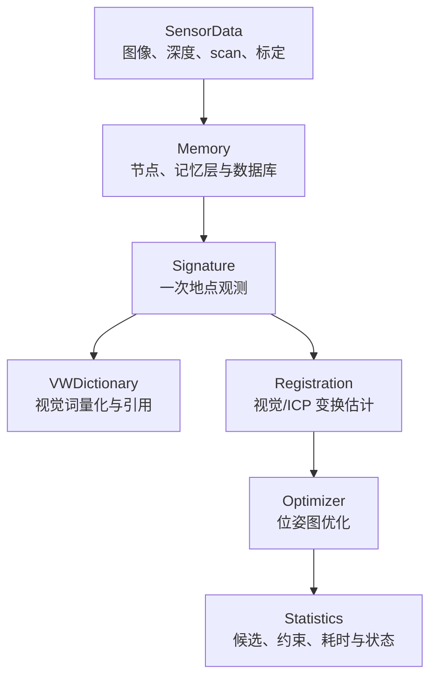

# RTAB-Map

RTAB-Map 不只是一个“图像匹配后输出 Pose”的定位器。它把传感器观测组织成节点，以里程计、回环、邻近匹配和地标等约束组成位姿图，并用短期记忆、工作记忆和数据库中的长期记忆控制在线计算规模。定位结果因此同时依赖地点假设、几何估计、图优化一致性和当前运行状态。

本专题按下面的顺序阅读：

1. [地图与记忆管理](./地图与记忆管理.md)：`SensorData`、`Signature`、视觉词、约束和 STM/WM/LTM 分别是什么。
2. [定位与重定位流程](./定位与重定位流程.md)：一帧数据怎样从地点候选走到 `map → odom` 修正，以及失败发生在哪一层。
3. [RTAB-Map 与 HLoc 的定位链对比](./RTAB-Map与HLoc的定位链对比.md)：两套系统的地图、候选、几何和输出契约为何不能按模块名字直接对齐。

通用原理仍由基础篇主讲：[视觉地点识别与图像匹配](../fundamentals/视觉地点识别与图像匹配.md)、[从图像对应到相机位姿](../fundamentals/从图像对应到相机位姿.md)、[地图到底存了什么](../fundamentals/地图到底存了什么.md)和[回环检测与位姿图优化](../fundamentals/回环检测与位姿图优化.md)。

## 核心对象怎样协作

| 对象 | 简明职责 |
| --- | --- |
| `Memory` | 创建和加载节点，维护 STM/WM/LTM、词典引用、数据库与节点约束 |
| `Signature` | 把一次传感器观测组织成地点节点，保存局部特征、Pose、负载与 Links |
| `VWDictionary` | 维护视觉词与量化索引，为外观 likelihood 提供基础 |
| `Registration` | 按配置组合视觉注册和 ICP，估计两个节点间的度量变换及诊断信息 |
| `Optimizer` | 对 Pose 与 Links 组成的图做非线性优化，并处理 prior/鲁棒设置 |
| `Statistics` | 暴露本轮地点假设、闭环、定位协方差、耗时和内存等可观测量 |

## 建图、回环、定位和重定位

- **建图**：新观测成为可持久化节点，里程计边不断扩展图。
- **回环**：当前节点与同一持续地图中的旧节点建立跨时约束，修正累计漂移。
- **定位模式**：已有地图保持为主要持久状态，新观测用于估计 `map → odom`，通常不继续扩展永久地图。
- **重定位**：系统尚未连接到正确地图区域或跟踪丢失后，通过全局地点候选和几何约束重新建立地图关系。

这些概念会复用相同检测与注册代码，但状态语义不同；“检测到回环”不能自动替代机器人层面的跟踪恢复。

## 本专题的公开资料边界

本专题只核对官方公开仓库。调研副本放在笔记仓库之外，正文链接固定到 commit，避免 `master`、`ros2` 分支继续更新后改变引用语义。核对日期为 2026-10-13：

| 公开仓库 | 核对分支 | 版本 | commit |
| --- | --- | --- | --- |
| [introlab/rtabmap](https://github.com/introlab/rtabmap) | `master` | `0.24.2` | [`29e4346`](https://github.com/introlab/rtabmap/tree/29e43469867d86160849303a9d0dae1262ec98d8) |
| [introlab/rtabmap_ros](https://github.com/introlab/rtabmap_ros) | `ros2` | `0.23.13` | [`e9ca237`](https://github.com/introlab/rtabmap_ros/tree/e9ca237e11b9da5542eebf5521fe350f5cb42e42) |
| [cvg/Hierarchical-Localization](https://github.com/cvg/Hierarchical-Localization) | `master` | `1.5` | [`c13273b`](https://github.com/cvg/Hierarchical-Localization/tree/c13273bd0ecc2917a35910fd843712a1c6243193) |

正文采用三种表述：**上游已实现**表示能在上述公开 commit 的代码或官方文档中定位；**根据公开接口推导**表示由数据流和坐标关系得到的解释；**设计建议**表示可行的系统集成方案，而不是上游现成功能。参数默认值还可能受版本和编译选项影响，因此运行记录仍应保存实际配置、数据库版本和构建信息。
