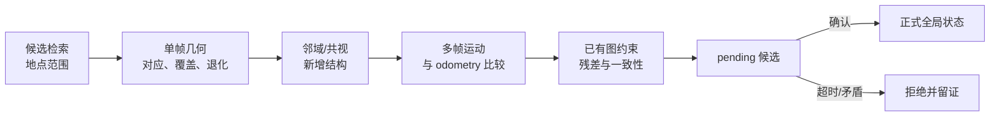

# 危险误接受防护与恢复

重复走廊或两间相似房间里，错误地点也可能产生大量匹配、较低重投影误差和可优化的位姿。问题因此不是“RANSAC 有没有成功”，而是：错误关联怎样被阻止进入正式全局状态；若已经进入，又有哪些状态真正可以撤销。

本文沿用本专题固定的 RTAB-Map `0.24.2` commit [`29e4346`](https://github.com/introlab/rtabmap/tree/29e43469867d86160849303a9d0dae1262ec98d8) 与 rtabmap_ros `ros2` commit [`e9ca237`](https://github.com/introlab/rtabmap_ros/tree/e9ca237e11b9da5542eebf5521fe350f5cb42e42)。默认值只描述该版本，不是推荐配置。

## 1. 从错误对应到运行层误接受

四层失败要分开：

1. 局部特征把不同物理点配在一起；
2. PnP、3D–3D 或 ICP 从错误对应估出错误变换；
3. 错误变换作为回环/定位边被图后端接受；
4. 运行系统据此更新 `map→odom`、地图融合或导航状态。

RANSAC 只在给定对应和模型假设下寻找一致子集。重复房间中的错误对应可能彼此一致，因此“内点多”不等于地点身份正确。唯一对应限制一对多歧义；空间覆盖避免内点挤在小区域；视差/深度检查验证 3D 可用性；退化检查验证几何可观测性。它们各自排除一类坏解，不能单独证明场所身份。

learned 特征可增加外观辨别信息，语义可排除明显类别冲突，RANSAC 验证局部几何，图优化验证新约束与已有图的兼容性。网络分数、Bayes posterior 或局部协方差若未做校准与独立验证，都不能直接解释为“定位正确概率”。

## 2. 接受前需要不同来源的证据



连续多帧都落在同一错误房间，可能只是相同纹理和相同视角导致的相关错误。真正增加区分信息的是视角变化后出现的新结构、共视关系、相对运动，以及来源清楚的外部信息。

稳定跟踪、首次全局定位、丢失后重定位和跨会话地图合并拥有不同先验。合法重定位可以带来很大的 `map→odom` 修正；这不是机器人在一帧内高速移动，所以不能机械使用速度阈值拒绝。反过来，运动一致性依赖 odometry 本身可信及其不确定性合理，不能把它当绝对真值。

下面是**系统设计方案**，不是 RTAB-Map 原生完整状态机：

```text
candidate = retrieve_and_register(observation)
if stale(candidate) or not geometry_ok(candidate): reject
pending.append(candidate)               # 尚不修改正式 map→odom/地图
if has_new_view_evidence(pending) and motion_consistent(pending, odom):
    commit(candidate)
elif timeout_or_contradiction(pending):
    reject_and_record(pending)
```

候选、已确认和不确定状态的输出语义见[定位状态机、误接受隔离与恢复](../../robotics-systems/定位状态机、误接受隔离与恢复.md)。

## 3. 图后端能抑制什么

位姿图常最小化约束残差的加权和：

$$
\min_{\{T_i\}}\sum_{(i,j)}
\rho\!\left(r_{ij}(T_i,T_j)^\top\Omega_{ij}r_{ij}(T_i,T_j)\right),
$$

$r_{ij}$ 是预测相对位姿与测量约束的差，$\Omega_{ij}$ 是信息矩阵，$\rho$ 是可选鲁棒损失。普通最小二乘对应 $\rho(s)=s$，一条高权重错误边可能把整张图拉向它。

- 鲁棒核降低大残差边的影响，但对低残差错误边无能为力；
- Switchable Constraints/Vertigo 给可疑约束引入可优化开关，使不一致边可被关闭；
- PCM/RRR 一类方法比较多条闭环之间的兼容关系，尝试选择相互一致子集。

这些机制仍有共同边界：一组彼此一致的错误边可能一起通过；两张尚未连接地图的第一条错误连接可通过整体移动一张图满足，未必留下大残差；相关约束并非多份独立证据；错误信息矩阵会让优化器过度相信坏边。优化收敛和低残差都不能证明数据关联正确。

## 4. RTAB-Map 公开实现中的检查

在固定 commit 中，`Rtabmap::process()` 组织假设选择、`Memory::computeTransform()` 的度量注册和 `graph::computeMaxGraphErrors()` 的图误差检查；被拒假设也进入 `Statistics`。定位模式使用 odometry cache、定位约束和 map pose priors 检查局部子图；建图模式则评估带新约束的图。

| 参数/机制 | 作用层与证据 | 行为 | 固定版本限制 |
| --- | --- | --- | --- |
| `Rtabmap/LoopThr`（默认 0.11） | 外观地点假设 | 低于门槛不进入后续闭环验证 | 不是几何正确概率；分数语义受词典与配置影响 |
| `Vis/MinInliers`（默认 20） | 视觉注册 | 内点不足时拒绝变换；实现还要求几何求解的最低点数 | 内点多仍可能来自重复结构 |
| `RGBD/OptimizeMaxError`（默认 3.0） | 图优化后最大约束误差与该约束标准差之比 | 超过阈值拒绝本轮新闭环/定位；0 关闭 | 不是米或像素阈值；依赖协方差/信息矩阵 |
| `Optimizer/Robust`（默认 false） | 图后端 | 使用 Vertigo switchable constraints 抑制不一致回环 | 固定版本仅 g2o/GTSAM 且构建需 Vertigo；不等于绝对拒错 |
| `RGBD/MaxOdomCacheSize`（默认 10） | 定位模式局部轨迹 | 保存有限 odometry cache，平滑并验证定位变换；0 关闭 | 依赖局部 odometry 质量，不是持久地图快照 |
| `RGBD/LocalizationPriorError`（默认 0.001） | 定位 cache 中 map pose prior | 为已知 map pose 设置 prior 方差 | 不是定位结果真实误差保证 |
| `RGBD/LocalizationSecondTryWithoutProximityLinks`（默认 true） | 定位图优化失败后的第二次尝试 | 有 global/landmark link 时移除 proximity links 重试，成功则删除相应 proximity links | 假定前者更可信；没有增加独立证据 |
| `RGBD/OptimizeMaxErrorRepairRadius`（默认 0.0） | 连续两次被同一旧 loop link 阻挡时 | 非零半径允许移除旧 link 及邻域内旧 links，直到图可接受 | 0 表示关闭；是约束修复，不是地图/运行状态全回滚 |

源码入口包括 [`Rtabmap.cpp`](https://github.com/introlab/rtabmap/blob/29e43469867d86160849303a9d0dae1262ec98d8/corelib/src/Rtabmap.cpp)、[`Memory.cpp`](https://github.com/introlab/rtabmap/blob/29e43469867d86160849303a9d0dae1262ec98d8/corelib/src/Memory.cpp)、[`Graph.cpp`](https://github.com/introlab/rtabmap/blob/29e43469867d86160849303a9d0dae1262ec98d8/corelib/src/Graph.cpp) 与 [`Parameters.h`](https://github.com/introlab/rtabmap/blob/29e43469867d86160849303a9d0dae1262ec98d8/corelib/include/rtabmap/core/Parameters.h)。旧 Wiki 对 Robust/OptimizeMaxError 的组合描述可能对应不同版本；这里以上述 commit 的参数定义和分支为准。

必须区分三个动作：**拒绝本次新约束**、**删除已存在的错误边**、**恢复机器人运行状态**。固定版本对前两者存在部分机制，但不提供涵盖地图派生物、规划和控制的通用事务回滚。

## 5. 误接受后为什么难以完整恢复

监控发现可疑跳变后，应保存原始观测、候选、约束、图版本和接受理由，停止继续污染全局状态，再隔离可疑边并重新优化。若结果只影响位姿图，删除边后重算 Pose 可能足够；若已经影响特征合并、稠密融合、占据栅格裁剪、滤波器反馈或导航任务，图边撤销不会自动逆转这些状态。

完整回滚需要事先定义事务边界，并保留快照或可重放数据。系统也不能先用可疑约束改地图，再把依赖该地图生成的后续结果当作独立验证。

局部 odometry 仍可信时，可维持 `odom→base` 连续估计，同时把全局状态标为 uncertain 并冻结新的 `map→odom` 确认。是否停车、限速或仅局部规划取决于剩余传感能力和安全要求，而不是 RTAB-Map 一个参数能统一决定。

## 6. 怎样评价防护

除 Precision、Recall、危险误接受率和首次恢复时间外，还应记录：

- 误接受事件持续时间；
- 从误接受到检测的延迟；
- 被污染的图边、地图产物和下游状态范围；
- 可疑约束撤销成功率；
- 撤销到重新确认正确位置的恢复耗时。

同时报告防护造成的正确接受损失、召回下降和恢复延迟，避免靠“从不接受”获得表面安全。

离线回放/故障注入至少覆盖相似房间、连续相关错误、跨会话第一条错误连接、合法的大幅重定位修正，以及时间戳/外参错误造成的表观运动矛盾。所有方案固定输入与参考版本，保存候选到最终状态的决策日志；没有合格位置参考时，只能评价内部一致性和状态恢复，不能声称绝对定位正确。

统一指标定义见[定位评估方法](../data-evaluation/定位评估方法.md)，RTAB-Map 的正常链路见[定位与重定位流程](./定位与重定位流程.md)，与 HLoc 的差异见[RTAB-Map 与 HLoc 的定位链对比](./RTAB-Map与HLoc的定位链对比.md)。

## 参考

- [RTAB-Map 参数文档](https://introlab.github.io/rtabmap/api/latest/parameters.html)（最新文档入口，使用时仍需对齐版本）
- [RTAB-Map Robust Graph Optimization Wiki](https://github.com/introlab/rtabmap/wiki/Robust-Graph-Optimization)
- [Switchable Constraints](https://nikosuenderhauf.github.io/projects/switchableConstraints/)
