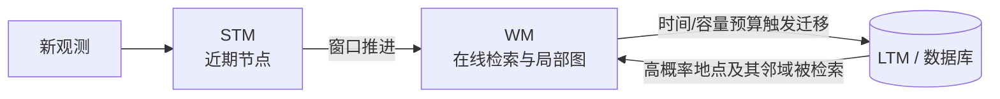

# 地图与记忆管理

理解 RTAB-Map 的第一步，是把“地图里有什么”和“当前有哪些内容留在内存里”分开。地图的逻辑身份由节点及其约束构成；内存管理决定本轮在线检索和优化能直接访问其中哪一部分。节点暂时不在 RAM 中，不等于它已从地图中消失。

## 1. 从传感器数据到 Signature

`SensorData` 是一次观测的载体，可包含图像、深度、激光、相机模型、IMU、GPS、用户数据和局部栅格等。`Signature` 则把一次观测提升为图中的地点节点，附加了：

- 节点 `id`、会话/子图 `mapId`、时间戳和标签；
- 原始里程计 Pose、可选 Ground Truth Pose 和速度；
- 视觉词到关键点索引的关联、关键点、局部三维点与描述子；
- 指向其他节点或地标的 `Link`；
- 观测负载 `SensorData`。

所核对的公开版本中，`_words3` 明确存放在 `base_link` 局部坐标中，而不是一张共享的 HLoc/COLMAP 式全局 Point3D 表。要得到地图坐标中的几何，需要把局部点和该节点的优化 Pose 组合起来。类定义可直接查 [Signature.h](https://github.com/introlab/rtabmap/blob/29e43469867d86160849303a9d0dae1262ec98d8/corelib/include/rtabmap/core/Signature.h)。

### 1.1 几类 ID 不要混用

| 身份 | 表示什么 | 不能当成什么 |
| --- | --- | --- |
| Signature ID | 一次地点/节点观测 | 视觉词 ID 或物理地标 ID |
| mapId | 节点所属的会话/子图身份 | 优化后的世界坐标 |
| visual word ID | 描述子量化后的词典项 | 唯一物理三维点 |
| keypoint index | 当前节点中特征数组的位置 | 跨帧稳定身份 |
| landmark ID | 显式地标约束的身份 | 普通视觉词的同义词 |

两个关键点落到同一个视觉词，只说明量化后相似；重复纹理会让不同物理位置共享词 ID。BoW 可以提出地点候选，却不能凭词 ID 直接建立可信的全局 3D 对应。

### 1.2 局部 3D 从哪里来

RGB-D 可把像素按深度反投影；校正后的双目可由视差得到深度。这类点能在单个节点内直接形成局部 3D，但质量受深度范围、视差、标定和遮挡影响。多视图三角化则需要跨帧对应和已知/估计相机 Pose，弱基线时深度病态。

RTAB-Map 的节点 `_words3` 可以承载这些局部几何，具体来源取决于输入与注册配置。HLoc/COLMAP 的 Point3D 则通常是跨图 track 三角化后的全局地图实体。二者都叫“3D 点”时，必须继续问其坐标系、观测历史和身份管理方式。

对校正双目，公开实现可以从左图关键点出发，只在右图寻找这些点的对应，再把视差投影成与关键点逐项对齐的稀疏 3D；对应失败的位置保留为无效值，并不要求先生成稠密视差图。这条数据链以及 SQLite 中的特征与标定字段见[建图过程与地图更新](./建图过程与地图更新.md)。

## 2. 约束才把节点组织成地图

节点之间的边不仅有一种。常见约束包括相邻里程计、全局回环、时间/空间邻近闭环、用户约束、虚拟约束、地标约束和 Pose prior。每条 `Link` 至少要表达：

1. `from` 与 `to`；
2. 明确方向的相对变换；
3. 约束类型；
4. 信息矩阵或等价的不确定性描述。

`Memory::addLink()` 会给两端节点写入互逆约束；这只表示边进入记忆结构。对公开的 `Rtabmap::addLink()`，增量建图模式还会临时加边、优化当前图、检查最大残差与标准差之比，失败时移除该边。源码分别见 [Memory.cpp](https://github.com/introlab/rtabmap/blob/29e43469867d86160849303a9d0dae1262ec98d8/corelib/src/Memory.cpp) 和 [Rtabmap.cpp](https://github.com/introlab/rtabmap/blob/29e43469867d86160849303a9d0dae1262ec98d8/corelib/src/Rtabmap.cpp)。因此“算出了变换”“创建了 Link”“最终被图接受”是三个状态。

### 2.1 同一数据库可导出多种地图视图

| 表示 | 主要查询 | 关键边界 |
| --- | --- | --- |
| 视觉特征图 | 关键点附近的局部描述与局部 3D，用于视觉注册 | word ID 不是物理 landmark；局部点要乘节点 Pose 才进入地图坐标 |
| 位姿图 | 节点在哪里、哪些相对约束连接它们 | 不等于保留全部像素或稠密表面 |
| scan 点云 | 局部/拼接几何、ICP 与可视化 | 不天然表达自由空间和视觉 observation |
| occupancy map | 自由、占据与未知空间查询 | 由节点局部栅格和优化 Pose 生成，不是节点/约束的替代品 |

这些视图可以共享节点 Pose，却有不同缓存与重建条件。图优化更新后，拼接点云或栅格可能需要重新生成。

因此“地图更新”至少要说明更新的是新节点、图约束、优化 Pose，还是由 Pose 派生的点云/栅格。四层更新的顺序见[建图过程与地图更新](./建图过程与地图更新.md#_5-地图更新-包含四种不同更新)。

## 3. STM、WM 与 LTM

### 3.1 STM：保护最近的时间上下文

Short-Term Memory 保存最近节点。窗口推进时，最老的 STM 节点被转入 WM；rehearsal 还可能合并高度相似的连续观测。它的重点是短期时间关系，不是完整地图缓存。

### 3.2 WM：当前可参与在线推断的集合

Working Memory 是外观似然、Bayes 后验、局部图和邻近搜索直接使用的活动集合。`Rtabmap/MemoryThr` 限制 WM 节点数，`Rtabmap/TimeThr` 以每轮更新时间预算触发迁移；所核对的公开版本中二者默认都是 `0`，即默认不靠这两个阈值设上限。运行配置若设置了它们，必须记录实际值，不能把“RTAB-Map 一定保持固定内存”当作无条件事实。

### 3.3 LTM：持久化且可按需召回

Long-Term Memory 在实现上对应数据库中未常驻活动内存的节点。节点从 WM 移出时，必要内容会持久化；当地点假设指向旧区域时，系统可从数据库重新加载候选邻域。所核对的公开版本用 `Rtabmap/MaxRetrieved` 控制一轮从 LTM 召回的节点数，默认值为 `2`，但路径节点等检索会另计。

`moveToTrash()` 是源码中的历史命名，不宜直译成“删除地图”。它承担从活动内存移出和异步写数据库等职责；是否真正舍弃、是否保留图连接以及是否处于增量模式，都影响最终结果。内存迁移逻辑见 [Memory.cpp](https://github.com/introlab/rtabmap/blob/29e43469867d86160849303a9d0dae1262ec98d8/corelib/src/Memory.cpp)。

## 4. 权重、年龄与免疫

实时预算不足时，并非简单删除最老节点。RTAB-Map 会结合节点权重、访问年龄、与 STM/当前局部图的连接及免疫集合选择可迁移节点。成功回环、被召回的邻域和当前路径附近节点可能被暂时保护。

这些机制优化的是“在有限在线预算下保留有用地点”，不是地图真实性。高权重节点仍可能来自重复结构；低权重节点也可能是将来唯一可用的视角。因此调参要同时观察：

- 单轮耗时与 WM 大小；
- LTM 召回次数和数据库访问尾延迟；
- 回环召回、误回环和可恢复性；
- 图优化规模与地图覆盖。

## 5. 定位模式不是只读文件查看器

`Mem/IncrementalMemory=false` 通常用于对已有数据库定位：不再把新节点作为永久地图扩展，但仍会构造当前 Signature、维护里程计缓存、检索旧节点、建立候选定位约束并更新 `map → odom`。`Mem/LocalizationReadOnly=true` 还会限制数据库状态回写；固定版本的参数说明同时指出它与部分记忆管理设置不兼容。

因此需要分别记录：地图数据库是否可写、是否增量建图、当前查询是否持久化、定位状态是否在重启后保存。只写“localization mode”不足以复现实验。

## 6. 地图导出不是地图本体

拼接点云、occupancy grid、mesh 或导出的优化轨迹，都是从节点、局部观测和优化 Pose 生成的视图。它们适合显示或下游使用，却不一定保留视觉词、节点连接、原始观测和不确定性。

所以“能打开一张 PCD”不等于“RTAB-Map 可以在这张 PCD 上执行原有视觉重定位”。地图接口与表示的通用区别见[地图到底存了什么](../fundamentals/地图到底存了什么.md)。下一篇先看这些对象怎样形成于[建图过程与地图更新](./建图过程与地图更新.md)，再继续到[定位与重定位流程](./定位与重定位流程.md)。

## 7. 大负载何时进入 RAM

节点身份、Links 与所有图像/scan 数据是否驻留内存是两回事。固定实现会在变换估计需要图像或 scan 时，从数据库加载缺失的二进制负载，并只解压当前路径所需的部分。`Mem/LoadVisualLocalFeaturesOnInit=true` 默认在打开已有数据库时预加载局部关键点、描述子和 3D 点；设为 `false` 则在回环变换估计时按需加载，缩短初始化或降低常驻内存的同时增加首次访问延迟。

因此分析性能时要区分冷启动、热缓存和数据库 I/O。只测第二次定位会低估按需加载成本，只测启动阶段又可能高估稳定运行成本。

## 8. 三种容易混淆的局部几何集合

- **局部视觉特征图**：当回环启用局部 BA 时，可沿邻接节点收集关键点与局部 3D 信息，对视觉约束做邻域精化；所核对的公开版本中 `RGBD/LocalBundleOnLoopClosure` 默认关闭。
- **多帧 scan 拼接**：one-to-many proximity 注册可把局部路径上的多个 scan 组装后再匹配，增加几何覆盖；它仍依赖所选路径、Pose 和 scan 质量。
- **全局 scan map**：定位模式可用 `RGBD/ProximityGlobalScanMap` 组装全局 scan 地图进行 proximity detection，所核对的公开版本中该参数默认关闭；图改变或从数据库召回节点时，该缓存可能被清空并退回局部路径方式。

它们分别服务视觉精化、局部 scan 几何和全局 scan proximity，不等价于 HLoc 的 Top-K Reference 图像汇集。是否启用、缓存何时失效以及使用哪些节点都应从实际参数与统计中确认。
