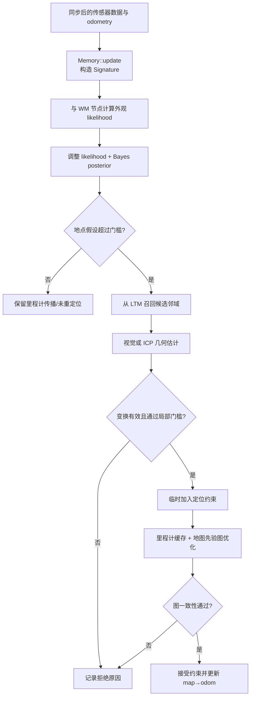

# 定位与重定位流程

RTAB-Map 的一次“定位成功”不是单个分类器事件。所核对公开版本的主循环把外观概率、几何配准、局部图优化和状态更新串在一起；每一层都可能拒绝前一层的候选。

## 1. 先约定输出的坐标含义

设里程计给出

$$
T_{O\leftarrow B}(t),
$$

RTAB-Map 维护地图对里程计的修正

$$
T_{M\leftarrow O}(t).
$$

连续输出的机器人地图 Pose 为

$$
T_{M\leftarrow B}(t)
=T_{M\leftarrow O}(t)T_{O\leftarrow B}(t).
$$

重定位约束主要修正 $T_{M\leftarrow O}$；高频局部运动仍由 odometry 提供。`rtabmap_ros` 的 `CoreWrapper` 在 `process()` 成功后读取 `getMapCorrection()`，并按相同乘法发布定位 Pose，见公开源码的 [CoreWrapper.cpp](https://github.com/introlab/rtabmap_ros/blob/e9ca237e11b9da5542eebf5521fe350f5cb42e42/rtabmap_slam/src/CoreWrapper.cpp)。

### 1.1 启动时有三种不同的“已知位置”

打开已有数据库时，系统会加载优化图，并可能读到上次保存的 `lastLocalizationPose`。它表示上一会话保存的校正状态，不是当前图像刚做出的视觉定位。外部 `setInitialPose()` 则是调用方给定的地图初始假设，会清空定位协方差和 odometry cache 后重新建立状态。只有本帧经过候选、注册和图验收得到的约束，才是当前观测产生的重定位证据。

如果 `Mem/LocalizationReadOnly=true`，上次定位状态不会在关闭时写回数据库；若显式从原点启动或外部提供初始 Pose，启动行为又不同。因此日志应写明状态来自“数据库恢复”“外部初始化”还是“当前视觉/几何定位”。

### 1.2 Query Signature 与 odometry cache

每帧输入仍会形成 Query Signature。定位模式不把它当作普通持久地图扩展，却会把近期 Query 的原始 odometry Pose 和相邻边放入 cache，用于平滑定位和检查新定位是否会让短期运动图过度变形。所核对的公开版本中 `RGBD/MaxOdomCacheSize=10`；窗口超限时从最旧 Pose 和约束开始淘汰，重置、切换数据库或显式设置初始 Pose 时会清空缓存。

`lastLocalizationPose` 是校正后的最近状态，cache 中的 Pose 主要仍是 odometry frame 状态；两者不能按名字互换。

## 2. 一帧数据经过哪些阶段

这张图省略了时间/空间邻近检测、地标和多传感器分支，但保留了最关键的证据层级。

## 3. 外观候选：likelihood 不是最终置信度

系统先对活动 WM 中的 Signature 计算外观相似 likelihood，再按当前分布做调整，最后由 Bayes filter 结合前一时刻的地点概率得到 posterior。虚拟地点表示“当前不属于已知地点”；所核对的公开实现用 $1-P(\text{virtual})$ 表示总体回环概率，并选取概率最高的具体节点。

候选仍要通过 `Rtabmap/LoopThr`、单一假设、时间比率或可选极几何检查。所核对的公开版本中 `Rtabmap/LoopThr` 默认 `0.11`；当尚未连接到旧地图时，还可能使用 `RGBD/AggressiveLoopThr` 的特殊门槛。数值是实现参数，不是跨数据集校准后的“定位正确概率”。主流程见 [Rtabmap.cpp](https://github.com/introlab/rtabmap/blob/29e43469867d86160849303a9d0dae1262ec98d8/corelib/src/Rtabmap.cpp)。

## 4. 召回邻域后才做度量几何

最高假设可触发从数据库召回相关节点及邻域。随后 `Memory::computeTransform()` 按配置调用视觉注册、ICP 或组合注册估计节点间变换。

所核对的公开版本中 `Vis/EstimationType=1` 的默认视觉估计是 3D→2D PnP，`Vis/PnPReprojError` 默认 `2` 像素；也可选择 3D→3D 或 2D→2D。局部特征的 BF/FLANN/NN 匹配服务于几何对应，它们不是全局图像检索器。`RGBD/LocalBundleOnLoopClosure` 默认关闭；即使开启，局部 BA 也只是在所选变量和邻域内精化，不会自动消除错误地点假设。参数声明见 [Parameters.h](https://github.com/introlab/rtabmap/blob/29e43469867d86160849303a9d0dae1262ec98d8/corelib/include/rtabmap/core/Parameters.h)。

双目地图节点中的稀疏 3D 如何产生并持久化，见[建图过程与地图更新](./建图过程与地图更新.md)；这只建立了可用于 PnP 的地图侧条件，不代表每个关键点都有深度，也不代表本次候选一定能形成足够内点。具体 PnP、RANSAC 和 BA 边界见[从图像对应到相机位姿](../fundamentals/从图像对应到相机位姿.md)。

## 5. 图一致性是另一层验收

几何估计给出可用变换后，定位模式会把新约束与一段 odometry cache 合并，并把涉及的地图 Pose 加入图。固定实现通过 Pose prior 给地图节点有限但很强的约束：`RGBD/LocalizationPriorError=0.001` 表示方差参数，对应有限信息矩阵，不是从优化变量中彻底删除这些节点。

优化后，`RGBD/OptimizeMaxError` 检查的是图中最大绝对边误差除以该边标准差的比值。所核对版本的默认门槛为 `3.0`。它不是“3 米”或“3 像素”，也不应脱离信息矩阵质量解释。若邻近约束导致失败而同时存在回环/地标约束，`RGBD/LocalizationSecondTryWithoutProximityLinks=true` 会允许去掉 proximity links 再试一次。

这解释了三种不同的拒绝：

- 地点概率不足：没有进入几何；
- 几何失败：候选无法形成可靠相对变换；
- 图不一致：单对几何看似成立，但与近期运动和地图约束冲突。

定位还可能带有时间确认语义。所核对的公开实现会统计 odometry cache 中已有的定位类约束；对小位移帧，只有在先前定位已由足够约束建立后才跳过部分重复检测，源码注释明确考虑 delayed localization 需要两个 link 的情形。这里的“两个”是该状态控制分支，不是通用的“两帧即可证明定位正确”。系统级是否等待多帧确认仍应由风险和验证决定。

## 6. proximity localization 与 global loop closure

全局外观回环从相似地点提出候选；空间邻近检测则依赖当前已有的地图位姿，在附近节点中寻找局部闭环。两者解决的问题不同：

- 尚未定位或发生大范围跳转时，不能只依赖当前空间邻域；
- 已稳定定位时，proximity 可补充局部约束并平滑更新；
- 错误的 `map → odom` 也可能把空间搜索带到错误区域，因此 proximity 不是独立真值。

地点识别、几何验证和位姿图优化的通用关系见[回环检测与位姿图优化](../fundamentals/回环检测与位姿图优化.md)。

## 7. rtabmap_ros 负责什么

核心库负责地图、记忆、候选、注册和图优化；ROS 包装层主要负责：

- 订阅并同步图像、深度、scan、odom、IMU 等消息；
- 通过 TF 把传感器数据转换到配置的机器人 frame；
- 调用核心 `process()`；
- 发布 `map → odom` TF、`localization_pose`、图、栅格和诊断；
- 暴露切换模式、初始 Pose、保存/加载数据库等服务。

包装层不会替你解决 TF 多发布者、时间戳不一致或错误外参。系统中应只有一个被明确授权的 `map → odom` 来源。

## 8. 如何记录一次定位

至少把下面几层分开保存：

| 层级 | 建议字段 |
| --- | --- |
| 输入 | stamp、传感器 frame、odometry Pose/协方差、地图版本 |
| 地点 | top hypothesis、posterior、virtual-place 概率、召回节点 |
| 几何 | 注册类型、matches/inliers、残差、估计变换、拒绝信息 |
| 图验收 | 新边类型、最大误差及 ratio、二次尝试、是否最终入图 |
| 输出 | `map → odom`、`map → base`、定位协方差、状态与原因码 |

“Pose 是有限数”“ROS topic 有消息”“回环 ID 非零”各自只说明一部分状态，不能互相替代为“定位正确”。

主循环末尾会把 map correction、最近定位 Pose/节点、定位协方差、候选、闭环/邻近 ID、注册证据和耗时写入 `Statistics`。诊断应优先保存这些分层字段，而不是只截一条“loop closure detected”日志；具体统计项仍随版本与发布配置变化。
