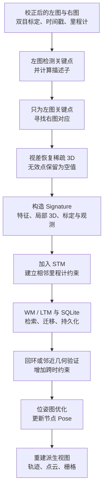

# 建图过程与地图更新

RTAB-Map 的“建图”不只是生成一份点云。对一帧校正后的双目观测，公开实现可以在左图提取局部特征，只为这些关键点寻找右图对应并恢复稀疏 3D；随后把观测组织为 `Signature`，加入节点和约束图，并在记忆迁移时持久化到 SQLite 数据库。回环或邻近约束出现后，图优化主要更新节点 Pose，由这些 Pose 派生的点云、栅格和轨迹视图也随之改变。

这条主线可以概括为：

## 1. 建图输入不等于一对图片

双目节点至少需要左图、右图和可用于投影的 `StereoCameraModel`。系统还通常接收时间戳、局部里程计 Pose 及其协方差；相机相对机器人基座的局部变换也属于标定模型的一部分。图像若没有在上游校正，所核对的公开版本可在 `Memory::createSignature()` 内按完整标定执行校正；若配置声明图像已经校正，则输入必须真的满足这一约定。

校正后的理想双目对应近似位于同一图像行。设左、右像素横坐标为 $u_L,u_R$，焦距为 $f_x$，基线为 $b$，视差为

$$
d=u_L-u_R,
$$

则常见的针孔模型近似为

$$
Z=\frac{f_xb}{d},\qquad
X=\frac{(u_L-c_x)Z}{f_x},\qquad
Y=\frac{(v_L-c_y)Z}{f_y}.
$$

这也说明远处小视差为何容易产生较大的深度不确定性：$Z$ 对 $d$ 的变化非常敏感。公式成立还依赖正确的基线符号、内参、校正模型和左右图同步，不能只凭“有左右两张图”推断三维点可靠。

## 2. 公开实现走的是稀疏双目路径

`Memory::createSignature()` 会取得或生成左图关键点和描述子。当输入包含有效右图与双目模型、而关键点还没有 3D 坐标时，它调用 `Feature2D::generateKeypoints3D()`：

1. 把已经存在的左图关键点转为 `leftCorners`；
2. 调用 `Stereo::computeCorrespondences()`，只为这些位置寻找 `rightCorners`；
3. 计算 $u_L-u_R$，再通过双目模型投影为 3D；
4. 用最小/最大深度等条件过滤结果，并按标定中的局部变换把点表达在节点的机器人基座局部坐标中。

在所核对的 RTAB-Map `0.24.2` commit 中，`Stereo/OpticalFlow=true`，因此默认由稀疏金字塔 LK 光流分支寻找左右对应；把该参数设为 `false` 时会改用另一套窗口匹配实现。这里的默认值是固定版本事实，不应代替实际运行配置记录。

重要的是，这条路径**不要求先计算整幅稠密视差图**。`generateKeypoints3DStereo()` 先把输出数组调整为与左图关键点相同的长度：能通过对应和深度检查的位置写入有限 3D，失败的位置写入 `NaN`。因此“逐行对应”表示数组索引一致，不表示每个关键点都有有效深度。

| 数组 | 第 $i$ 行的含义 |
| --- | --- |
| `wordsKpts[i]` | 左图第 $i$ 个局部特征的位置与尺度等属性 |
| `wordsDescriptors.row(i)` | 该左图特征的描述子 |
| `words3[i]` | 同一特征对应的局部 3D；双目失败时可为无效值 |
| word ID | 描述子量化身份；不是唯一物理地标 ID |

RTAB-Map 也有从已有深度/视差图反投影关键点的代码路径，但它与这里的“左关键点 → 右图稀疏对应”不是同一条计算链。

## 3. 一帧怎样成为地图节点

局部特征生成后，描述子可被词典量化为 visual word。`Signature::setWords()` 要求关键点、局部 3D 和描述子的行数与词关联保持一致，然后把这些数组挂到当前节点。`Signature` 还带有节点 ID、会话 `mapId`、时间戳、里程计 Pose、`SensorData` 和指向其他节点的 `Link`。

这里应把三层身份分开：

- 关键点索引只在该节点的特征数组中定位一行；
- visual word ID 表示量化后的描述子身份，重复纹理可能共享同一个 word；
- 节点局部 3D 是一次观测恢复的几何，不是跨多图 track 管理的全局 landmark。

`Memory::update()` 的基本顺序是 `preUpdate → createSignature → addSignatureToStm`。若 STM 中已有同一 `mapId` 的上一节点，`addSignatureToStm()` 根据相邻里程计 Pose 和协方差建立双向的相邻约束。增量建图模式还可能进行 rehearsal，将高度相似的连续地点合并或调整权重；当 STM 窗口推进时，较旧节点进入 WM。

所以一个新节点进入地图时，至少发生了两件不同的事：保存这次观测，以及用里程计边把它接到已有图上。只有图像特征而没有可靠节点 Pose/约束，不能构成可优化的连续地图。

## 4. 数据库究竟保存什么

在所核对的 SQLite 实现中，节点的 `Feature` 记录包含 node ID、word ID、2D 关键点属性、可空的 `depth_x/depth_y/depth_z` 以及描述子。`Data.calibration` 可保存双目的 $f_x,f_y,c_x,c_y$、baseline、图像尺寸和局部变换。因此，RTAB-Map 上游已经具备把关键点、描述子、对应的稀疏 3D 和相机模型随节点持久化的能力。

这句话仍有三个限定：

1. 无效稀疏 3D 在数据库中对应空字段，不会被伪装成有效点；
2. 原始图像、右图/深度和其他大负载是否保留，受节点类型、压缩与记忆参数影响，不能假定所有数据库都包含完整原图；
3. 数据先进入内存结构，节点从活动记忆迁出或数据库线程刷新时才异步保存。进程异常结束与正常关闭的持久化边界需要单独验证。

`moveToTrash()` 虽然名字像删除，实际还承担把节点从 STM/WM 移出并交给 `DBDriver::asyncSave()` 的职责。它是否保留图连接、是否真正丢弃坏节点，又取决于增量模式和相关配置。更完整的 STM、WM、LTM 语义见[地图与记忆管理](./地图与记忆管理.md)。

## 5. “地图更新”包含四种不同更新

把所有变化都叫地图更新，很容易把观测、约束、状态估计和显示混为一谈。

| 更新层 | 发生了什么 | 没有自动保证什么 |
| --- | --- | --- |
| 节点更新 | 新 `Signature` 带着传感器观测和局部特征进入记忆 | 不保证已找到旧地点 |
| 拓扑更新 | 相邻里程计边、回环、邻近或地标约束被加入 | 算出候选变换不等于边最终被接受 |
| 状态更新 | 优化器根据约束更新节点 Pose 和地图校正 | 不会重新发明缺失的图像/scan 几何 |
| 派生地图更新 | 用局部观测与新 Pose 重建轨迹、拼接点云或栅格 | 导出视图不等于数据库的全部地图状态 |

建图初期主要靠相邻里程计边扩展图。回到旧地点时，外观候选还要通过视觉或 ICP 几何验证；有效的跨时约束加入图后，优化器才能把累计漂移分配到相关节点 Pose 上。若约束被图一致性检查拒绝，地图不应因为“曾出现候选”就跳到另一处。

图优化通常改变的是节点 Pose，而不是把数据库中每个局部点改写成全局坐标。显示全局点云时，再以节点优化 Pose 变换各节点的局部点或 scan。因此优化后轨迹与拼接结果会改变，但 `words3` 仍可保持节点局部表达。关于边的类型、验收和不同地图视图，见[地图与记忆管理](./地图与记忆管理.md)和[回环检测与位姿图优化](../fundamentals/回环检测与位姿图优化.md)。

## 6. 稀疏 3D 怎样参与定位

已有地图节点保存的局部 3D 与描述子，为后续视觉注册提供了 3D–2D 对应的来源。查询帧的局部特征与候选地图节点匹配后，可以把地图节点的局部 3D 经节点 Pose 关联到地图几何，再估计查询相机/机器人相对候选的变换。

所核对版本中 `Vis/EstimationType=1`，默认视觉估计类型是 3D→2D PnP。但“数据库里有稀疏 3D”只说明具备这条求解路径，还必须满足：

- 候选地点被检索或召回；
- 描述子能够形成足够且分布合理的对应；
- 参与求解的地图点具有有效 3D；
- PnP/RANSAC 与后续图一致性检查通过。

因此数据库记录存在、候选分数较高、PnP 返回变换和最终定位约束被接受，是四个不同状态。完整执行链见[定位与重定位流程](./定位与重定位流程.md)，PnP 的几何条件见[从图像对应到相机位姿](../fundamentals/从图像对应到相机位姿.md)。

## 7. 上游能力与设备集成的边界

从固定的官方源码可以确认，RTAB-Map 上游已经实现了双目图像校正处理、左图局部特征、稀疏左右对应、局部 3D 恢复、`Signature` 组织、SQLite 持久化，以及使用局部几何做视觉注册的路径。这不是某个产品仓库从零实现的一套双目深度与建图算法。

具体机器人产品仍要完成设备和系统层工作，例如相机驱动与同步、双目标定、TF/外参、里程计输入、参数选择、数据库生命周期和运行诊断。这些工作决定上游路径收到什么数据、以什么配置运行，却不改变该算法路径的公开来源。

局部特征类型同样是配置和构建相关的，不应把某一产品当前选择写成 RTAB-Map 的永久默认。若地图端与查询端更换了不兼容的特征表示，旧地图能否继续使用是[地图兼容性](../fundamentals/地图到底存了什么.md#_6-地图兼容性-为什么不同前端可能需要各自地图)问题；本文不展开具体接入改造。

## 8. 阅读源码时的稳定入口

以下链接都固定到本专题记录的 RTAB-Map commit；函数名比浮动的行号更适合作为长期入口：

- [`Memory::createSignature()` 与 `Memory::update()`](https://github.com/introlab/rtabmap/blob/29e43469867d86160849303a9d0dae1262ec98d8/corelib/src/Memory.cpp)：图像校正、特征/3D 生成、节点创建和记忆更新；
- [`Feature2D::generateKeypoints3D()`](https://github.com/introlab/rtabmap/blob/29e43469867d86160849303a9d0dae1262ec98d8/corelib/src/Features2d.cpp)：从左关键点发起双目稀疏对应；
- [`Stereo::create()` 与 `StereoOpticalFlow::computeCorrespondences()`](https://github.com/introlab/rtabmap/blob/29e43469867d86160849303a9d0dae1262ec98d8/corelib/src/Stereo.cpp)：选择并执行左右对应方法；
- [`util3d::generateKeypoints3DStereo()`](https://github.com/introlab/rtabmap/blob/29e43469867d86160849303a9d0dae1262ec98d8/corelib/src/util3d_features.cpp)：视差投影、深度过滤与无效点表达；
- [`Signature::setWords()`](https://github.com/introlab/rtabmap/blob/29e43469867d86160849303a9d0dae1262ec98d8/corelib/src/Signature.cpp)：保持 word、关键点、3D 和描述子的索引关系；
- [`DBDriverSqlite3::saveQuery()`](https://github.com/introlab/rtabmap/blob/29e43469867d86160849303a9d0dae1262ec98d8/corelib/src/DBDriverSqlite3.cpp)：持久化节点、Links、局部特征与标定。

读完这条建图链，再看[定位与重定位流程](./定位与重定位流程.md)，就能把“地图数据怎样产生”和“查询怎样利用地图”分开分析。
