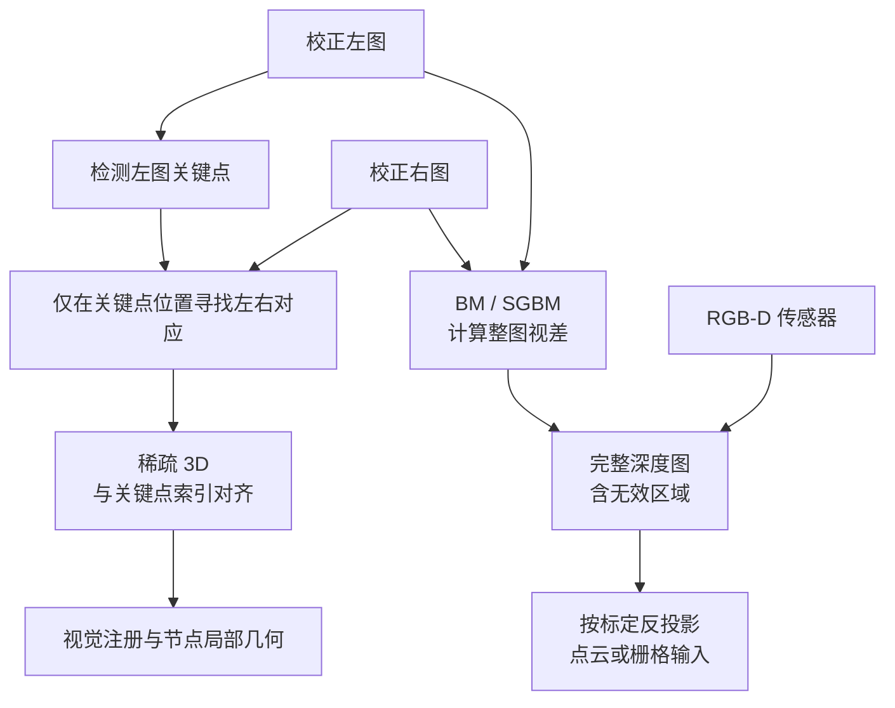

# 视觉前端、跟踪与深度来源

RTAB-Map 同时出现特征、光流、双目、深度图和点云，最容易产生的误解是把它们看成一条固定流水线。实际上，系统会按传感器输入、里程计策略和建图配置选择不同数据路径：有的计算为运动跟踪服务，有的只为左右图关键点恢复深度，还有的是地图节点保存后再生成的显示或导航产品。

本文先回答三个问题：观测以什么形式进入系统；跨时间跟踪和左右目对应有什么区别；“有 3D 点”究竟指稀疏特征、完整深度图还是派生点云。节点怎样持久化见[建图过程与地图更新](./建图过程与地图更新.md)，通用的 detector/descriptor/matcher 原理见[视觉地点识别与图像匹配](../fundamentals/视觉地点识别与图像匹配.md)。

## 1. SensorData 是观测容器，不是单一传感器格式

固定版本中的 `SensorData` 可以承载图像、右图或深度、相机模型、激光扫描、IMU、GPS，以及已经生成的局部特征等数据。某一帧实际具有什么，由采集端和 ROS 同步层决定；类中存在字段不表示当前运行已经提供它。

常见视觉输入可以先分为三类：

| 输入形态 | 几何来源 | 必要约定 |
| --- | --- | --- |
| 单目图像 | 跨帧运动与多视图约束；单帧没有由相机几何直接给出的绝对深度 | 内参、时间戳；若与 IMU/odometry 联合，还需外参与同步 |
| 校正双目 | 左右图视差给出尺度深度 | 双目标定、左右同步、校正状态与基线方向 |
| RGB-D | 深度传感器直接提供与彩色图关联的深度图 | 深度单位、无效值、彩色—深度配准与局部变换 |

相机模型不只是 $f_x,f_y,c_x,c_y$。它还定义畸变/校正关系、图像尺寸和传感器相对机器人基座的局部变换。若数据被声明为“已校正”，下游就会依赖这个契约；不能只因为图像尺寸正确就认为可直接做视差。

## 2. 特征检测、描述、匹配和跟踪不是同一动作

- **检测**决定在哪些像素建立观测，如角点或尺度空间极值；
- **描述**把局部邻域编码成可比较向量；
- **匹配**在两个特征集合之间寻找相似描述子并做几何过滤；
- **光流跟踪**从已有像素位置出发，在另一幅图里直接估计位置变化，通常不要求先生成第二套描述子。

描述子匹配适合跨较大视角、跨时较久或地点检索后的对应；KLT/LK 一类局部光流利用小运动和亮度连续性，适合连续帧稀疏轨迹。两者都能得到二维对应，但假设、失败模式和计算代价不同。

在 RTAB-Map 中，它们还可能服务于不同层：odometry 需要连续运动；回环注册连接相隔较远的节点；双目深度则需要同一时刻的左右图对应。看到“optical flow”这个实现名，必须继续确认它连接的是**时间相邻图像**还是**同步左右图像**。

## 3. 两种不同的“光流”用途

### 3.1 跨时间跟踪

在视觉里程计或 VIO 中，一条特征轨迹连接 $t_0,t_1,\ldots$ 的观测。它提供相机运动约束，也会受到动态物体、曝光变化、滚动快门和帧间运动过大的影响。轨迹跨越的是时间，不直接等于双目基线。

### 3.2 同时刻左右目对应

对校正双目，RTAB-Map 的稀疏路径从左图关键点出发，在右图寻找同一时刻的对应。固定 commit 中 `StereoOpticalFlow` 调用金字塔 LK 的双目变体，并用极线、正视差和匹配误差等条件筛选。这里复用了光流式局部搜索，但任务是左右相机对应，不是估计机器人从上一帧到当前帧的运动。

设校正后的对应为 $(u_L,v_L)$ 和 $(u_R,v_R)$，视差 $d=u_L-u_R$，则常见针孔模型给出

$$
Z=\frac{f_xb}{d}.
$$

这条关系依赖正确标定与同步。小视差会放大深度不确定性；错误左右对应会产生几何上有限但物理上错误的 3D 点。

## 4. 稀疏双目与整图视差是两条路径

固定 RTAB-Map commit 能确认两种上游能力：

1. `Feature2D::generateKeypoints3D()` 只为左图关键点求右图对应，再由视差生成与特征数组等长的稀疏 3D；
2. `SensorCaptureThread` 的可选 stereo-to-depth 分支通过 `StereoDense` 生成整幅视差，支持 BM/SGBM 策略，再转换成深度图。

第二条能力的存在不表示所有双目运行都先做整图 SGBM。第一条路径足以让视觉节点拥有用于 3D–2D/3D–3D 注册的稀疏几何。应以实际输入、参数和调用链判断，而不是从数据库里出现 3D 坐标倒推“必有稠密深度图”。

## 5. 四种容易混淆的几何产物

| 名称 | 数据密度与身份 | 典型来源 | 主要用途 |
| --- | --- | --- | --- |
| 稀疏特征 3D | 只在局部特征位置有值，并与关键点/描述子索引对应 | RGB-D 深度采样或双目稀疏对应 | 视觉注册、PnP、节点局部几何 |
| 完整深度图 | 每个像素理论上一个深度，实际含无效/遮挡区 | RGB-D，或双目 BM/SGBM 等 | 稠密反投影、障碍/表面建图 |
| 稠密/半稠密点云 | 深度图或扫描在相机/机器人坐标中的反投影 | 深度、双目视差、LiDAR | 显示、ICP、地图拼接 |
| 占据栅格 | 空闲、占据和未知空间的离散表达 | 点云/scan 经过投影、射线与过滤 | 导航与碰撞相关地图 |

“稀疏 3D”不等于 COLMAP 的全局 Point3D track。RTAB-Map 节点中的局部点先属于一次 `Signature` 观测，跨节点身份、局部坐标与优化 Pose 的关系见[地图与记忆管理](./地图与记忆管理.md)。同样，点云或栅格常是由节点负载与优化 Pose 重建的派生产品，不应反向当作数据库全部状态。

多视图三角化是第四种深度来源：它需要同一物理点在不同相机位姿下的观测，并依赖基线与 Pose。它与同步双目公式形式相关，却不是“任意两帧做一次左右视差”。COLMAP 的 track 与三角化见[增量式 SfM 与稀疏地图](../hloc/增量式SfM与稀疏地图.md)。

## 6. 学习式深度与光流放在哪一层

RAFT 类稠密光流、学习式双目和单目深度可以作为前端扩展方向，但不能从它们的论文能力推断固定 RTAB-Map 版本默认使用了这些网络。

- 学习式单目深度给出的是模型预测，需要明确尺度、相机域、时序稳定性和不确定性；它不自动等价于几何可度量的 RGB-D；
- 学习式双目仍需校正、同步和基线，输出接口可接近视差/深度图，但算子、预处理和置信度契约不同；
- 稠密光流可以建立像素级时间对应，却不自动提供相机 Pose、静态场景筛选或稠密地图。

若替换某一模块，首先冻结数据契约：输入图像空间、输出坐标/单位、无效值、时间戳、置信度和延迟。然后分别评价对应质量、几何结果和端到端定位，不把“网络输出更密”直接等同于“地图更准”。

## 7. 固定源码入口

以下链接固定到本专题沿用的 RTAB-Map `0.24.2` commit [`29e4346`](https://github.com/introlab/rtabmap/tree/29e43469867d86160849303a9d0dae1262ec98d8)：

- [`SensorData.h`](https://github.com/introlab/rtabmap/blob/29e43469867d86160849303a9d0dae1262ec98d8/corelib/include/rtabmap/core/SensorData.h)：观测容器及不同负载；
- [`Features2d.cpp`](https://github.com/introlab/rtabmap/blob/29e43469867d86160849303a9d0dae1262ec98d8/corelib/src/Features2d.cpp)：特征生成和稀疏 3D 入口；
- [`Stereo.cpp`](https://github.com/introlab/rtabmap/blob/29e43469867d86160849303a9d0dae1262ec98d8/corelib/src/Stereo.cpp)：稀疏左右对应策略；
- [`util3d_features.cpp`](https://github.com/introlab/rtabmap/blob/29e43469867d86160849303a9d0dae1262ec98d8/corelib/src/util3d_features.cpp)：视差到关键点 3D 的投影和过滤；
- [`StereoDense.cpp`](https://github.com/introlab/rtabmap/blob/29e43469867d86160849303a9d0dae1262ec98d8/corelib/src/StereoDense.cpp) 与 [`SensorCaptureThread.cpp`](https://github.com/introlab/rtabmap/blob/29e43469867d86160849303a9d0dae1262ec98d8/corelib/src/SensorCaptureThread.cpp)：BM/SGBM 工厂与可选 stereo-to-depth 调用链。

下一步可沿[建图过程与地图更新](./建图过程与地图更新.md)继续追踪稀疏特征、3D 和相机模型怎样进入 `Signature` 与数据库。
