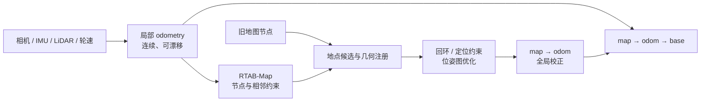

# 里程计与外部 VIO

RTAB-Map 建图和定位都需要知道相邻观测之间怎样运动，但这份连续局部运动不一定由 RTAB-Map 自己计算。它可以来自视觉/激光里程计节点、轮速与 IMU 融合，也可以来自 OpenVINS 一类独立 VIO。真正重要的不是模块名字，而是 Pose、时间、坐标、协方差与失效状态是否满足同一接口契约。

本文主讲 RTAB-Map 这一侧的里程计职责和系统边界。OpenVINS 的滤波状态、IMU 传播、MSCKF 更新与可观测性单独保留在[OpenVINS：状态传播与视觉更新](./OpenVINS状态传播与视觉更新.md)。

## 1. odometry 回答的是局部连续运动

典型坐标链写成

$$
T_{map\leftarrow base}(t)
=T_{map\leftarrow odom}(t)\,T_{odom\leftarrow base}(t).
$$

- $T_{odom\leftarrow base}(t)$ 应连续、低延迟，允许长期漂移；
- $T_{map\leftarrow odom}(t)$ 由地图定位、回环和图优化修正，可以在获得新全局约束后变化；
- 两者相乘才是机器人相对全局地图的 Pose。

因此 VIO 输出通常适合承担 `odom → base`，不应仅因它带协方差就改名为 `map → base`。相反，把全局回环后的跳变 Pose 当作局部 odometry，会让相邻节点边包含并非机器人真实运动的离散校正。

## 2. 内部里程计与外部 odometry 是两种部署边界

### 2.1 RTAB-Map 提供的 odometry 前端

`rtabmap_ros` 的 `rtabmap_odom` 包提供 RGB-D、stereo 和 ICP odometry 节点。它们把各自的 ROS 传感器消息转成 `SensorData`，由 RTAB-Map core 的 `Odometry` 实现估计连续运动，再发布 `nav_msgs/Odometry`、TF 和诊断信息。

这里“内部”只表示采用 RTAB-Map 工程中的 odometry 实现，仍应把 odometry 节点与 SLAM/地图节点看作两个职责：前者产生局部连续运动，后者维护地点、约束和全局修正。

### 2.2 外部 odometry

外部估计器先独立产生 `odom → base`。`rtabmap_ros` 可从 odometry 消息，或按 `odom_frame_id` 在观测时间查询 TF；随后把 Pose 与同步后的图像/scan 交给 core。这个接口使轮速融合、第三方 VIO 或 LiDAR-inertial odometry 能在不共享内部滤波状态的情况下为 RTAB-Map 提供运动先验。

“能接收外部 odometry”只证明接口存在，不保证任意发布者都兼容。至少要核对：

| 契约 | 需要明确的内容 | 常见后果 |
| --- | --- | --- |
| 坐标 | parent/child frame、Pose 方向、base 与传感器外参 | 镜像、轴交换或把相机 Pose 当 base Pose |
| 时间 | Pose 对应的采样时刻、同步/插值、处理延迟 | 快速运动时形成系统偏差 |
| 连续性 | 初始化、reset、relocalization 是否跳变 | 错误相邻边或被误判为真实大运动 |
| 协方差 | 排列、单位、未知值和失效标志 | 图约束权重失真，或丢失无法被识别 |
| 覆盖 | 每个地图观测是否能获得对应 odometry | 丢帧、等待或样本集合变化 |

## 3. OpenVINS 与 RTAB-Map 的两种关系

OpenVINS 是独立的 VIO 框架，不依赖 RTAB-Map 的地点数据库或位姿图。把它归入本专题，是因为它回答“局部连续运动从哪里来”，而不是因为两个项目共享估计器。

固定公开版本里可以区分两种技术路径：

1. **外部进程/ROS 接口**：OpenVINS 独立运行并发布局部 VIO，再按上一节的 odometry/TF 契约交给 `rtabmap_ros`。两侧只共享消息和坐标约定；
2. **可选 core wrapper**：所核对的 RTAB-Map commit 包含 `OdometryOpenVINS`，但 `WITH_OPENVINS` 默认关闭，只有构建时找到 OpenVINS 库才启用。wrapper 调用外部 OpenVINS 库，并不把 OpenVINS 的 MSCKF 状态改造成 RTAB-Map 的全局地图状态。

因此不能从 `OdometryOpenVINS` 类名推出“所有 RTAB-Map 构建都内置 OpenVINS”，也不能从外部 odometry 接口推出“RTAB-Map 会理解 VIO 的全部克隆、特征和标定状态”。实际采用哪条路径，必须查看构建摘要、运行节点图和参数。

## 4. VIO 的局部状态与全局地图状态为何要分开

OpenVINS 的核心状态包含 IMU 位姿、速度、偏置、相机时刻 clones、标定变量和少量可选 in-state landmarks。它依靠 IMU 传播和视觉轨迹更新，典型输出属于自由局部世界中的连续运动。

RTAB-Map 则保存 `Signature`、视觉词、传感器负载、节点 Pose 和跨节点 `Link`，并把回环/定位约束送入位姿图。两者都可能出现“feature”“landmark”“state”，但身份和生命周期不同：

| 问题 | VIO/OpenVINS | RTAB-Map 地图层 |
| --- | --- | --- |
| 首要目标 | 高频连续运动估计 | 地点记忆、跨时约束与全局一致性 |
| 历史范围 | 有界 clone/滤波状态 | 可持久化节点与数据库 |
| 全局地点识别 | 核心估计器不提供 | 外观候选与几何注册 |
| 漂移处理 | 局部模型内抑制与估计 | 回环/定位更新 `map → odom` |
| reset 含义 | 新的局部状态或坐标原点 | 需要决定新会话、断边或重定位策略 |

局部 VIO 中名为 “SLAM feature” 的状态量，也不等同于 RTAB-Map 的长期可检索地图点。更详细的状态生命周期见[OpenVINS：状态传播与视觉更新](./OpenVINS状态传播与视觉更新.md#_5-msckf-feature-与-slam-feature)。

## 5. 时间与外参必须在入口处闭合

设 VIO 输出的是 IMU 位姿 $T_{odom\leftarrow I}(t)$，RTAB-Map 节点需要机器人基座位姿，则

$$
T_{odom\leftarrow base}(t)
=T_{odom\leftarrow I}(t)\,T_{I\leftarrow base}.
$$

若 VIO 输出相机 Pose，链条又不同。公式只有在方向、原点和同一时刻都明确时才成立。相机图像时间 $t_c$、IMU 时间 $t_i$ 与发布时刻不是同一概念；应在原始轨迹上按测量时间关联或插值，而不是用消息到达顺序代替同步。

在线估计外参或时间偏移时，配置初值不自动等于运行最终值。若外部 VIO 内部使用了动态标定状态，而地图节点仍用固定 TF，就需要明确哪个变换用于把 Pose 转到 `base`，以及日志是否能复现该状态。通用的变换方向和时间模型见[多传感器时空标定](../fundamentals/多传感器时空标定.md)。

## 6. 失效和 reset 不能只用“没有 Pose”表达

一条可用的 odometry 接口至少要区分：

- 尚未完成初始化；
- 当前帧暂时无法更新，但上一状态仍存在；
- 跟踪确认丢失；
- 估计器 reset，并建立了新的局部坐标原点；
- 外部模块做了全局重定位，输出发生有意跳变。

这些状态对 RTAB-Map 的行为含义不同。把 reset 前后的两个 Pose 用普通相邻边连接，会把坐标原点变化解释成机器人瞬移；把所有高协方差都当作同一种丢失，也可能遗漏可降级使用的短时预测。具体怎样开始新 map/session、何时等待重定位，属于系统策略，不能只靠一个数值阈值在知识笔记里写死。

## 7. 验证时分开看两条轨迹

调试全局定位时，建议至少保存：

1. 原始 $T_{odom\leftarrow base}$；
2. RTAB-Map 给出的 $T_{map\leftarrow odom}$；
3. 组合后的 $T_{map\leftarrow base}$；
4. 对应每次跳变的回环/定位约束和接受状态。

局部轨迹的漂移、初始化和覆盖率属于 odometry/VIO 评价；全局闭环后的地图一致性与重定位成功属于地图层评价。若只保存最终组合轨迹，就很难判断误差来自局部运动、错误全局约束还是坐标/时间接口。ATE、RPE 与有效样本处理见[定位评估方法](../data-evaluation/定位评估方法.md)。

## 8. 固定公开源码入口

RTAB-Map core 入口固定到 commit [`29e4346`](https://github.com/introlab/rtabmap/tree/29e43469867d86160849303a9d0dae1262ec98d8)：

- [`Odometry.cpp`](https://github.com/introlab/rtabmap/blob/29e43469867d86160849303a9d0dae1262ec98d8/corelib/src/Odometry.cpp)：odometry 策略工厂和基类执行边界；
- [`OdometryOpenVINS.cpp`](https://github.com/introlab/rtabmap/blob/29e43469867d86160849303a9d0dae1262ec98d8/corelib/src/odometry/OdometryOpenVINS.cpp)：可选 wrapper，代码由 `RTABMAP_OPENVINS` 构建条件保护；
- [顶层 `CMakeLists.txt`](https://github.com/introlab/rtabmap/blob/29e43469867d86160849303a9d0dae1262ec98d8/CMakeLists.txt)：`WITH_OPENVINS` 默认值和依赖探测。

ROS 入口固定到 `rtabmap_ros` commit [`e9ca237`](https://github.com/introlab/rtabmap_ros/tree/e9ca237e11b9da5542eebf5521fe350f5cb42e42)：

- [`CommonDataSubscriber.cpp`](https://github.com/introlab/rtabmap_ros/blob/e9ca237e11b9da5542eebf5521fe350f5cb42e42/rtabmap_sync/src/CommonDataSubscriber.cpp)：图像、scan、odometry 等订阅与同步组合；
- [`CoreWrapper.cpp`](https://github.com/introlab/rtabmap_ros/blob/e9ca237e11b9da5542eebf5521fe350f5cb42e42/rtabmap_slam/src/CoreWrapper.cpp)：ROS 数据转入 RTAB-Map core 以及地图坐标关系；
- [`rtabmap_odom`](https://github.com/introlab/rtabmap_ros/tree/e9ca237e11b9da5542eebf5521fe350f5cb42e42/rtabmap_odom)：RGB-D、stereo 与 ICP odometry 节点。

读完接口边界，再看[定位与重定位流程](./定位与重定位流程.md)，可以把“连续运动从哪里来”和“全局地点约束怎样修正它”分开分析。
